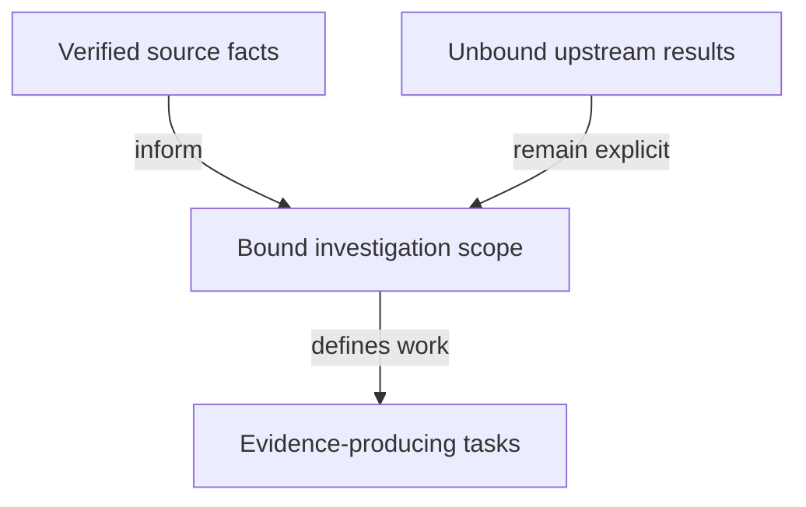

# Source intake for the investigation

As the ticket team, I want the verified source facts and unresolved dependencies in one place so that planning does not accidentally turn a proposal into an accepted guarantee.

## Findings

- At the bound base, `lean/Singular/Model/Registry.lean` defines `TokenId` with policy/name, but `Config.stateToken` uses the abstract registry identity and name zero. Its comment explicitly leaves byte correspondence separate.
- The same file reads witness policies from pins and defines `tokenAssetName` as the key. This does not state the proposal's finite hash injectivity premise.
- `Config` retains `registrationCost` and `bookingWidth` in addition to the proposed residual fields. The issue's four-field datum is a hypothesis to reconcile.
- `applications/open-datum/lean/OpenDatumApplication/Model.lean` defines `App.registry` and protected `Control.registry`/`activePolicy`. Application unparameterization is not a consequence already established by this consumer.
- The constitution's ruled economic translation moves a genuine tag to a pending termination before fold; a burn-only application release proposal must account for that path.
- Ledger tickets #679/#680 are open and their ledger modules are absent from main. No current upstream acceptance or integration is presumed.
- `nix/model.nix` supplies the actual packaged `model-check`. The root `justfile` supplies application-model and simulator checks.
- `.specify/` contains the constitution only. Global Spec Kit templates guide these documents; no generated script is available to run locally and no initialization overwrite is needed.

## Planning decisions and alternatives

| Decision | Reason | Alternative excluded |
|---|---|---|
| Use isolated issue branch from the fetched main revision | Concrete auditable base while preserving #529 and canonical untracked files | Editing another lane or resetting canonical main |
| Investigate under a distinct hypothetical namespace before amendment | Preserve accepted behavioral authority | Replacing accepted pins/semantics before a ruling |
| Treat absent ledger/history work as a dependency | Avoid inheriting unproved or unaccepted guarantees | Reimplementing #679/#680 or claiming an issue body is proof |
| Use current checks and generated consumer owners | Keep one model/evidence vocabulary | Parallel proof/observation frameworks |
| Plan the investigation, with signatures frozen at its first checkpoint | Semantic questions are the requested work | Inventing a replacement contract in planning |

The accepted design remains in the sources bound by [authority.md](authority.md). This file is source review, not execution evidence.

