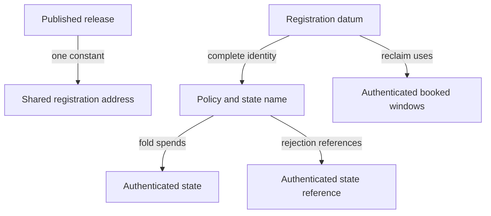
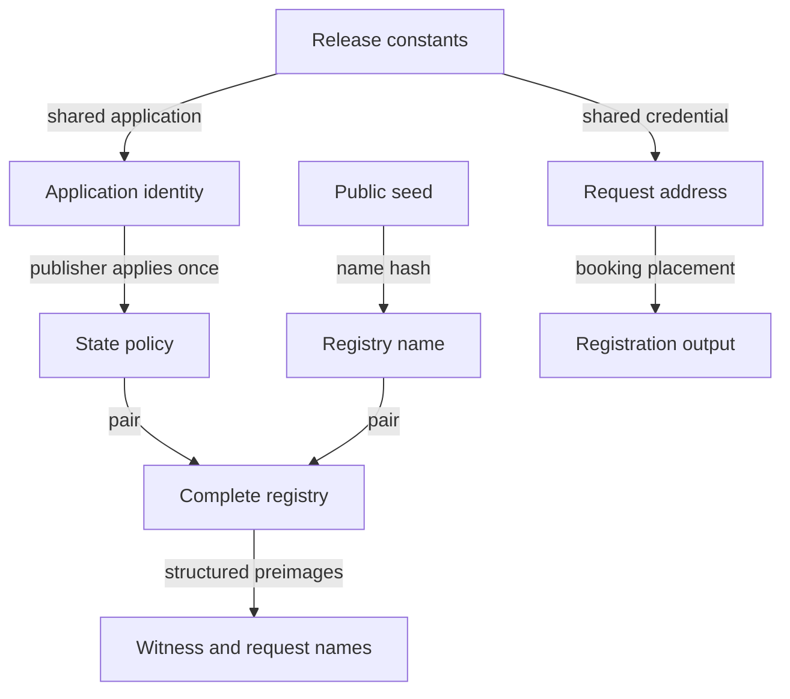

# One request address for a release

As a requester, I want to build a registration from published release constants and public chain data, then have it folded, rejected or reclaimed only under its own registry's rules. As a reader, I want to find authentic requests without accepting another registry's data or an arbitrary datum as a booked request.

## Status and reading route

This is a hypothetical surface candidate, not accepted law or an implemented shared validator. The source trace binds accepted revision `00771d77af996605845cf062285263909a049cf8`. The request script is untouched by the separate removal of the two unused witness pins in #749; this lane keeps its commissioned base and does not rebase. Exact source quotes below establish source identity only. No compiled script, ledger history, performance or client implementation is evidenced here.

[The callable surfaces](functions-model.md#frozen-shared-request-surface) and [records](data-model.md#frozen-shared-request-records) freeze the next hypothetical family. [The impact inventory](impact.md#shared-request-correspondence-and-encoding-debt) records byte, authentication and consumer obligations. Earlier identity and application-held statements remain unchanged.

## Today's spend paths and the ruled economics

The current validator is request(statePolicyId, cageTokenName). Contribute decodes RequestDatum, compares the request's name with its parameter, resolves a spent state, authenticates that state's token using the policy and name, and reads Modify actions. Its processing-window check is bypassed when matchingAction pairs this input with Rejected. matchingAction walks transaction inputs in order and consumes an action only when folded sees an inline request datum with the same request token name. It does not check the input's address or policy there. The state fold performs its separate approval, trie, mint, continuation and settlement checks. Rejection here is Contribute with Rejected; it is not a separate request redeemer.

Retract also compares the request name, checks its supported edge and owner's signature, obtains state using inputOrReferenceByRef, authenticates the policy/name and reads both windows. It then refuses any spending input carrying the state policy and checks one sufficient owner output with inline datum bound to this request reference. There is no additional reclaim branch. Sweep always fails; every other spend constructor and the fallback handler fail. A constructor's presence supplies no successful path.

The ruled economic judgements differ from those legacy handlers. registrationBookingRefusal authenticates exact cost, tip, carrier, both tags minted with booking, the booked upper time and interval width. It has no concrete request script credential parameter. foldAccepted obtains registrations and terminations by their actual pending references, observes complete request contents and executes foldBatch, state continuation, routing and balance. A request's own locking address is not checked by observesRegistration or foldMemberAt. The address read by foldCarrierRefusal is the eventual delivery address, not the request address.

rejectionAccepted authenticates the current complete state token/configuration by reference and refuses every spent state. retractionAccepted refuses both reading and spending state, and reads the booked request, its owner's signature and refund, and the configuration's two windows. Neither receives an applied request program. The hypothetical shared representation must make these correspondences explicit. Today's Aiken Retract reads state; the ruled economic retraction does not. A new prerequisite is not evidence that these existing scripts implement the ruled exits.

The shared request holds registrations only. Pending terminations and their genuine witnesses remain at the application under the 23 October ruling. One economic fold may consume both categories; only its registration members are subject to the shared request address condition. The held projection, deposit partition and exact same-key burn coupling retain their separate premises.

The release fixes one registration address. A fold authenticates a spent state, rejection authenticates a reference state and reclaim authenticates its own booked data without reading state. These are different evidence paths.

## Parameter occurrence mapping

Each row is one source occurrence, keyed by source line, one-based column and token. The extraction covers both parameters and the bound cageToken name, including helper signatures and recursive calls. Passing a name through a helper is a use; repeated occurrences on one line are retained. The source register below binds the surrounding definitions, while this table supplies a replacement for every extracted occurrence.

| Source line | Column | Token | Shared-data replacement |
|---|---|---|---|
| 18 | 19 | `statePolicyId` | Datum.registry.policy; authenticated spent state on fold, authenticated reference state on rejection; own booked configuration on economic reclaim. |
| 18 | 44 | `cageTokenName` | Datum.registry.name; release-shared script has no registry parameter. |
| 25 | 9 | `cageToken` | Datum.registry as the complete policy/name pair; compare each selected input, never its name alone. |
| 25 | 42 | `cageTokenName` | Datum.registry.name; release-shared script has no registry parameter. |
| 30 | 11 | `statePolicyId` | Datum.registry.policy; authenticated spent state on fold, authenticated reference state on rejection; own booked configuration on economic reclaim. |
| 31 | 11 | `cageToken` | Datum.registry as the complete policy/name pair; compare each selected input, never its name alone. |
| 41 | 26 | `statePolicyId` | Datum.registry.policy; authenticated spent state on fold, authenticated reference state on rejection; own booked configuration on economic reclaim. |
| 41 | 41 | `cageToken` | Datum.registry as the complete policy/name pair; compare each selected input, never its name alone. |
| 70 | 3 | `statePolicyId` | Datum.registry.policy; authenticated spent state on fold, authenticated reference state on rejection; own booked configuration on economic reclaim. |
| 71 | 3 | `cageToken` | Datum.registry as the complete policy/name pair; compare each selected input, never its name alone. |
| 78 | 26 | `cageToken` | Datum.registry as the complete policy/name pair; compare each selected input, never its name alone. |
| 80 | 28 | `statePolicyId` | Datum.registry.policy; authenticated spent state on fold, authenticated reference state on rejection; own booked configuration on economic reclaim. |
| 80 | 43 | `cageToken` | Datum.registry as the complete policy/name pair; compare each selected input, never its name alone. |
| 86 | 22 | `cageToken` | Datum.registry as the complete policy/name pair; compare each selected input, never its name alone. |
| 118 | 3 | `cageToken` | Datum.registry as the complete policy/name pair; compare each selected input, never its name alone. |
| 126 | 17 | `cageToken` | Datum.registry as the complete policy/name pair; compare each selected input, never its name alone. |
| 133 | 30 | `cageToken` | Datum.registry as the complete policy/name pair; compare each selected input, never its name alone. |
| 139 | 24 | `cageToken` | Datum.registry as the complete policy/name pair; compare each selected input, never its name alone. |
| 146 | 11 | `cageToken` | Datum.registry as the complete policy/name pair; compare each selected input, never its name alone. |
| 150 | 33 | `cageToken` | Datum.registry as the complete policy/name pair; compare each selected input, never its name alone. |
| 161 | 3 | `statePolicyId` | Datum.registry.policy; authenticated spent state on fold, authenticated reference state on rejection; own booked configuration on economic reclaim. |
| 162 | 3 | `cageToken` | Datum.registry as the complete policy/name pair; compare each selected input, never its name alone. |
| 170 | 26 | `cageToken` | Datum.registry as the complete policy/name pair; compare each selected input, never its name alone. |
| 188 | 30 | `statePolicyId` | Datum.registry.policy; authenticated spent state on fold, authenticated reference state on rejection; own booked configuration on economic reclaim. |
| 188 | 45 | `cageToken` | Datum.registry as the complete policy/name pair; compare each selected input, never its name alone. |
| 197 | 53 | `statePolicyId` | Datum.registry.policy; authenticated spent state on fold, authenticated reference state on rejection; own booked configuration on economic reclaim. |

The replacement must preserve where the value is consumed. For Contribute and its folded/matchingAction helpers, every name-only comparison becomes a comparison of the complete datum identity. At fold admission that identity must also equal the authenticated spent state's complete asset. For economic rejection the corresponding identity is supplied by the authenticated state reference, while the state stays unspent. For economic reclaim it is bound to the request's genuine tags and authenticated booked configuration through the named correspondence premise. No helper gains an address-derived identity oracle.

The accepted root requestAddressSpend separately permits an untagged output's prerequisite and requires exact tag disposal for a tagged exit. sweepAccepted leaves the world unchanged and checks complete pending observations. This is not today's Aiken Sweep, which fails unconditionally. The new family gives an untagged sweep its own case and calls that accepted root judgement; it does not use it to remove a pending request or add an owner-seizure path.

## Discovery and public inputs

Today requestAddrFromCfg hashes request bytes after applyRequestParams supplies the state policy and token name. queryContext and queryRejectContext query that per-registry request address, then findRequestUtxos decodes RequestDatum and filters on the state token name. That name filter relies on the address query's per-registry scope; it is inadequate at a release-shared address. The helper alone checks neither complete registry identity nor genuine tag provenance.

The candidate discovers public outputs at the release's one shared request credential, decodes the complete registration datum, selects the complete registry pair and authenticates the exact trie-ready and application assets, multiplicities and correspondence to accepted exactContents. Origin and completeness of those observations remain a named premise. A foreign registry, copied datum without the genuine tags, wrong role or output at another address is refused selection. The same conditions bind every selected registration in fold, rejection and reclaim. An empty result cannot establish a terminal or never-registered key.

Sharing an address concentrates unrelated registries and spam in one query surface. Readers filter before building and retain unavailable/incomplete status when their provider cannot supply the required public view. No bound on query cost, spam resistance or latency is measured. Application-held termination discovery remains the held family's public application observations and is combined explicitly with registration discovery by the folder.

## Client identities and dependency order

The release publisher applies the state program to the shared application once per application per release and publishes the resulting authenticated state policy/spending identity with both shared script identities. A client uses those constants, a public seed/reference, complete registry identity and request payloads. The client performs no parameter application, including during registry creation. This claim depends on authenticated release publication and the model-to-byte application correspondence; a supplied hash alone does not establish either.

The shared request identity has no incoming registry, key, seed, witness or request-name edge. Neither state policy nor state name takes a later asset name as input. The dependency graph's ranked edge list is a candidate observation, checked from each derivation rather than asserted by a picture.

Create uses the published state policy and the seed-derived state name. Register uses that complete registry, the shared registration address, structured registration tags and the application destination. Terminate lists only the application approval name and active token name, both hashes over release constants and public chain data. The termination output shape is under revision in the following stage; this slice neither models it nor freezes a new termination-ready name. It does not move the witness to the shared registration address. Fold uses the complete state identity, both public pending categories, and their exact tag/witness assets. Reject uses the shared address, complete registry's authenticated reference state and both registration tags. Reclaim uses the shared address, genuine registration tags and its authenticated booked windows without reading state. Network and staking-address interpretation stay explicit encoding obligations; no undeclared address form is inferred.

## Structured name preimages

The new family owns a distinct Preimage inductive with one constructor per asset role it changes: witness(registry,key), registrationReady(registry,bookingData), and registrationApproval(registry,bookingData). The termination derivation inventory names the existing complete-identity NoPin.approvalAsset and the active witness hash only; the termination shape and any changed approval payload remain under revision, outside this family. bookingData includes the exact economic request payload, nonce, booked time, datum, reference and configuration snapshot; tag asset fields are excluded to avoid a self-reference. Every occurrence of registry is the complete policy/name pair. State name retains the existing seed derivation in this hypothetical stage; a decision to move its wire encoding to CBOR remains open.

Codec and Hash are explicit pure parameters. CanonicalSerialisation and FiniteCollisionFree are separate named premises over the finite occurring preimages. Only together do equal digests imply equal structured preimages on that domain. No finite hash is declared globally injective. The structural test codec is not CBOR bytes or Plutus Data serialisation. CDDL, exact bytes, constructor numbering, hash selection and cross-language test vectors including both list forms and a byte string over 64 bytes remain recorded obligations; no vectors are produced in this stage.

## Termination revision boundary

A subsequent operator direction is revising the application-held termination output shape. This stage does not model terminations. The client inventory lists its application approval name and active token name only, computed by hashes over release constants and chain data. Any later termination-shape, approval-payload or economic change reopens the held mapping in that following stage; existing slice-four sources and receipts remain history at their own revision. General non-rejection, supply and permanent-retirement obligations retain their accepted root vocabulary and premises, without this stage inventing a replacement termination representation.

## Statement reconciliation

Every old statement and ledger row remains byte-identical. The following new rows will restate consumer mappings, not silently change the old statements' meaning.

| Earlier family | Preserved meaning | New shared-request obligation |
|---|---|---|
| full_approval_inversion and cross_registry_approval_refused | Existing complete-identity approval and finite-domain refusal | registration_approval_binding and shared_cross_registry: structured booking/configuration preimage under complete registry identity. |
| trieReady_inversion and application_inversion | Simplified registry/role/key identity only | shared_registration_tags: actual operation, nonce, contents and booked configuration correspondence; no relabelling simplified tags as economic tags. |
| same_transaction_two_applications | One observed seed spend under two policies | shared_same_seed_separation: distinct complete registries remain separated at one shared request address. |
| authenticated_state_role_separation | State/name/provenance under its finite premises | shared_state_binding: full datum identity against the spent or reference state; origin remains supplied authenticated evidence. |
| pending_witness_authentication and booking_retains | Application-held exact token, retained control and root booking | shared_held_mapping: new witness preimages require a correspondence to the existing held identity consumer; no termination-ready preimage or revised termination shape is modeled here. |
| release_terminal and composed_available | Exact burn under BurnCoupling; root economics plus deposit partition | shared_held_fold: new asset names and registration selection preserve those consumers under explicit identity and physical correspondence. |
| Held concrete non-rejection, supply and retirement instances | Their existing finite witnesses only | shared_termination_unrejectable, shared_world_supply and shared_permanent_retirement: general rows reuse the accepted statements with their actual WorldReachable/Reachable and membership/batch premises. |
| discovery_inversion and consumption_inversion | Application-held pending records and actual consumed references | shared_discovery and shared_consumption: registrations selected by full identity, genuine tags and shared address; terminations retain application discovery. |

No new general theorem exists at this surfaces checkpoint. The statements checkpoint must provide executed satisfying antecedents, single-guard falsifications, derived public inversions, generic oracle replay and compiled sorry status for every new row. Existing hypothetical guarantees remain unproved.

## Choices and limits

| Candidate choice | Alternative | Reason |
|---|---|---|
| Complete registry identity in authenticated request data | Name-only filter at the common address | Same seed can give the same name under different policies. |
| Call accepted economics through explicit correspondence | Reimplement refund, window or routing rules | Preserve the exact named judgements and expose representation debt. |
| Separate fold, rejection, reclaim and untagged sweep | Require a spent state for every spend | Accepted rejection and reclaim deliberately exclude that requirement. |
| Published state identity per application/release | Apply scripts in each client operation | The stated client simplicity goal puts the single application in release publication. |
| Distinct structured role constructors | Concatenated variable-length fields | Encoding and role separation must be expressible and checked independently of hash collisions. |

## Revision-bound source register

Each quote is the exact trimmed source line at the accepted revision. Citation integrity establishes these source facts, not behavior, script invocation or ledger acceptance.

| Source fact | Exact quoted line |
|---|---|
| [Request parameters](https://raw.githubusercontent.com/lambdasistemi/singular/00771d77af996605845cf062285263909a049cf8/onchain/validators/request.ak#L18) | `validator request(statePolicyId: PolicyId, cageTokenName: AssetName) {` |
| [Request token binding](https://raw.githubusercontent.com/lambdasistemi/singular/00771d77af996605845cf062285263909a049cf8/onchain/validators/request.ak#L78) | `expect requestToken == cageToken` |
| [Spent state lookup](https://raw.githubusercontent.com/lambdasistemi/singular/00771d77af996605845cf062285263909a049cf8/onchain/validators/request.ak#L79) | `let stateInput = inputByRef(stateRef, tx)` |
| [State token check](https://raw.githubusercontent.com/lambdasistemi/singular/00771d77af996605845cf062285263909a049cf8/onchain/validators/request.ak#L80) | `expect carriesStateToken(statePolicyId, cageToken, stateInput)` |
| [Fold redeemer](https://raw.githubusercontent.com/lambdasistemi/singular/00771d77af996605845cf062285263909a049cf8/onchain/validators/request.ak#L81) | `expect Some(actions) = foldActions(stateRef, tx)` |
| [Matching request selection](https://raw.githubusercontent.com/lambdasistemi/singular/00771d77af996605845cf062285263909a049cf8/onchain/validators/request.ak#L150) | `pending.requestToken == cageToken` |
| [Retraction state lookup](https://raw.githubusercontent.com/lambdasistemi/singular/00771d77af996605845cf062285263909a049cf8/onchain/validators/request.ak#L187) | `let stateInput = inputOrReferenceByRef(stateRef, tx)` |
| [Applied request address](https://raw.githubusercontent.com/lambdasistemi/singular/00771d77af996605845cf062285263909a049cf8/offchain/lib/Singular/Registry/TxBuilder/Internal/Identity.hs#L206) | `requestAddrFromCfg cfg tid net =` |
| [Applied request bytes](https://raw.githubusercontent.com/lambdasistemi/singular/00771d77af996605845cf062285263909a049cf8/offchain/lib/Singular/Registry/TxBuilder/Internal/Identity.hs#L228) | `requestScriptBytesFromCfg cfg tid =` |
| [Pending request lookup](https://raw.githubusercontent.com/lambdasistemi/singular/00771d77af996605845cf062285263909a049cf8/offchain/lib/Singular/Registry/TxBuilder/Internal/Lookup.hs#L270) | `findRequestUtxos tid = filter isRequest` |
| [Fold discovery address query](https://raw.githubusercontent.com/lambdasistemi/singular/00771d77af996605845cf062285263909a049cf8/offchain/lib/Singular/Registry/TxBuilder/Update/Context.hs#L264) | `requestUtxos <- outputsAt view reqAddr` |
| [Reject discovery address query](https://raw.githubusercontent.com/lambdasistemi/singular/00771d77af996605845cf062285263909a049cf8/offchain/lib/Singular/Registry/TxBuilder/Reject.hs#L177) | `requestUtxos <- outputsAt view reqAddr` |
| [Root booking judgement](https://raw.githubusercontent.com/lambdasistemi/singular/00771d77af996605845cf062285263909a049cf8/lean/Singular/Economics/Booking.lean#L45) | `def registrationBookingRefusal (c : Config) (b : RegistrationBooking) : Option String :=` |
| [Root fold judgement](https://raw.githubusercontent.com/lambdasistemi/singular/00771d77af996605845cf062285263909a049cf8/lean/Singular/Economics/Fold.lean#L43) | `def foldAccepted (world : World) (u : EconomicUtxo) (tx : EconomicTransaction) : Except String World :=` |
| [Root state shape](https://raw.githubusercontent.com/lambdasistemi/singular/00771d77af996605845cf062285263909a049cf8/lean/Singular/Economics/FoldRouting.lean#L18) | `def foldStateShape (c : Config) (output : EconomicOutput) : Bool :=` |
| [Root rejection reference](https://raw.githubusercontent.com/lambdasistemi/singular/00771d77af996605845cf062285263909a049cf8/lean/Singular/Economics/Rejection.lean#L51) | `def rejectionStateRefusal (world : World) (u : EconomicUtxo) (r : Rejection) : Option String :=` |
| [Root rejection forbids state spend](https://raw.githubusercontent.com/lambdasistemi/singular/00771d77af996605845cf062285263909a049cf8/lean/Singular/Economics/Rejection.lean#L73) | `def rejectionInputsRefusal (u : EconomicUtxo) (r : Rejection) : Option String :=` |
| [Root reclaim state exclusion](https://raw.githubusercontent.com/lambdasistemi/singular/00771d77af996605845cf062285263909a049cf8/lean/Singular/Economics/Retraction.lean#L9) | `def retractionInputsRefusal (u : EconomicUtxo) (tx : EconomicTransaction) : Option String :=` |
| [Root reclaim judgement](https://raw.githubusercontent.com/lambdasistemi/singular/00771d77af996605845cf062285263909a049cf8/lean/Singular/Economics/Retraction.lean#L60) | `def retractionAccepted (world : World) (u : EconomicUtxo)` |
| [Root request gate](https://raw.githubusercontent.com/lambdasistemi/singular/00771d77af996605845cf062285263909a049cf8/lean/Singular/Economics/RequestSpend.lean#L16) | `def requestAddressSpend (u : EconomicUtxo) (tx : EconomicTransaction)` |
| [Root untagged sweep](https://raw.githubusercontent.com/lambdasistemi/singular/00771d77af996605845cf062285263909a049cf8/lean/Singular/Economics/RequestSpend.lean#L31) | `def sweepAccepted (world : World) (u : EconomicUtxo)` |
