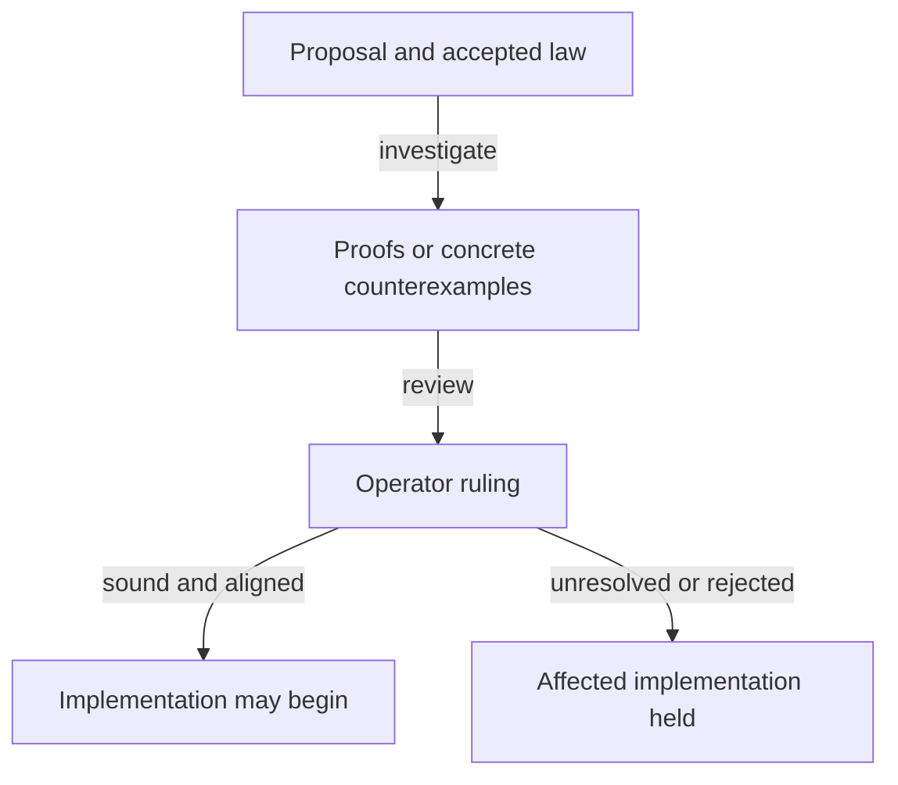

# Investigate registry identities without policy pins

As an integrator, I want to run the proposed registry model and distinguish proved guarantees, counterexamples and unresolved premises before adopting a new contract.

**Ticket:** [#741](https://github.com/lambdasistemi/singular/issues/741), first child of [#731](https://github.com/lambdasistemi/singular/issues/731).
**Created:** 22 October 2026. **Status:** investigation specification; no soundness ruling.
**Branch:** `investigate/741-no-policy-pins-model`.

## User stories and acceptance

### Identify exactly which registry a token names — priority P1

Given a registry, an application and a key, when I inspect the candidate's identity derivation, then I can see its complete inputs, premises and scope of uniqueness. Given two state policies using one seed in the same transaction, the investigation either establishes the promised separation or produces the exact counterexample and asks for a ruling. Reuse of a seed across separate transactions is a separate case.

Independent check: replay identity examples and refusal controls with named premises; inspect a satisfying instance of every premise. No stronger claim follows from a theorem's name.

### Follow registration through permanent retirement — priority P1

Given a registry reached through legitimate operations, when a key is registered and later terminated, then the model accounts for its genuine token across application custody and pending requests and states the exact permitted mint and burn. A forged second state, extra mint or burn, wrong key or registry, excluded edge and mixed transaction must be assessed against the actual claimed law.

Independent check: executable reachable traces and theorem statements covering mint at an unknown key, no remint after retirement, and burn coupled to that key's transition. If the proposal cannot satisfy these promises, preserve the witness and hold the affected decision.

### Understand what a reader can conclude — priority P1

Given an address and a key, when a reader obtains an observation, then the model distinguishes active application custody, pending termination, never registered, terminal and unavailable or incomplete evidence. Absence of a token alone cannot justify a reusable key or never-registration claim.

Independent check: exhibit each observation class and its information requirements, including wrong application/release and incomplete provider evidence. Full state classification and a positive token lookup have separate evidence boundaries.

### Decide whether implementation may begin — priority P1

Given the model and application investigation, when the operator reviews the result, then each requested guarantee has its exact premise, proof/refutation/open status, consumer mapping and remaining implementation gap. Required economic fields and pending-custody obligations remain visible.

Independent check: run the packaged model check, inspect the changed-declaration inventory and generated consumers, and read the recorded decision. Successful model execution alone cannot release implementation.

## Requirements

| Requirement | Observable acceptance |
|---|---|
| Bound authority | Exact root, consumer and any reused ledger/history revisions are named; proposed input is distinguished from accepted law. |
| Explicit identities | Witness and approval preimages and the application-bound state identity are executable and documented without a recursive dependency. |
| Satisfiable premises | Hash and ledger premises are explicit, each with a satisfying example; finite hash injectivity is not asserted as an unconditional theorem. |
| Authenticated asset roles | The candidate addresses genuine witnesses masquerading as state and distinguishes state, witness and request-tag roles under a shared policy. |
| Scoped history uniqueness | Same-seed multiple-policy genesis within one transaction and seed reuse across history are both covered; broader uniqueness is never borrowed from a narrower theorem. |
| Permanent key supply | Reachable mint/burn, custody and permanent-retirement guarantees cover the exact key, registry and transaction, including adverse mixed cases. |
| Consumer and economic agreement | The registry-independent application release rule, controller update and pending termination agree with bound consumer and protected-rejection obligations; required parameters cannot disappear to satisfy a proposed datum size. |
| Honest reader conclusions | The five reader states above and their observation prerequisites are explicit; unavailability never becomes absence. |
| Traceable decision and consumers | Every changed definition, theorem, observation and consumer has a disposition; generated artifacts follow the approved revision; new implementation claims remain uncovered. |

## Edge cases

Same seed with different application policies; malformed or ambiguous encodings; state/witness/request-tag confusion; duplicate state outputs; extra mint or burn; mixed registration/termination; a newly created holding burned in the same batch; pending termination without application custody; unrelated assets in an application holding; unknown release; incomplete provider observations.

## Key entities

Registry identity, application identity, key, asset role, ledger history, pending request, reader observation, explicit premise, theorem disposition and operator ruling. Their planning contracts are in [data-model.md](data-model.md).

## Success criteria

- All nine requirements have a named task, evidence owner and explicit disposition.
- Every accepted new or changed theorem is proved under its stated premises; a refuted claim has a concrete reachable witness and an operator disposition.
- No unresolved required guarantee is counted as a passed requirement.
- Every affected generated consumer is regenerated or explicitly held with the dependency that prevents it.
- The operator's recorded soundness decision is present before any dependent implementation starts.

## Assumptions and scope

This ticket investigates the enriched proposal; it does not promise the proposal is sound. Open semantic questions are the work's outputs to resolve, not missing product requirements to guess. The accepted two-edge law and bound consumer obligations stay authoritative during investigation.

No validator, transaction builder, CLI, release or active #529 lane changes. No browser delivery, real KERI integration, terminal witness feature, key reuse, sharding, migration or performance claim.

