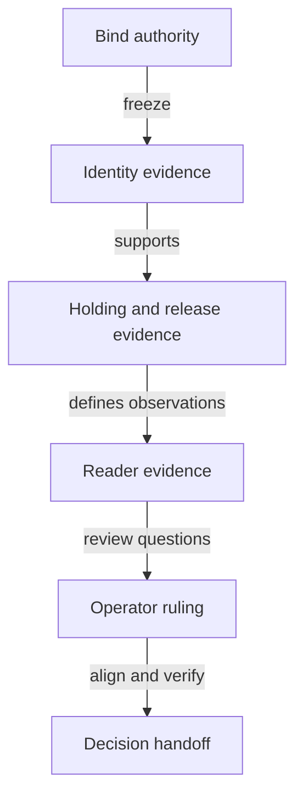

# Tasks for deciding the no-pin model

As the ticket owner, I want independently reviewable evidence at each stage, with semantic decisions reaching the operator before dependent work.

Every task below is pending. Task names are descriptive; accepted task stamps belong to the ticket owner. Source paths denote owners, not blanket writable permission: freeze each stage's exact fence.

## Setup and authority

- [ ] **Bind accepted inputs** — Confirm the revisions/digests and upstream acceptance status in `specs/741-no-pin-model/authority.md` and `base-hashes.json`; obtain exact #679/#680 references without entering their working lanes. Requirement: Bound authority.
- [ ] **Record baseline checks** — Run the scoped model/application baselines through `nix/model.nix` and root `justfile`; retain actual command/exit receipts in the ticket runtime. Requirements: Bound authority; Traceable decision and consumers.
- [ ] **Freeze the changed-obligation inventory** — Add `specs/741-no-pin-model/impact.md` covering old/new definitions, theorem statements, observations, consumers and dispositions. Requirement: Traceable decision and consumers.

## Identify the registry — priority P1

Independent outcome: a reader can inspect exact identity premises and replay the same-seed cases, without claiming the whole design is accepted.

- [ ] **Inventory identity premises** — Read `lean/Singular/Model/Registry.lean`, the bound ledger/history sources and the application model; record exact hash/ledger premises with satisfying-witness obligations in `impact.md`. Requirements: Explicit identities; Satisfiable premises.
- [ ] **Freeze candidate call surfaces** — Complete the hypothetical identity signatures in `functions-model.md` and owned records in `data-model.md` before implementing candidate files. Requirements: Explicit identities; Bound authority.
- [ ] **Model identity and role cases** — In the frozen `lean/Singular/NoPins/` files, state executable naming/application dependencies and state/witness/request-tag classification, including a genuine witness carrying a fabricated state datum. Requirements: Explicit identities; Authenticated asset roles.
- [ ] **State same-seed history obligations** — In the same candidate namespace, distinguish multiple policies in one transaction from repeated spending across history; preserve any concrete counterexample. Requirement: Scoped history uniqueness.
- [ ] **Audit identity statements** — Independent auditor checks exact statement hashes, reachable/satisfiable premises, completeness and finite mutation floor; ticket owner records the result in `impact.md` and runtime. Requirements: Satisfiable premises; Scoped history uniqueness; Authenticated asset roles.
- [ ] **Prove or refute identity claims** — After statement approval, supply proofs or constructive witnesses in the frozen candidate modules; semantic findings go to `decisions.md`. Requirements: Explicit identities; Satisfiable premises; Scoped history uniqueness; Authenticated asset roles.

## Follow the genuine holding — priority P1

Independent outcome: the candidate explains legitimate creation, custody and retirement and exposes incompatible application requirements.

- [ ] **Bind application and economic effects** — Map `OpenDatumApplication/Model.lean`, root `Model/Termination.lean` and `Economics/` obligations into `impact.md`, retaining every economic parameter and controller/release obligation. Requirement: Consumer and economic agreement.
- [ ] **State supply and release obligations** — Freeze signatures, then candidate statements for unknown-key mint, permanent no-remint, exact same-key burn/transition, pending custody and excluded/mixed cases in `lean/Singular/NoPins/`. Requirements: Permanent key supply; Consumer and economic agreement.
- [ ] **Audit then prove holding claims** — Independent statement audit precedes proof or constructive refutation; retain the selected reachable and mutation witnesses, and record any release/custody conflict in `decisions.md`. Requirements: Permanent key supply; Consumer and economic agreement.

## Explain reader conclusions — priority P1

Independent outcome: each reader class has an exact observation contract, with unavailable evidence kept distinct.

- [ ] **Specify observation requirements** — Complete `contracts/model-observations.md` from the candidate and the accepted reader vocabulary; exhibit active custody, pending, never-registered, terminal and unavailable cases. Requirement: Honest reader conclusions.
- [ ] **Audit then establish observation claims** — State and independently review the relevant observation theorems before proofs; retain incomplete/wrong-release controls in the frozen candidate corpus. Requirement: Honest reader conclusions.

## Decide and align consumers — priority P1

Independent outcome: the operator receives an exact decision packet; implementation remains held until that decision and alignment.

- [ ] **Obtain the soundness ruling** — Present the actor/start/action/outcome and concrete evidence for every unresolved semantic question; record the user's words and scope in `decisions.md`. Requirements: Bound authority; Consumer and economic agreement; Traceable decision and consumers.
- [ ] **Align only approved laws** — After the ruling, version the writable fence and align affected root/application model declarations, statements and constitution translation; update `impact.md` with every preservation/restatement/retirement. Requirements: Consumer and economic agreement; Traceable decision and consumers.
- [ ] **Regenerate model consumers** — Update the affected `lean/*corpus.json`, theorem registers, `applications/open-datum/` exports, `simulator/` mirror, `conformance/coverage/` identities and public model/economics/theorem explanations through their existing tools. New implementation claims remain uncovered. Requirement: Traceable decision and consumers.
- [ ] **Verify the exact candidate** — Run model, application, simulator and affected docs/presentation checks; commission fresh independent final audit and collect exact-head hosted results. Requirement: Traceable decision and consumers.
- [ ] **Publish the decision handoff** — Update `quickstart.md`, PR template and `impact.md` with candidate identities, proofs/refutations, operator decision and unmeasured/unsupported boundaries. Keep landing held until epic sequencing permits it. Requirement: Traceable decision and consumers.

## Dependencies and parallel work

Authority binding precedes every candidate stage. Identity premises precede dependent supply/release proofs. Statements are audited before their proofs. Reader claims depend on the corresponding identity/custody meaning. The ruling precedes accepted-law amendments and implementation; consumer generation follows its approved revision.

One commit owner writes at a time. Auditor reads frozen candidates in a separate checkout. No author/auditor shared index. Independent source inventory can continue while an unrelated ruling is pending. No parallel research or simulator seat is authorized.

