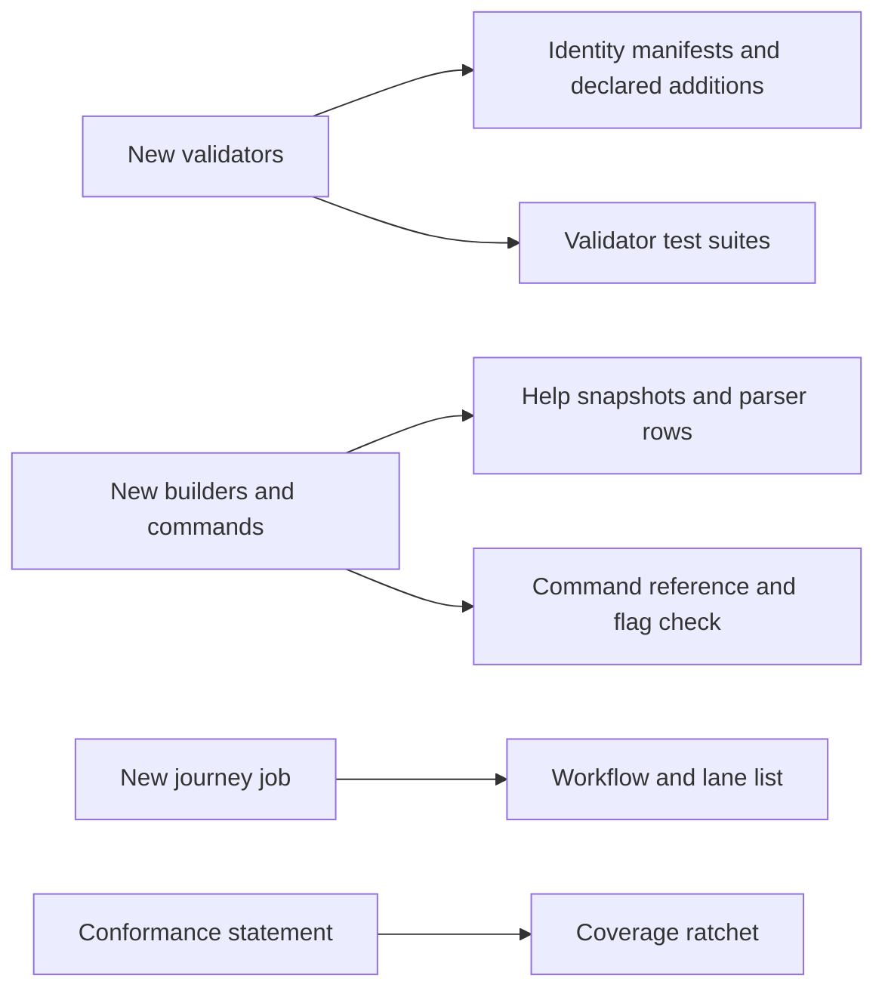

# Consumers of creating a registry and registering a key on the proved design

Issue 742. This page is for the commit owner and the auditor: every place in the tree a slice of [the plan](plan.md) can break, and what moves there.

## Census

Census of the current tree at 0c0ab880. Because the new line is added beside the current one, most of these are rows the
slices must keep green rather than files they edit.

| Consumer | Touched by | What moves |
| --- | --- | --- |
| `onchain/` blueprint and `onchain/script-identity.json` | the new Singular validator | new titles; manifest regenerated with `just script-identity-regen` |
| `nix run .#script-hash-comparison` (`flake.nix`, the declared records list) | both new validators | a `specs/742-create-register-no-pin/evidence/declared-changes.json` record with the added titles and no changed ones, appended to the records list |
| `onchain/lib/registry_pin.ak`, the naming custody pin `naming-onchain/validators/naming.ak:203`, `onchain/permanent-contract.json`, `offchain/cli/src/Singular/CLI/Permanent.hs` | none expected | must stay byte-identical: the current state hash does not move; a slice that moves it has edited the current line |
| `applications/open-datum/onchain/` blueprint, `script-identity.json`, `permanent-contract.json` | the new open-datum validator | new titles; manifests regenerated |
| `onchain-release/verify-identities.sh`, `tools/assemble_onchain_release.py` | release assembly | issue 747 decides when the new titles are announced; until then nothing calls them |
| `applications/open-datum/onchain/flake.nix` (`open-datum-blueprint`) and `tools/assemble_onchain_release.py` merged counts | the first pull request | the count of merged validators is derived from the two blueprints instead of a literal, so new titles do not move it; the exact set stays pinned by `script-hash-comparison`; the release archive built from the epic branch carries the new titles unused until issue 747 decides their release |
| Lean model, driver, corpora, simulator mirror | none: the aligned models are issue 741's | stay green untouched |
| Conformance suite and coverage record | conformance slice | new rows for the old-versus-new statement; `coverage-gate` ratchet stays green |
| `offchain/test/fixtures/help/singular/*.txt`, `applications/open-datum/offchain/test/fixtures/help/open-datum/*.txt` | commands slice | new help snapshots for the new groups; the root help snapshot of each executable changes |
| `offchain/test/fixtures/cli-corpus/singular.json`, `applications/open-datum/offchain/test/fixtures/cli-corpus/open-datum.json` | commands slice | new parser rows recorded with the specs' own switch (`CLI_CORPUS_RECORD`) |
| `docs/singular-node.md` settings table, `tools/cli_flags_check.sh` | commands and documentation | the new flags are documented; the check's expected command counts per executable move with the new groups, and its invocation matcher learns the new groups; specs pages name no flag before its slice lands it |
| `.github/workflows/registry.yml`, `.github/ci/e2e-parts.json` | journey slice | two new hosted jobs, `no-pin-registration-journey` and `no-pin-registration-refusals`, and their root flake apps (CI change in this ticket) |
| Speech companions of every new page under `specs/742-create-register-no-pin/` and `docs/` | every slice that writes a page | stamped companions; `nix run .#docs-check` |

## The current line stays untouched

The registry pin, the naming custody pin, the permanent contract tables and the generated `Permanent.hs` keep their bytes. A diff that moves one of them has edited the current line, which answer A-001 leaves to issue 743.

## Named limits so far

The stake part of the state address is not constrained, as in the model, which checks the payment credential only.
