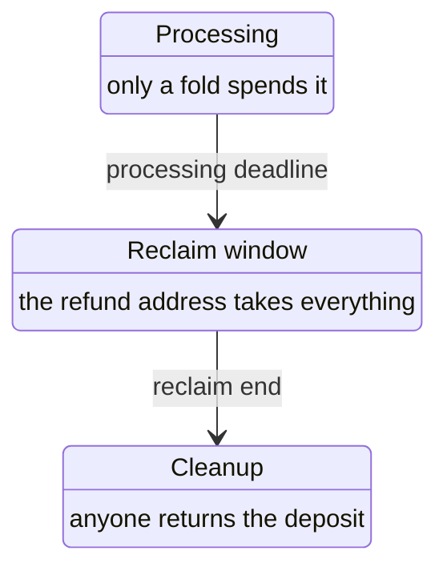

# Records for creating a registry and registering a key on the proved design

Issue 742. This page names the new records, their fields and the invariants each one must keep. Field encodings follow the
aligned Lean models; where those models fix an order or a constructor number, that wins over this page.

## Records

| Record | Fields | Invariants |
| --- | --- | --- |
| Registry identity | state policy, state token name | the name is derived from the genesis seed; equal names under different policies are different registries |
| State datum | root | genesis writes the empty root; every fold writes exactly the computed root |
| State output | address of the state script, ADA, one state token, state datum | holds only ADA and its own state token; its ADA never decreases across a fold |
| Registration approval preimage | registration constructor, key, registry identity, holding address, initial-datum hash, deposit | CBOR in the Plutus Data serialisation; one constructor per role, distinct from every other hashed name |
| Registration approval | one token under the application policy, named by the hash of its preimage | anyone may burn it; burning grants nothing |
| Configuration record | the five request parameters: registration cost, minimum tip, processing time, reclaim time, booking width | fixed per registry at creation, immutable, read by reference at booking; registration cost and minimum tip are carried but enforce nothing |
| Pending registration | at the open-datum address: one registration approval, the booked data, the model's ten fields of `RegistrationData` (registry, key, controller, refund address, holding address, initial datum, deposit, booking time, processing deadline, reclaim end) and the request value | its value covers the deposit; spent only by a fold before the deadline, a refund-address reclaim inside the window, or a cleanup after it |
| Holding | at the committed address: the genuine token, the committed datum, at least the committed deposit | created only by a registration fold |
| Creation measurement | for a first and a later registry of one application: transactions, locked ADA per output | produced by the journey job, recorded as a receipt |

## Time phases of a pending registration

The phases are disjoint: a validity interval that is not wholly inside one phase is refused.
