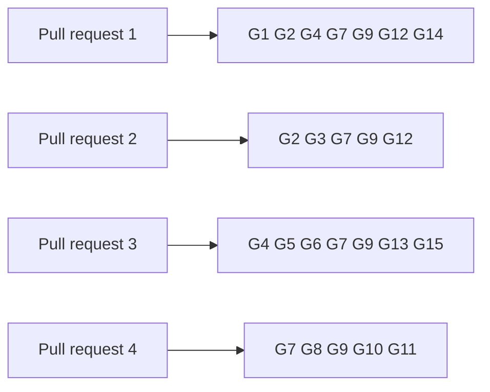

# Gate for creating a registry and registering a key on the proved design

Issue 742. This page is for the commit owner, the auditor and the reviewers: each acceptance item, the hosted job and the
verbatim command that proves it, and what each pull request must show. The requirements are in
[the specification](spec.md) and the pull requests in [the plan](plan.md#pull-requests-and-slices).

## Rows

The ticket owner's table, written before the auditor's. The auditor writes its own table independently when it is seated;
the ticket owner synthesizes the two once, records both input hashes and freezes the result in the runtime root before
the commit owner starts. Every command is an existing hosted command, or one this ticket adds to a hosted job and marks
"CI change in this ticket".

| Row | Acceptance it proves | Hosted job | Verbatim command | Expected exit |
| --- | --- | --- | --- | --- |
| G1 | Singular validator statements, each seen to fail | registry.yml `aiken-suite` | `nix flake check` in `onchain/` | 0 |
| G2 | new titles declared, current hashes unmoved | registry.yml `script-identity`, `application-script-identity` | `nix build --quiet --no-link --print-out-paths .#script-identity` in `onchain/` and in `applications/open-datum/onchain/`; `nix run --quiet .#script-hash-comparison` | 0 |
| G3 | open-datum validator statements, each seen to fail | registry.yml `application-aiken-suite` | `nix flake check` in `applications/open-datum/onchain/` | 0 |
| G4 | library builders, script publication and reuse, preimage vectors in Haskell, singular help and parser rows | registry.yml `journey` | `nix run --quiet .#cage-tests` in `offchain/` | 0 |
| G5 | open-datum builders, help and parser rows | ci.yml `open-datum-tests` | `nix run --quiet .#open-datum-tests` in `applications/open-datum/offchain/` | 0 |
| G6 | documented flags | registry.yml `cli-flags` | `nix run --quiet .#cli-flags-check`; `nix run --quiet .#cli-flags-controls` | 0 |
| G7 | pages, diagrams and speech | ci.yml `rendered-docs` | `nix run --quiet .#docs-check` | 0 |
| G8 | devnet journey through the packaged commands, folded by a second wallet from chain data only, with the creation measurement receipt for a first and a later registry | new registry.yml job `no-pin-registration-journey`, "No-pin registration journey through the packaged commands" (CI change in this ticket) | `nix run --quiet .#no-pin-registration-journey` | 0 |
| G9 | lint and format of touched paths | ci.yml `dev-shell`, `offchain-lint`; conformance.yml `format-check` | `nix develop --quiet -c just lint`; `(cd offchain && nix run --quiet .#lint)`; `nix run --quiet .#format-check` | 0 |
| G10 | conformance statement and coverage ratchet | conformance.yml `conformance-checks`, `coverage-gate` | `nix run --quiet .#conformance-appendix-tests`; `nix run --quiet ./conformance#coverage-gate -- --root . ratchet` | 0 |
| G11 | the five refusals on a development network, each with its passing control | new registry.yml job `no-pin-registration-refusals`, "No-pin registration refusals on a development network" (CI change in this ticket) | `nix run --quiet .#no-pin-registration-refusals` | 0 |
| G12 | the new validators compile into the blueprints that every other row reads | registry.yml `blueprint`, `application-blueprint` | `nix build --quiet --no-link --print-out-paths .#plutus-blueprint` in `onchain/` and in `applications/open-datum/onchain/` | 0 |
| G13 | the packages with the new builders and commands build | ci.yml `offchain-component-build`, `open-datum-component-build` | `nix build --quiet .#component-build` in `offchain/`; `cd applications/open-datum/offchain && nix build --quiet .#component-build` | 0 |
| G14 | the current line's vectors are unmoved; if the new preimage vectors join the generated vectors, they are fresh too | ci.yml `registry-test-vectors`; registry.yml `vectors-fresh` | `nix build --quiet --no-link .#checks.x86_64-linux.cage-test-vectors` in `offchain/`; `nix run --quiet .#vectors-check` | 0 |
| G15 | the new commands keep transaction identity on cancellation and uncertain submission, without resubmitting | registry.yml `cli-recovery-partition`, with partitions for the new commands (CI change in this ticket) | `nix run --quiet .#cli-recovery-partition -- <partition>` | 0 |

Rows run scoped to what each slice can break. `just ci` runs once on the final candidate of each pull request, then the
push; hosted checks on the pull request head are the net. Every build or test runs in a named, memory-capped scope:
`systemd-run --user --scope --unit=t742-<what>-<n> -p MemoryMax=24G timeout 3600 <command>`.

## Rows per pull request

## Evidence the pull requests will carry

- per statement: the validator test that executes it and the RED run that showed it fail;
- the byte vectors and the two encoders that reproduce them;
- a later registry's create that publishes no script and references the live copies, and a control showing a reference
  script with another hash is not reused;
- the journey job's receipt: the transactions, the holding's token, payload and deposit, the fold built by a second
  wallet from chain data only, the reclaim and cleanup payouts, and the creation measurement for a first and a later
  registry;
- the refusals job's receipt: each of the five refusals and its control;
- the conformance statement of each registration journey, old against new;
- left uncovered, stated in the pull requests: update and termination (issue 743), the reader (issue 744), batch limits
  (issue 746), release of the new titles (issue 747).

## Synthesis

The ticket owner's table and the auditor's independent table were joined once on 24 October 2026. Rows G12 to G15 came
from the auditor's inventory or from its missing-job findings. A green existing command proves nothing about the new line
until the new checks are in what it selects: each slice names, in its decision record, the test that executes each
statement and the hosted step that runs it. "Hosted checks green on each pull request" is not a gate row; the ticket owner
records it from the required checks at the pull request head before handing the pull request to the epic owner.
