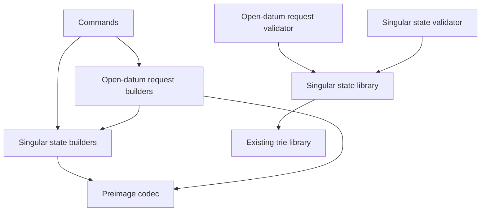

# Modules for creating a registry and registering a key on the proved design

Issue 742. This page places the new code and fixes its dependency direction. Records are in [the data model](data-model.md)
and signatures in [the functions model](functions-model.md). Nothing of the current contract line is edited (answer A-001).

## New components

| Component | Responsibility | Depends on | Must not depend on |
| --- | --- | --- | --- |
| Singular state validator, `onchain/validators/singular_state.ak` | genesis, state recognition from the supplied seed, the registration fold, delivery, state output integrity | the state library below; the existing trie proof library, read only | the current `state`, `request`, `witness`, `open` validators and `registry/*` duty and settlement modules |
| Singular state library, `onchain/lib/singular_state/` | state token name from the seed, the root-only state datum, the approval preimage and its name, the fold's per-change checks | Aiken standard library; the existing trie library | any open-datum module |
| Open-datum request validator, `applications/open-datum/onchain/validators/open_datum_requests.ak` | the configuration record at creation, the registration approval mint and its open burn, the pending registration's three phases, the fold path's genuine-token check | the Singular state library, for the approval preimage and the token name only | the Singular validator's compiled hash; the current `open_datum` and `closed_datum` validators |
| Preimage codec, `offchain/lib/Singular/State/Preimage.hs` | the CBOR approval preimage and the state token name off-chain, byte for byte equal to the on-chain encoders | the existing Plutus Data serialisation used by the codec | transaction building |
| Singular state builders, `offchain/lib/Singular/State/` | genesis and registration fold transactions against the new validator, the fold from chain data alone; publication of the reference scripts once per application and their reuse | the preimage codec; the existing provider and session (the chain entry point) and trie libraries | the open-datum envelope |
| Open-datum request builders, `applications/open-datum/offchain/src/OpenDatum/Requests/` | configuration create, book, reclaim and cleanup | the Singular state builders and preimage codec | the current open-datum book and plan modules |
| Commands, `offchain/cli/src/Singular/CLI/State.hs` and open-datum `OpenDatum/CLI/Requests.hs` | the six commands of [the plan](plan.md#commands) | the builders above; the existing submit, recovery and wallet code | — |
| Devnet journey, a new hosted job and its script under `tools/` | the packaged-command journey, the refusals and the creation measurement | the released executables | test-only controls in ordinary builds |

Paths are proposals. When the aligned Lean models name a component differently, the code takes the model's name, and the
mandate is versioned before the slice that creates it starts.

## Dependency direction

Singular never depends on open datum. Open datum learns the state policy and the registry name as data from its own
approved request, never from a compiled hash.
