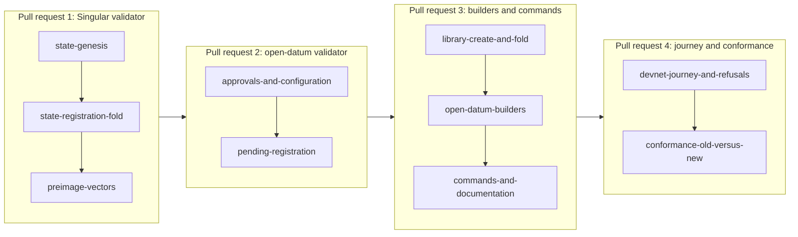

# Plan for creating a registry and registering a key on the proved design

Issue 742. This page is for the people who implement and review the four pull requests. It binds the model, the rulings,
the commands, the pull requests and their slices, and the seats. The story and the requirements are in
[the specification](spec.md); the checks are in [the gate](gate.md).

## Lane

| Field | Value |
| --- | --- |
| Repository and worktree | lambdasistemi/singular, /code/singular-issue-742 |
| Branches | one per pull request, each from `epic/731-no-pin-registry` after the previous one merged; the first is feat/742-create-register-no-pin from 0c0ab880 |
| Pull request target | `epic/731-no-pin-registry`, never main; the epic owner merges each pull request when its checkpoints and hosted checks are green |
| Runtime root | /home/paolino/.orch-runtime/singular/epic-731/ticket-742 |
| Constitution | version 1.19.0 |
| Change class | changes behaviour (on-chain code, conformance claims): ticket owner, commit owner and a persistent mute auditor |

## Lean binding

Lean is the authority. Issue 741 lands its aligned models on the epic branch beside the current `lean/Singular` models,
and each family is bound to the landed revision before the first slice that implements it is released.

The Singular family is bound to the Lake project `models/singular-application-held` (library `SingularApplicationHeld`,
recipe `just application-held-model`) at epic-branch commit b1be26a6, statements in `SingularApplicationHeld.Statements`,
all proved with the standard axioms. The model's vocabulary (`Preimage.state`, `Preimage.active`,
`Preimage.registrationApproval`, `PublishedRelease`, `FoldObservation`, `genesis`, `recognizeState`, `fold`) names the
code. The open-datum families are bound to the Lake project `models/open-datum-application-held` (library
`OpenDatumApplicationHeld`, recipe `just open-datum-application-held-model`) at epic-branch commit 2d2a8fc2, statements in
`OpenDatumApplicationHeld.RefundLifecycle.Statements` and `OpenDatumApplicationHeld.Money.Statements`, all proved.

Correspondence premise (the epic owner's ruling): the model's datum category of an output is read from its role in the
fold. The output carrying the state token is the root; every other output, including the holding a change points at, is
an application output. No address and no payload shape is excluded.

The absence check (the trie proof shows the key absent) is open: the new line's trie moves to CSMT (aiken-csmt on chain,
haskell-csmt off chain, keys hashed before insertion), and this plan is revised once when that release is ready.

| Family | Statements this ticket implements and checks |
| --- | --- |
| Singular, bound at b1be26a6 | `genesis_inversion`, `recognition_inversion`, `registration_inversion`, `registration_effects`, `registration_separate_holdings`, `batch_inversion`, `publicFold_inversion`, `batch_effects`, `fold_minted_outputs`, `fold_untouched_keys`, `active_role_never_state`, `minted_active_never_state`, `public_fold_constructed`, `public_fold_effects` |
| Open-datum lifecycle, bound at 2d2a8fc2 | `configurationCreate_inversion`, `configuration_immutable`, `bookRegistration_inversion`, `booking_authority_and_parameters`, `approvalBurn_inversion`, `approval_burn_open`, `burning_grants_nothing`, `registrationFold_inversion`, `folder_protection`, `ownerReclaim_inversion`, `expiredCleanup_inversion`, `registration_lifecycle`, `additive_payments` |
| Money and equivalence, bound at 2d2a8fc2 | `create_journey`, `registration_booking_journey`, `registration_fold_journey_holding_separated`, `reclaim_journey`, `cleanup_journey`, `journey_allocations`, `accepted_economic_allocations` |

`termination_inversion`, `termination_effects`, and the termination, update and history statements belong to issue 743. A statement the aligned models rename or restate is
rebound by name; one they drop, or one whose meaning the code cannot meet, is a question to the epic owner, never a quiet
change of the check.

## Rulings in force

The operator's words, from the epic runtime root's ruling records and issue 741's `specs/741-no-pin-model/decisions.md`:

- Staffing, 2026-10-24: "Team is opus to. Sol ca. Sonnet co" and "High high xhigh": Claude Opus 5.5 high ticket owner,
  Claude Sonnet 5.5 xhigh commit owner, Codex gpt-6.1-sol high auditor. No other seats.
- The lifecycle belongs to the application: "the idea that we can demand [delegate] the request lifecycle to the
  application is just great, because it makes Singular much easier to prove." Singular is one validator per application,
  the state applied to the application policy; it acts only at the fold, has no request script and no witness scripts,
  and mints no request tags. The protected-rejection request tag of issue 529 does not apply to this line.
- Money: "singular has to be unforgiving about the rest of the Ada ... the folder decides if to fold based on whatever he
  can take." And: "the tip is everything for the termination request, everything minus the deposit for the
  registration, the deposit is committed in the aproval". Singular routes no money; its datum is the root.
- Delivery: "the deposit has to get through the fold btw, so the singular will have to validate the registration." At a
  registration fold Singular checks the committed address, the committed datum hash, exactly one new token and at least
  the committed deposit; the continuing state output holds only ADA and its state token.
- No rejection: "the full epic of rejection protection is gone for good ... You can only fold what's good." A pending
  registration has three timed phases; the refund address signs a reclaim; a cleanup returns the deposit.
- Parameters: "yes, parameters are per seed": the five request parameters live in a configuration record per registry.
- Encoding: "I would use a Seaboard and that's it ... They just use Seaboard CDDL." Preimages are CBOR in the Plutus
  Data serialisation, pinned by byte vectors.
- Inline request datum (planning rule): the pending registration's datum is inline, with no size cap beyond the ledger's.
- Command line split (issue 528): commands build against the library's request and fold, not the open-datum envelope.
- Placement (answer A-001): the new line goes beside the current one; issue 743 removes the current line.
- Not in this line: the application policy doubling as its address.

## Commands

Epic-scoped names from the model's vocabulary (answer A-001); issue 743 moves them onto the established names.

| Command | What it does | Model operation |
| --- | --- | --- |
| `singular state create` | spends a seed and creates the registry state of an application with an empty root; publishes the state script as a reference script when no live copy exists, reuses it otherwise | genesis |
| `singular state fold` | folds pending registrations from chain data alone: consumes each approval, proves each key absent, mints each token into its holding | registration fold |
| `open-datum state create` | creates an open-datum registry: the state, from the library's genesis, and its configuration record; publishes or reuses both reference scripts | genesis and configuration create |
| `open-datum registration book` | books a registration: the approval and the request value at the open-datum address | book registration |
| `open-datum registration reclaim` | the refund address takes everything back inside the reclaim window | owner reclaim |
| `open-datum registration cleanup` | after the window, returns the deposit to the refund address; the cleaner keeps the rest | expired cleanup |

Every command keeps today's recovery promise: cancellation and uncertain submission preserve the transaction identity, and
nothing is resubmitted on its own. Placement is in the [modules model](modules-model.md), records in the
[data model](data-model.md), signatures in the [functions model](functions-model.md), and every place a slice can break in
[the consumers page](consumers.md).

## Pull requests and slices

Four pull requests into the epic branch, merged in order; the ticket closes with the fourth. Each slice finishes in well
under two hours with its own RED evidence and checkpoints; the commit owner may cut a slice smaller, never merge two.

| Pull request | Slice | Delivers | Requirements |
| --- | --- | --- | --- |
| 1 (PR 754) | state-genesis | genesis, state recognition from the supplied seed, state output integrity, the state-name and root-datum encoding; blueprint titles, identity manifest, declared-additions record | validators-follow-the-model |
| 1 | state-registration-fold | approval recomputed and consumed for exactly the change, trie proof of absence, one token into the committed address and datum with at least the committed deposit, nothing else under the state policy | validators-follow-the-model |
| 1 | preimage-vectors | the CBOR preimages of the model's state, active and registration-approval roles (`Preimage.state`, `Preimage.active`, `Preimage.registrationApproval`) in Aiken and Haskell, with shared byte vectors | preimage-bytes-pinned |
| 2 | approvals-and-configuration | the configuration record at creation, the registration approval mint with its committed fields, the open burn | validators-follow-the-model |
| 2 | pending-registration | the three phases and the fold path's genuine-token check | validators-follow-the-model |
| 3 | library-create-and-fold | genesis and registration fold builders; reference-script publication once per application, reuse for a later registry | devnet-registration-journey, scripts-published-once |
| 3 | open-datum-builders | configuration create, book, reclaim, cleanup | devnet-registration-journey |
| 3 | commands-and-documentation | the six commands, help snapshots, parser rows, recovery behaviour, the command reference | documentation-and-board, interrupted-commands-keep-identity |
| 4 | devnet-journey-and-refusals | the hosted journey job, its refusals and the creation measurement; the fold by a second wallet from chain data only | devnet-registration-journey, devnet-refusals, creation-measured, fold-from-public-data |
| 4 | conformance-old-versus-new | old against new for folded, reclaimed and cleaned-up registrations | conformance-old-versus-new |

## Seats and briefs

The commit owner and the auditor are seated together, with the first slice of pull request 1, in panes of this window.
The auditor stays for the ticket, mute toward the commit owner; every message between them goes through the ticket owner.
Each commit-owner brief is one whole slice with its terminal condition: green (every checkpoint requested), blocked (a
question filed), or at capacity (a handoff written). No run counting and no nudges. The push of each pull request waits
for every checkpoint of its slices to be approved.
