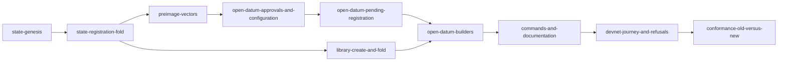

# Plan for creating a registry and registering a key on the proved design

Issue 742. This page is for the people who implement and review the pull request. It binds the model, the rulings, the
placement, the consumers, the slices and the gate. The story and the requirements are in [the specification](spec.md).

## Lane

| Field | Value |
| --- | --- |
| Repository | lambdasistemi/singular |
| Worktree | /code/singular-issue-742 |
| Branch | feat/742-create-register-no-pin, pushed with an upstream on the first push |
| Base | epic/731-no-pin-registry at 0c0ab880 |
| Pull request target | epic/731-no-pin-registry, never main; the epic owner merges |
| Runtime root | /home/paolino/.orch-runtime/singular/epic-731/ticket-742 |
| Constitution | version 1.19.0 |
| Change class | changes behaviour (on-chain code, conformance claims): ticket owner, commit owner and a persistent mute auditor |

## Lean binding

Lean is the authority. Implementation starts only after issue 741 lands its aligned models on the epic branch, beside the
current `lean/Singular` models. The epic owner forwards their module paths in a release note, and this section is then
rebound to that revision, statement by statement, before the first slice is released. Until then the binding is
provisional, to pull request 748 at 4126a951:

| Family | Statements this ticket implements and checks |
| --- | --- |
| Singular | `genesis_inversion`, `recognition_inversion`, `registration_inversion`, `registration_effects`, `registration_separate_holdings`, `batch_inversion`, `batch_effects`, `fold_minted_outputs`, `fold_untouched_keys`, `active_role_never_state`, `minted_active_never_state`, `public_fold_constructed`, `public_fold_effects` |
| Open-datum lifecycle | `configurationCreate_inversion`, `configuration_immutable`, `bookRegistration_inversion`, `booking_authority_and_parameters`, `approvalBurn_inversion`, `approval_burn_open`, `burning_grants_nothing`, `registrationFold_inversion`, `folder_protection`, `ownerReclaim_inversion`, `expiredCleanup_inversion`, `registration_lifecycle`, `additive_payments` |
| Money and equivalence | `create_journey`, `registration_booking_journey`, `registration_fold_journey` (restated in issue 741), `reclaim_journey`, `cleanup_journey`, `journey_allocations`, `accepted_economic_allocations` |

Termination, update and history statements (`termination_*`, `bookTermination_inversion`, `liveUpdate_inversion`,
`treasury_at_booking`, `no_stuck_termination`, `update_*`, `HistoryStatements`) belong to issue 743. A statement the
aligned models rename or restate is rebound by name; one they drop, or one whose meaning the code cannot meet, is a
question to the epic owner, never a quiet change of the check.

## Rulings in force

Recorded with the operator's words in the epic runtime root (`ruling-20261023-request-lifecycle-to-application.md`,
`ruling-20261023-termination-request-shape.md`, `ruling-20261023-cbor-preimages.md`) and in issue 741's
`specs/741-no-pin-model/decisions.md`. In short:

- Singular is one validator per application, the state applied to the application policy. It acts only at the fold. It
  has no request script, no witness scripts and routes no money. Its datum is the root.
- At a registration fold Singular checks the new holding against the approval it recomputes: the committed address, the
  committed datum hash, exactly one new token and at least the committed deposit. The continuing state output holds only
  ADA and its state token.
- Approvals bind the complete registry identity, the state policy and the state token name. Anyone may burn an approval.
- The request lifecycle belongs to open datum: three timed phases for a pending registration, no rejection. Open datum
  never reads the root or checks a trie proof. A registration that can never be folded waits for reclaim.
- The folder takes the request value above the committed deposit. A reclaim inside the window returns everything; a
  cleanup after it returns the deposit to the refund address. The refund address signs a reclaim.
- The five request parameters live in a configuration record fixed per registry at creation.
- Hashed-name preimages are CBOR in the Plutus Data serialisation, pinned by byte vectors.
- Command line split (issue 528): commands build against the library's request and fold, not the open-datum envelope.
- The new line goes beside the current one (answer A-001): new validators are new blueprint titles, new builders are new
  modules, the new journey is a new hosted job, and nothing of the current line is edited. Issue 743 removes the current
  line when the new one gains update and termination.
- Not in this line: the application policy doubling as its address.

## Commands

Epic-scoped names from the model's vocabulary (answer A-001); issue 743 moves them onto the established names when the
current line is removed. These names are checked at plan review.

| Command | What it does | Model operation |
| --- | --- | --- |
| `singular state create` | spends a seed and creates the registry state of an application with an empty root | genesis |
| `singular state fold` | folds pending registrations: consumes each approval, proves each key absent, mints each token into its holding | registration fold |
| `open-datum state create` | creates an open-datum registry: the state, from the library's genesis, and its configuration record | genesis and configuration create |
| `open-datum registration book` | books a registration: the approval and the request value at the open-datum address | book registration |
| `open-datum registration reclaim` | the refund address takes everything back inside the reclaim window | owner reclaim |
| `open-datum registration cleanup` | after the window, returns the deposit to the refund address; the cleaner keeps the rest | expired cleanup |

Every command keeps today's recovery promise: cancellation and uncertain submission preserve the transaction identity, and
nothing is resubmitted on its own.

## Placement

The [modules model](modules-model.md) places the new code. The [data model](data-model.md) holds the records and their
invariants, and the [functions model](functions-model.md) the new signatures.

## Consumers

[The consumers page](consumers.md) lists every place in the tree a slice can break, from the census of 0c0ab880.

## Slices

Each slice is one bisect-safe commit range on this branch, finishing in well under two hours, with its own RED evidence
and checkpoints. The commit owner may cut a slice smaller; it may not merge two.

| Slice | Delivers | Requirements | Gate rows |
| --- | --- | --- | --- |
| state-genesis | the new Singular validator's genesis, state recognition from the supplied seed, state output integrity, the state-name and state-datum encoding; blueprint title, identity manifest, declared-additions record | validators-follow-the-model | G1, G2, G9 |
| state-registration-fold | the registration fold: approval recomputed and consumed, trie proof of absence, one token minted into the committed address and datum with at least the committed deposit, nothing else under the state policy | validators-follow-the-model | G1, G2, G9 |
| preimage-vectors | the CBOR approval preimage in Aiken and in Haskell, with shared byte vectors including a definite and an indefinite list and a byte string longer than 64 bytes | preimage-bytes-pinned | G1, G4, G9 |
| open-datum-approvals-and-configuration | the new open-datum validator's configuration record at creation, the registration approval mint with its committed fields, the open burn | validators-follow-the-model | G3, G2, G9 |
| open-datum-pending-registration | the pending registration's three phases and the fold path's genuine-token check | validators-follow-the-model | G3, G2, G9 |
| library-create-and-fold | library builders for genesis and the registration fold, against the new validators | devnet-registration-journey (library half) | G4, G9 |
| open-datum-builders | builders for configuration create, book, reclaim and cleanup | devnet-registration-journey (library half) | G5, G9 |
| commands-and-documentation | the six commands, help snapshots, parser rows, recovery behaviour, the command reference and its speech | documentation-and-board, interrupted-commands-keep-identity | G4, G5, G6, G7, G9 |
| devnet-journey-and-refusals | a new hosted job running the packaged commands on a development network: the journey, the five refusals and the creation measurement as a receipt | devnet-registration-journey, devnet-refusals, creation-measured | G8, G9 |
| conformance-old-versus-new | the conformance statement of each registration journey, old against new, in requirement language, with the decided difference | conformance-old-versus-new | G10, G7, G9 |

## Gate

The ticket owner's table, written before the auditor's. The auditor writes its own table independently when it is seated;
the ticket owner synthesizes the two once, records both input hashes and freezes the result in the runtime root before
the commit owner starts. Every command is an existing hosted command, or one this ticket adds to a hosted job and marks so.

| Row | Acceptance it proves | Hosted job | Verbatim command | Expected exit |
| --- | --- | --- | --- | --- |
| G1 | Singular validator statements, each seen to fail | registry.yml `aiken-suite` | `nix flake check` in `onchain/` | 0 |
| G2 | new titles declared, current hashes unmoved | registry.yml `script-identity`, `application-script-identity` | `nix build --quiet --no-link --print-out-paths .#script-identity` (in `onchain/` and in `applications/open-datum/onchain/`); `nix run --quiet .#script-hash-comparison` | 0 |
| G3 | open-datum validator statements, each seen to fail | registry.yml `application-aiken-suite` | `nix flake check` in `applications/open-datum/onchain/` | 0 |
| G4 | library builders, preimage vectors in Haskell, singular help and parser rows | registry.yml `journey` (focused off-chain suite) | `nix run --quiet .#cage-tests` in `offchain/` | 0 |
| G5 | open-datum builders, help and parser rows | ci.yml `open-datum-tests` | `nix run --quiet .#open-datum-tests` in `applications/open-datum/offchain/` | 0 |
| G6 | documented flags | registry.yml `cli-flags` | `nix run --quiet .#cli-flags-check`; `nix run --quiet .#cli-flags-controls` | 0 |
| G7 | pages, diagrams and speech | ci.yml `rendered-docs` | `nix run --quiet .#docs-check` | 0 |
| G8 | devnet journey, refusals and measurement | new registry.yml job (CI change in this ticket) | the job's own command, named when the slice adds it | 0 |
| G9 | lint and format of touched paths | ci.yml `dev-shell`, `offchain-lint`; conformance.yml `format-check` | `nix develop --quiet -c just lint`; `(cd offchain && nix run --quiet .#lint)`; `nix run --quiet .#format-check` | 0 |
| G10 | conformance statement and coverage ratchet | conformance.yml `conformance-checks`, `coverage-gate` | `nix run --quiet .#conformance-appendix-tests`; `nix run --quiet ./conformance#coverage-gate -- --root . ratchet` | 0 |

Rows run scoped to what each slice can break. `just ci` runs once on the final candidate, then the push; hosted checks on
the pull request head are the net. Every build or test runs in a named, memory-capped scope:
`systemd-run --user --scope --unit=t742-<what>-<n> -p MemoryMax=24G timeout 3600 <command>`.

## Evidence the pull request will carry

- per statement: the validator test that executes it and the RED run that showed it fail;
- the byte vectors and the two encoders that reproduce them;
- the hosted journey job's receipt: transactions, the holding's token, payload and deposit, the reclaim and cleanup
  payouts, the five refusals, and the creation measurement for a first and a later registry;
- the conformance statement of each registration journey, old against new;
- left uncovered, stated in the pull request: update and termination (issue 743), the reader (issue 744), batch limits
  (issue 746), release of the new titles (issue 747).
