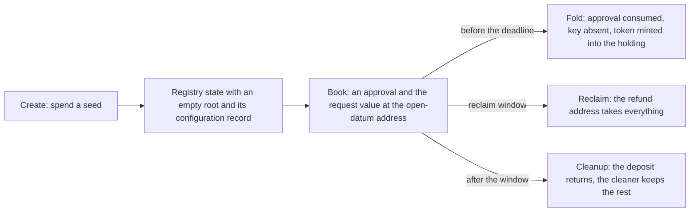

# Create a registry and register a key on the proved design

Issue 742, part of epic 731. This page is for an open-datum user, for an author of another application, and for the
people who review the four pull requests. It records the story, the requirements, the refusals and the checks that prove them.

## Story

As an open-datum user, I run `singular` and `open-datum` to create a registry for open datum, book the registration of a
key with its initial payload and deposit, and see a fold deliver the key's genuine token into a new open-datum holding that
carries my payload and deposit. If nobody folds it, I reclaim everything in my window; after the window anyone can clean
it up and my deposit comes back to me.

## What the two validators promise

| Part | Promise |
| --- | --- |
| Genesis | Spending a seed creates the registry's state token, named from the seed, in one state output holding only ADA and that token, with an empty root. |
| Registration fold | For each change, the application approval for exactly that change is consumed and burned, the trie proof shows the key absent, and one token for the key is minted into the address and datum the approval commits, holding at least the committed deposit. |
| State output integrity | Nothing else is minted or burned under the state policy; the continuing state output holds only ADA and its state token, and its datum is the new root. |
| State recognition | A registry state is recognised from the seed supplied with the fold; a token parked at the state address cannot pose as a registry. |
| Registration approval | It commits the change, the key, the registry identity (state policy and name), the destination, the initial-datum hash and the deposit. Anyone may burn an approval. |
| Pending registration | It sits at the open-datum address. Until the processing deadline only a fold may spend it; in the reclaim window the refund address reclaims everything; after the window anyone may clean it up, keeping what is above the deposit and returning the deposit to the refund address. |
| Fold path of open datum | It checks that the genuine token reaches the new holding. |
| Configuration record | The five request parameters are fixed per registry at creation. |
| Money | The folder takes the request's value above the deposit. Singular routes no money. |
| Hashed names | Approval preimages are CBOR (Plutus Data serialisation), pinned by byte vectors that off-chain encoders reproduce. |

The binding Lean statements are listed in [the plan](plan.md#lean-binding); they come from the aligned models of issue 741.

## Requirements

- validators-follow-the-model: the two validators implement the aligned Lean statements for genesis, the registration
  fold, delivery, state output integrity, state recognition and the open-datum registration lifecycle; each statement has
  an executable check that has been seen to fail.
- devnet-registration-journey: through the packaged commands on a development network: create a registry; book a
  registration; fold it; the holding carries the token, the payload and the deposit; a reclaim inside the window returns
  everything; a cleanup after the window returns the deposit.
- fold-from-public-data: in that journey the fold is built and signed by a second wallet, not the booker's, from chain
  data alone: no file, key or record from the booker. A fold that needs the booker's private data is a critical defect.
- scripts-published-once: creating the first registry of an application publishes the state script and the open-datum
  script as reference scripts when no live copy exists; a later registry reuses the live copies and publishes none; a
  reference script whose hash is not the expected one is never reused.
- devnet-refusals: on a development network, each of these is refused: a fold without the approval; a token delivered to
  another address or with less than the deposit; a second registration of the same key; extra tokens added to the state
  output; a parked token presented as a registry state.
- creation-measured: the transactions and the locked ADA for the first registry of an application and for a later one.
- conformance-old-versus-new: the conformance suite states the old and new outcome of each registration journey (folded,
  reclaimed, cleaned up) in requirement language, including the decided difference: a registration that can never be
  folded waits for reclaim instead of being rejected early.
- documentation-and-board: user documentation for the commands ships in the pull request that adds them; hosted checks are green
  on each pull request into the epic branch.
- preimage-bytes-pinned: each new hashed-name preimage has byte vectors reproduced by the on-chain and off-chain encoders,
  including a definite and an indefinite list case and a byte string longer than 64 bytes.
- interrupted-commands-keep-identity: cancellation and uncertain submission preserve the transaction identity; no command
  resubmits on its own.

## Refusals

| Attempt | Refused by | Seen on |
| --- | --- | --- |
| Fold with no approval for the change | Singular | validator test and devnet |
| Token delivered to another address, or with less than the committed deposit | Singular and open datum | validator test and devnet |
| Second registration of an active key | Singular (trie proof) | validator test and devnet |
| Extra token added to the continuing state output | Singular | validator test and devnet |
| A token parked at the state address presented as a registry state | Singular | validator test and devnet |
| Spending a pending registration other than by a fold before the deadline | open datum | validator test |
| Reclaim not signed by the refund address, or outside the window | open datum | validator test |
| Cleanup before the window ends, or returning less than the deposit | open datum | validator test |

## Out of scope

Holding updates and termination (issue 743), the reader (issue 744), the preimage specification command (issue 745), batch
folding limits (issue 746), integration into `main` and release (issue 747), the model work itself (issue 741), and the
paused protected-rejection work (issues 498 and 529). The application policy doubling as its address is a later version.
