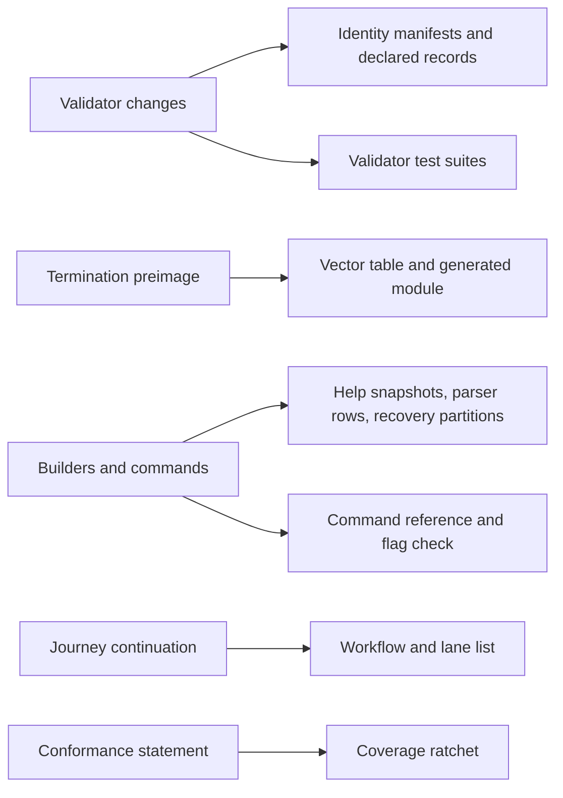

# Consumers of updating a holding and terminating its key on the proved design

Issue 743. This page is for the commit owner and the auditor: every place in the tree a slice of [the plan](plan.md) can
break, and what moves there. Census of the tree at 000ccf6a.

## Pull requests 1 to 3

| Consumer | Touched by | What moves |
| --- | --- | --- |
| `onchain/` blueprint and `onchain/script-identity.json` | termination-fold | the `singular_state` hashes move; manifest regenerated with the repository's regeneration recipe |
| `applications/open-datum/onchain/` blueprint and `script-identity.json` | holding-update, termination-booking, termination-request | the `open_datum_requests` hashes move; manifest regenerated |
| `nix run .#script-hash-comparison` and its records list in `flake.nix` | every slice that moves a new hash | a `specs/743-update-terminate-no-pin/evidence/declared-changes.json` record naming the changed new titles and no current title, appended to the records list |
| The registry pin, the naming custody pin, both `permanent-contract.json` files, the generated `Permanent.hs` | none in pull requests 1 to 3 | byte-identical until pull request 4 |
| `offchain/test/fixtures/preimage-vectors.json`, `onchain/validators/singular_state_preimage_vectors.tests.ak` | termination-preimage-vectors | rows appended; the module regenerated by the `preimage-vectors` freshness app |
| The aligned Lean models | none | stay green untouched; a needed restatement is a question, not an edit |
| The open-datum request validator test modules and fixtures | pull request 1 | new test modules beside issue 742's |
| Issue 742's builders, records, the shared fold builder and their tests | pull request 2 | the termination additions |
| Help snapshots and parser corpora of both executables | commands-and-documentation | new snapshots and rows recorded with the specs' own record switch |
| `docs/singular-node.md` settings table, `tools/cli_flags_check.sh` | commands-and-documentation | new flags documented; the check's command counts and matchers move with the new commands; specs pages name no flag before its slice lands it |
| `tools/io-ownership.sites` and `tools/io-ownership.allow` | any new effectful module | regenerated in the same commit |
| `.github/workflows/registry.yml`, `.github/ci/e2e-parts.json` and root flake apps | devnet-journey-and-refusals | the journey continuation in issue 742's journey job, and a new termination refusals job (CI change in this ticket) |
| Conformance rows and the coverage record | conformance-old-versus-new | rows for the update and termination journeys; the ratchet stays green |
| Speech companions of every new page under `specs/743-update-terminate-no-pin/` and `docs/` | every slice that writes a page | stamped companions; `nix run .#docs-check` |

## Pull request 4: the current line

The current line spans every layer of the repository. Its size, from the census:

| Layer | Current-line footprint | Shared with the new line |
| --- | --- | --- |
| On-chain | Singular `state`, `request`, `witness`, `open`, `staking`, `cage` validators, `lib/registry/*`, `registry_pin.ak`, `types.ak`, `lib.ak`, `shared.ak`, about 10,000 lines with tests; open datum's `open_datum.ak` (the `open_datum` and `closed_datum` validators) with its tests and envelope, about 2,400 lines | the new validators import none of them; open datum's `aiken.toml` depends on the whole `onchain/lib` package |
| Manifests and release | both `script-identity.json` and `permanent-contract.json` files, the generated `Permanent.hs`, the script-hash comparison's base evidence and plants (every plant names a current title), `onchain-release/`, `tools/assemble_onchain_release.py`, `tools/negative_host_mutants.sh`, the application separation checks | the comparison needs a declared removal kind and new plants |
| Off-chain library | `Singular/Registry/**` and the naming sources, about 21,000 lines | the new preimage codec imports `Singular.Registry.TrieState`; the Koios provider, local services, wallet, submit and vault code are generic |
| Commands | the `singular registry`, `wallet`, `submit` groups and the `open-datum` create, insert, update, terminate, fold, inspect commands, about 25,000 lines | the wallet, submit, vault and option infrastructure are reused by the new commands |
| Tests and executables | `cage-tests`, `e2e-tests`, `contract-tests`, the journey and row executables, about 80,000 lines; help snapshots and parser corpora | the new line's tests live in the same suites |
| Lean | `lean/Singular` (121 files), the corpus mains and corpora, the open-datum application model and its corpus | the aligned models import about 43 modules of it (the model types, lemmas, economics, the driver codec and surface, and the open-datum model and statements, which the equivalence statements quote as the old side) |
| Simulator and conformance | `simulator/` and its formal mirror; the conformance package and its rows, which run on the current driver | the old-versus-new statements need the old side |
| Hosted jobs | most of `registry.yml` (e2e parts, contract, journey, demo1, two actors, recovery partitions, forged pins, keri stub), `negative-host.yml`, `release-bundles.yml`, parts of `ci.yml` and `conformance.yml` | the new line's jobs sit in the same workflows |
| Other | naming (`naming-onchain` copies the current state hash), the KERI stub application (reuses the current command library), `demo1/`, `paper/` citations, the inventory and confinement tools, about 40 documentation pages | — |

What pull request 4 removes, keeps or rehomes in each layer is set by [the plan's removal decisions](plan.md#removal-decisions).
