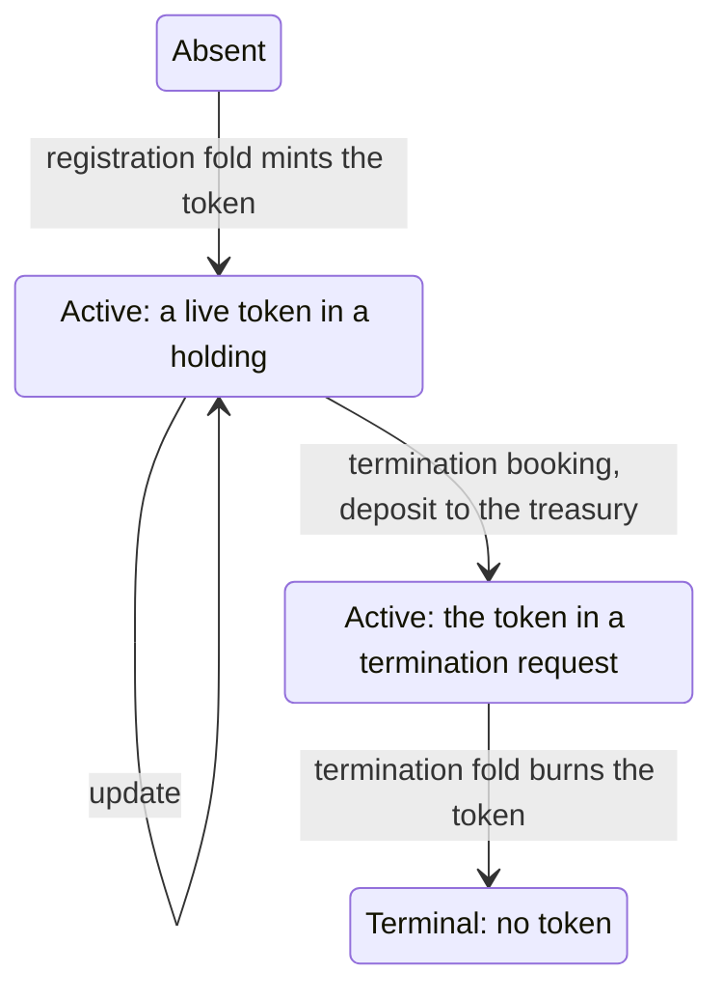

# Records for updating a holding and terminating its key on the proved design

Issue 743. This page names the new and changed records, their fields and the invariants each one must keep. Field
encodings follow the aligned Lean models; where those models fix an order or a constructor number, that wins over this
page. Records issue 742 introduced are in [its data model](../742-create-register-no-pin/data-model.md) and are not
repeated.

## Records

| Record | Fields | Invariants |
| --- | --- | --- |
| Holding | at the open-datum address: the active token, the envelope (protected control and payload), at least the deposit | the protected control names the registry, the key, the controller, the active token and the deposit; it changes only by leaving the holding at a termination booking |
| Updated holding | at the open-datum address: exactly the tokens of the holding it replaces, the same protected control, any payload, at least the deposit | created only by an update the controller signs; no registry fold takes part |
| Termination approval preimage | termination constructor, key, registry identity (state policy and name) | CBOR in the Plutus Data serialisation; the constructor is the model's termination constructor of `Preimage`, distinct from every other hashed name |
| Termination approval | one token under the application policy, named by the hash of its preimage | minted only by a termination booking the controller signs, fresh in that transaction; anyone may burn it; burning grants nothing |
| Termination request | at the open-datum address: exactly the active token and the termination approval, an empty datum, the request value | created only by a termination booking; spent only in a transaction that burns its active token under the state policy and burns its approval |
| Termination change | in a fold redeemer: the request reference, the key, the trie proof | the trie proof shows the key active in the root before and terminal in the root after; the matching approval is consumed and burned; the active token is burned once |
| Treasury donation | the transaction's donation to the treasury | equals the sum of the deposits of the holdings booked for termination in that transaction, and is zero in every other application transaction |

## Life of a key

A pending termination is not a Singular state: its leaf stays active until the fold. A terminal leaf has no transition.
