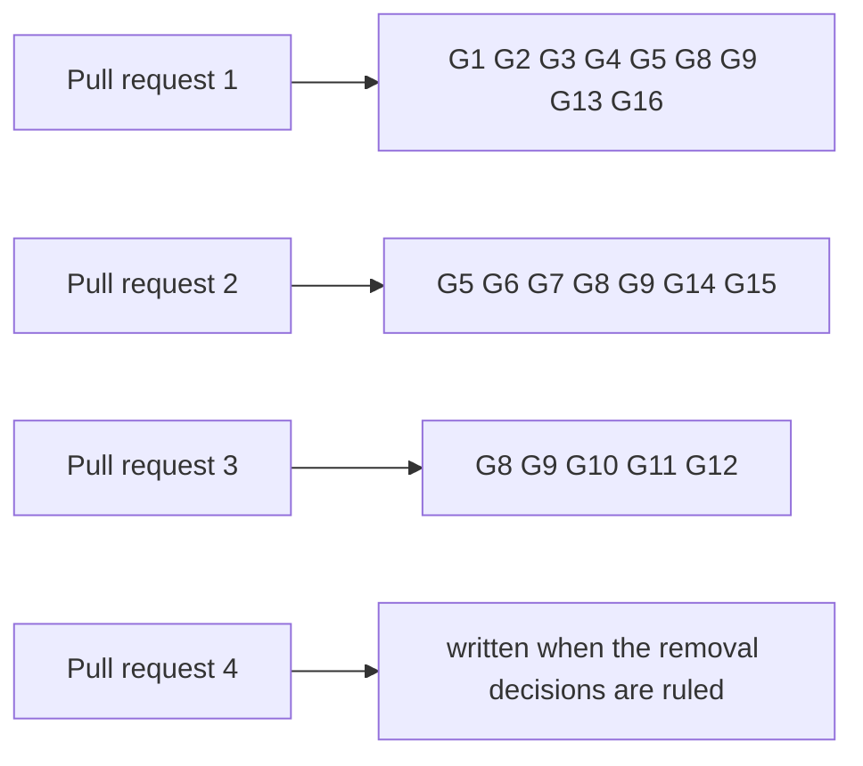

# Gate for updating a holding and terminating its key on the proved design

Issue 743. This page is for the commit owner, the auditor and the reviewers: each acceptance item, the hosted job and the
verbatim command that proves it, and what each pull request must show. The requirements are in
[the specification](spec.md) and the pull requests in [the plan](plan.md#pull-requests-and-slices).

## Rows

The ticket owner's table, written before the auditor's. The auditor writes its own table independently when it is seated;
the ticket owner synthesizes the two once, records both input hashes and freezes the result in the runtime root before
the commit owner starts. Every command is an existing hosted command, or one this ticket adds to a hosted job and marks
"CI change in this ticket". Pull request 4's rows are written when its removal decisions are ruled.

| Row | Acceptance it proves | Hosted job | Verbatim command | Expected exit |
| --- | --- | --- | --- | --- |
| G1 | Singular statements (termination fold, mixed batches, supply and history), each seen to fail | registry.yml `aiken-suite` | `nix flake check` in `onchain/` | 0 |
| G2 | changed new titles declared, current hashes unmoved | registry.yml `script-identity`, `application-script-identity` | `nix build --quiet --no-link --print-out-paths .#script-identity` in `onchain/` and in `applications/open-datum/onchain/`; `nix run --quiet .#script-hash-comparison` | 0 |
| G3 | open-datum statements (update, termination booking, termination request, treasury, no stuck termination), each seen to fail | registry.yml `application-aiken-suite` | `nix flake check` in `applications/open-datum/onchain/` | 0 |
| G4 | the termination preimage vectors are fresh in the generated module | registry.yml `vectors-fresh` | `nix run --quiet .#vectors-check` | 0 |
| G5 | the Haskell termination preimage, the shared fold builder over terminations, singular help and parser rows | registry.yml `journey` | `nix run --quiet .#cage-tests` in `offchain/` | 0 |
| G6 | update and termination booking builders, open-datum help and parser rows | ci.yml `open-datum-tests` | `nix run --quiet .#open-datum-tests` in `applications/open-datum/offchain/` | 0 |
| G7 | documented flags | registry.yml `cli-flags` | `nix run --quiet .#cli-flags-check`; `nix run --quiet .#cli-flags-controls` | 0 |
| G8 | pages, diagrams and speech | ci.yml `rendered-docs` | `nix run --quiet .#docs-check` | 0 |
| G9 | lint and format of touched paths | ci.yml `dev-shell`, `offchain-lint`; conformance.yml `format-check` | `nix develop --quiet -c just lint`; `(cd offchain && nix run --quiet .#lint)`; `nix run --quiet .#format-check` | 0 |
| G10 | the update and termination journeys old against new, and the coverage ratchet | conformance.yml `conformance-checks`, `coverage-gate` | `nix run --quiet .#conformance-appendix-tests`; `nix run --quiet ./conformance#coverage-gate -- --root . ratchet` | 0 |
| G11 | the journey continuation through the packaged commands: update, termination booking with the deposit at the treasury, the fold by a second wallet from chain data only, the refused re-registration | issue 742's journey job, extended (CI change in this ticket) | `nix run --quiet .#no-pin-registration-journey` | 0 |
| G12 | the four termination refusals on a development network, each with its passing control | new registry.yml job `no-pin-termination-refusals`, "No-pin termination refusals on a development network" (CI change in this ticket) | `nix run --quiet .#no-pin-termination-refusals` | 0 |
| G13 | the changed validators compile into the blueprints every other row reads | registry.yml `blueprint`, `application-blueprint` | `nix build --quiet --no-link --print-out-paths .#plutus-blueprint` in `onchain/` and in `applications/open-datum/onchain/` | 0 |
| G14 | the packages with the new builders and commands build | ci.yml `offchain-component-build`, `open-datum-component-build` | `nix build --quiet .#component-build` in `offchain/` and in `applications/open-datum/offchain/` | 0 |
| G15 | the new commands keep transaction identity on cancellation and uncertain submission, without resubmitting | registry.yml `cli-recovery-partition`, with partitions for the new commands (CI change in this ticket) | `nix run --quiet .#cli-recovery-partition -- <partition>` | 0 |
| G16 | the aligned models still build with every statement proved | ci.yml `dev-shell-checks` | `nix develop --quiet -c just application-held-model`; `nix develop --quiet -c just open-datum-application-held-model` | 0 |

Rows run scoped to what each slice can break. `just ci` runs once on the final candidate of each pull request, then the
push; hosted checks on the pull request head are the net. Every build or test runs in a named, memory-capped scope:
`systemd-run --user --scope --unit=t743-<what>-<n> -p MemoryMax=24G timeout 3600 <command>`.

## Rows per pull request

## Evidence the pull requests will carry

- per statement: the validator test that executes it, the hosted step that runs it, and the RED run that showed it fail;
- for each history statement: the generator, the inputs it covers, the counts and the seed;
- the termination preimage byte vectors and the two encoders that reproduce them;
- the journey job's receipt: the update, the booking with the treasury donation, the fold built by a second wallet from
  chain data only with the burn and the folder's payment, and the refused re-registration;
- the refusals job's receipt: each of the four refusals and its control;
- the conformance statement of the update and termination journeys, old against new;
- left uncovered, stated in the pull requests: the reader (issue 744), batch limits (issue 746), release (issue 747).
