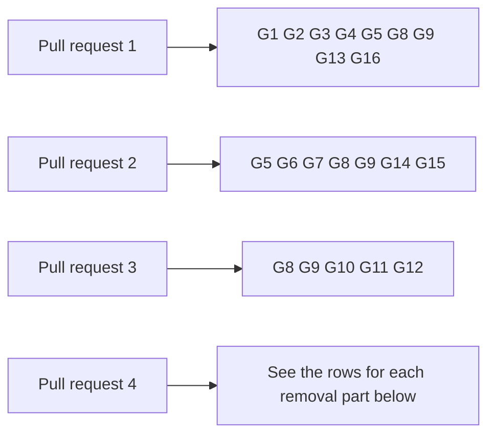
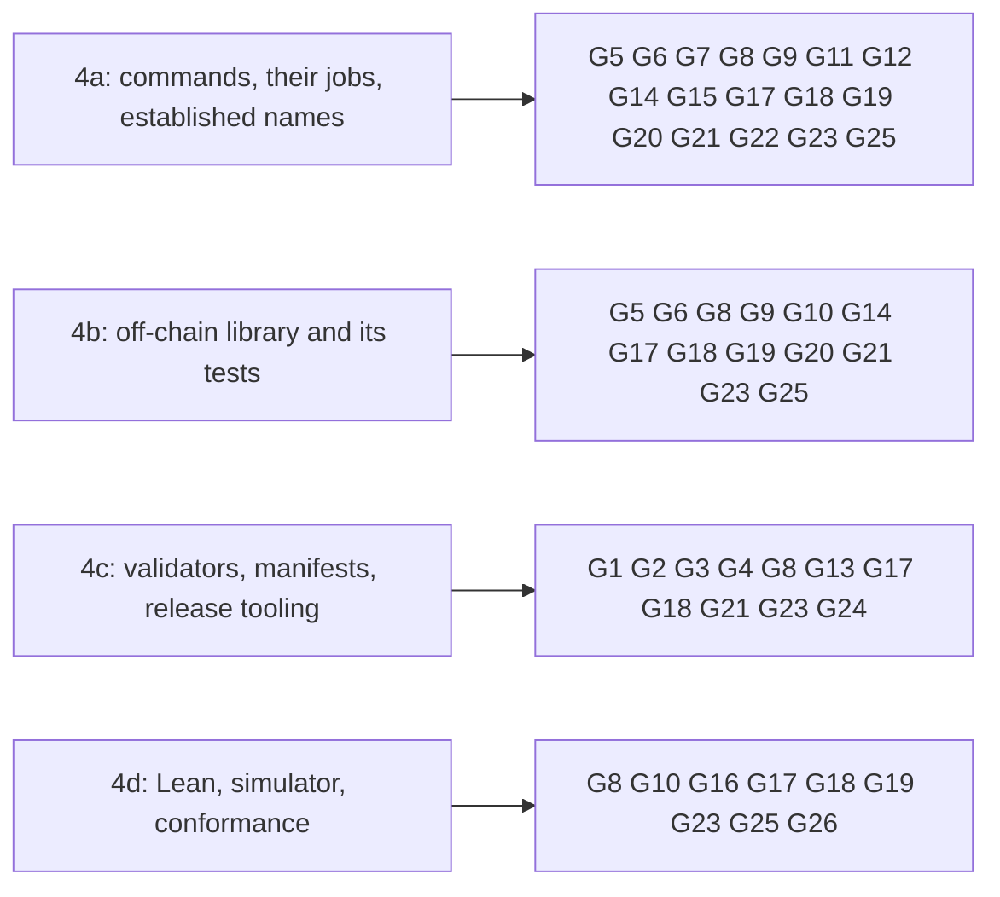

# Gate for updating a holding and terminating its key on the proved design

Issue 743. This page is for the commit owner, the auditor and the reviewers: each acceptance item, the hosted job and the
verbatim command that proves it, and what each pull request must show. The requirements are in
[the specification](spec.md) and the pull requests in [the plan](plan.md#pull-requests-and-slices).

## Rows

The ticket owner's table, written before the auditor's. The auditor writes its own table independently when it is seated;
the ticket owner synthesizes the two once, records both input hashes and freezes the result in the runtime root before
the commit owner starts. Every command is an existing hosted command, or one this ticket adds to a hosted job and marks
"CI change in this ticket". Pull request 4 follows [the rows below](#rows-for-pull-request-4-gate-version-2).

| Row | Acceptance it proves | Hosted job | Verbatim command | Expected exit |
| --- | --- | --- | --- | --- |
| G1 | Singular statements (termination fold, mixed batches, supply and history), each seen to fail | registry.yml `aiken-suite` | `nix flake check` in `onchain/` | 0 |
| G2 | changed new titles declared, current hashes unmoved | registry.yml `script-identity`, `application-script-identity` | `nix build --quiet --no-link --print-out-paths .#script-identity` in `onchain/` and in `applications/open-datum/onchain/`; `nix run --quiet .#script-hash-comparison` | 0 |
| G3 | open-datum statements (update, termination booking, termination request, treasury, no stuck termination), each seen to fail | registry.yml `application-aiken-suite` | `nix flake check` in `applications/open-datum/onchain/` | 0 |
| G4 | the termination preimage vectors are fresh in the generated module | registry.yml `vectors-fresh` | `nix run --quiet .#vectors-check` | 0 |
| G5 | the Haskell termination preimage, the shared fold builder over terminations, singular help and parser rows | registry.yml `journey` | `nix run --quiet .#cage-tests` in `offchain/` | 0 |
| G6 | update and termination booking builders, open-datum help and parser rows | ci.yml `open-datum-tests` | `nix run --quiet .#open-datum-tests` in `applications/open-datum/offchain/` | 0 |
| G7 | documented flags | registry.yml `cli-flags` | `nix run --quiet .#cli-flags-check`; `nix run --quiet .#cli-flags-controls` | 0 |
| G8 | pages, diagrams and speech | ci.yml `rendered-docs` | `nix run --quiet .#docs-check` | 0 |
| G9 | lint and format of touched paths | ci.yml `dev-shell`, `offchain-lint`; conformance.yml `format-check` | `nix develop --quiet -c just lint`; `(cd offchain && nix run --quiet .#lint)`; `nix run --quiet .#format-check` | 0 |
| G10 | the update and termination journeys old against new, and the coverage ratchet | conformance.yml `conformance-checks`, `coverage-gate` | `nix run --quiet .#conformance-appendix-tests`; `nix run --quiet ./conformance#coverage-gate -- --root . ratchet` | 0 |
| G11 | the journey continuation through the packaged commands: update, termination booking with the deposit at the treasury, the fold by a second wallet from chain data only, the refused re-registration | issue 742's journey job, extended (CI change in this ticket) | `nix run --quiet .#no-pin-registration-journey` | 0 |
| G12 | the four termination refusals on a development network, each with its passing control | new registry.yml job `no-pin-termination-refusals`, "No-pin termination refusals on a development network" (CI change in this ticket) | `nix run --quiet .#no-pin-termination-refusals` | 0 |
| G13 | the changed validators compile into the blueprints every other row reads | registry.yml `blueprint`, `application-blueprint` | `nix build --quiet --no-link --print-out-paths .#plutus-blueprint` in `onchain/` and in `applications/open-datum/onchain/`; `nix build --quiet --no-link --print-out-paths .#open-datum-blueprint` in `applications/open-datum/onchain/` | 0 |
| G14 | the packages with the new builders and commands build | ci.yml `offchain-component-build`, `open-datum-component-build` | `nix build --quiet .#component-build` in `offchain/` and in `applications/open-datum/offchain/` | 0 |
| G15 | the new commands keep transaction identity on cancellation and uncertain submission, without resubmitting | registry.yml `cli-recovery-partition`, with partitions for the new commands (CI change in this ticket) | `nix run --quiet .#cli-recovery-partition -- <partition>` | 0 |
| G16 | the aligned models still build with every statement proved | ci.yml `dev-shell-checks` | `nix develop --quiet -c just application-held-model`; `nix develop --quiet -c just open-datum-application-held-model` | 0 |

Rows run scoped to what each slice can break. `just ci` runs once on the final candidate of each pull request, then the
push; hosted checks on the pull request head are the net. Every build or test runs in a named, memory-capped scope:
`systemd-run --user --scope --unit=t743-<what>-<n> -p MemoryMax=24G timeout 3600 <command>`.

## Rows per pull request

## Evidence the pull requests will carry

- per statement: the validator test that executes it, the hosted step that runs it, and the RED run that showed it fail;
- for each history statement: the generator, the inputs it covers, the counts and the seed;
- the termination preimage byte vectors and the two encoders that reproduce them;
- the journey job's receipt: the update, the booking with the treasury donation, the fold built by a second wallet from
  chain data only with the burn and the folder's payment, and the refused re-registration;
- the refusals job's receipt: each of the four refusals and its control;
- the conformance statement of the update and termination journeys, old against new;
- left uncovered, stated in the pull requests: the reader (issue 744), batch limits (issue 746), release (issue 747).

## Synthesis

The ticket owner's table and the auditor's independent table were joined once on 25 October 2026. The auditor's table
added the merged open-datum blueprint to G13 and confirmed every other row of pull request 1 by its workflow line. Its
rows for the current Lean models (`model-check`, `application-model`) are left out: no slice of pull requests 1 to 3
touches them. Three of its findings bind the slices:

- RED evidence is lane evidence: each checkpoint record names the defective candidate or fault and the run that failed;
  no hosted job runs it.
- The history statements are checked by property tests inside the Aiken suites (G1, G3), or by a check this ticket wires
  into a hosted job in the same diff; a generator no hosted job runs is not evidence.
- The off-chain encoder's reproduction of the termination vectors runs in the off-chain suite (G5), which the `journey`
  job runs.

The link from a test to the Lean statement it executes is recorded in each slice's decision record and in the pull
request's correspondence, not in a gate row.

## Rows for pull request 4 (gate version 2)

Appended on 27 October 2026 once the removal decisions were ruled (plan, "Removal decisions"; the operator's ruling on
naming and the KERI stub). Rows G1 to G16 above are unchanged. Pull request 4 is four pull requests, each removing one
layer with its consumers and its hosted jobs, merged in order.

| Row | Acceptance it proves | Hosted job | Verbatim command | Expected exit |
| --- | --- | --- | --- | --- |
| G17 | no workflow command names an output the removal deleted, and the resolver still refuses its controls | ci.yml `workflow-commands-resolve` | `nix run --quiet .#workflow-commands-resolve-controls` | 0 |
| G18 | every declared check is still run by a hosted job | ci.yml `declared-checks-hosted` | `nix run --quiet .#declared-checks-classify-controls`; `nix run --quiet .#declared-checks-issue-states "$RUNNER_TEMP/issue-states.txt"`; `nix run --quiet .#declared-checks-hosted "$RUNNER_TEMP/issue-states.txt"` | 0 |
| G19 | the code inventory follows the removal | ci.yml `inventory` | `nix run --quiet .#inventory-check`; `nix run --quiet .#inventory-controls` | 0 |
| G20 | the registry command line's build graph holds only what remains | ci.yml `registry-cli-build-graph` | `nix run --quiet ./offchain#registry-cli-build-graph-check`; `nix run --quiet ./offchain#registry-cli-build-graph-controls` | 0 |
| G21 | the build gate and the deployment identity after the removal | ci.yml `build-gate` | `nix build --quiet .#build-gate`; `nix shell --quiet nixpkgs#jq nixpkgs#diffutils -c bash offchain/deployment-identity-check.sh` | 0 |
| G22 | the packaged `singular` command answers on its established name | ci.yml `open-datum-singular-smoke` | `nix run --quiet .#singular -- --help` | 0 |
| G23 | the workflows parse and lint once the removed jobs are gone | conformance.yml `lint` | the job's three steps: the `yq` parse of every workflow, `actionlint` on `conformance.yml`, `presentation-check` | 0 |
| G24 | the on-chain release assembly and its review archive carry only the new line | ci.yml `release-check`, `release-artifacts`, `release-review-reproduction` | `nix run --quiet .#release-check`; `nix run --quiet .#release-build-control`; `nix run --quiet .#release-artifacts -- "$RUNNER_TEMP/release"`; `nix run --quiet .#verify-release-controls -- "$RUNNER_TEMP/release"`; the reproduction job's steps | 0 |
| G25 | the development shell checks: the aligned models, node confinement, IO ownership and their controls, over what remains | ci.yml `dev-shell-checks` | every `nix develop --quiet -c ...` step the job keeps after the diff | 0 |
| G26 | the Lean, simulator, browser and coverage jobs pass on what remains, or leave in the same diff as what they check | ci.yml `model`, `simulator`, `browser`, `coverage` | `nix run --quiet .#model-check`; `nix run --quiet .#simulator-check`; `nix run --quiet .#browser-check`; `nix run --quiet .#coverage-check`; `nix run --quiet .#coverage-tests` | 0 |

Binding for every part of pull request 4:

- A hosted job that exercises only the current line leaves in the same commit as the code it runs, and the part's
  removal record names it with the new-line job that replaces it, or "none" with the reason. A job that still runs is
  kept green; a job is never disabled, skipped or marked allowed to fail.
- Each part opens with a census of its layer's consumers (the consumers page, "Pull request 4"), extended by grep over
  the repository, and the removal record lists every removed path, job and flake output.
- Naming and the KERI stub leave with the current line and are listed in the removal record (operator ruling).
- Rows G1 to G16 that a part can break bind that part as before.

### Rows added by the synthesis

The auditor's independent table (27 October 2026) confirmed G17 to G26 by their workflow lines and added four commands
of existing hosted jobs; they are appended as rows of their own.

| Row | Acceptance it proves | Hosted job | Verbatim command | Expected exit |
| --- | --- | --- | --- | --- |
| G27 | the wallet, vault and submit option infrastructure still serves the commands that remain | registry.yml `cli-flags` | `nix run --quiet .#wallet-vault-controls` | 0 |
| G28 | the application separation holds over what remains, and its controls still refuse | ci.yml `offchain-component-build` | `nix run --quiet .#application-separation-check`; `nix run --quiet .#application-separation-controls` | 0 |
| G29 | the backend contract suite runs on the adapters that remain | registry.yml `contract` | `nix build --quiet --no-link .#signed-tx-control`; `CONTRACT_RESULTS="$CONTRACT_RESULTS_DIR/external.jsonl" nix run --quiet .#contract-external` | 0 |
| G30 | the conformance package's format, lint and their controls on the reduced package | conformance.yml `format-check` | `nix run --quiet .#format-check`; `nix run --quiet .#hlint-check`; `nix run --quiet .#format-controls` | 0 |

Rows per part after the synthesis: 4a adds G27 G28 G29; 4b adds G27 G28 G29 and G30 when the conformance package
moves; 4c adds G28; 4d adds G30.

What no hosted job can carry, stated in each part's pull request: a removal has no failing run of its own (its evidence
is the removal record, the diff and every kept row green); the census of consumers is a review record, with G17 and G19
as its hosted leads; that the old side of each old-versus-new statement is computed from the retained old model is a
review claim of part 4d.
