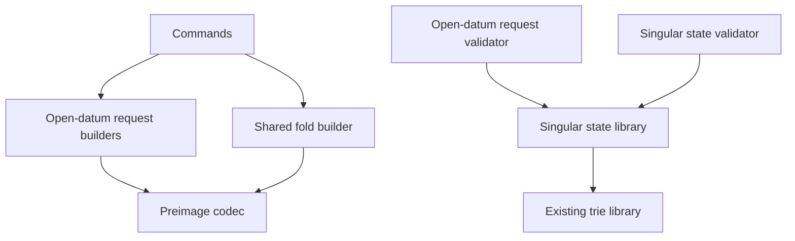

# Modules for updating a holding and terminating its key on the proved design

Issue 743. This page places the new and changed code and fixes its dependency direction. Records are in
[the data model](data-model.md) and signatures in [the functions model](functions-model.md). The components issue 742
created are in [its modules model](../742-create-register-no-pin/modules-model.md); this page names only what changes.

## Changed components

| Component | Change | Depends on | Must not depend on |
| --- | --- | --- | --- |
| Singular state library, `onchain/lib/singular_state/` | the termination change of the fold: approval, trie transition active to terminal, the burn; batches mixing both kinds; the termination preimage | the existing trie library, read only | any open-datum module |
| Open-datum request validator, `applications/open-datum/onchain/validators/application/` | the live holding's two spend paths (update and termination booking), the termination approval mint, the termination request's spend | the Singular state library for the preimages and token names only | the Singular validator's compiled hash; the current `open_datum` and `closed_datum` validators |
| Preimage codec, `offchain/lib/Singular/State/Preimage.hs` | the termination preimage | as issue 742 | transaction building |
| Open-datum request builders | update and termination booking | issue 742's builders and the session | the current open-datum book and plan modules |
| The shared fold builder | termination requests among the requests it folds | the session, the trie library | any record the controller keeps |
| Commands | update, termination booking and the fold over terminations; in pull request 4, the move onto the established names | the builders; the existing submit, recovery and wallet code | — |
| Devnet journey and refusals | the continuation of issue 742's journey job and a termination refusals job | the released executables | test-only controls in ordinary builds |

Paths are proposals. When the aligned Lean models name a component differently, the code takes the model's name, and the
mandate is versioned before the slice that creates it starts.

## Dependency direction

Singular never depends on open datum. Open datum learns the state policy and the registry name as data from its own
holding's protected control, never from a compiled hash.
