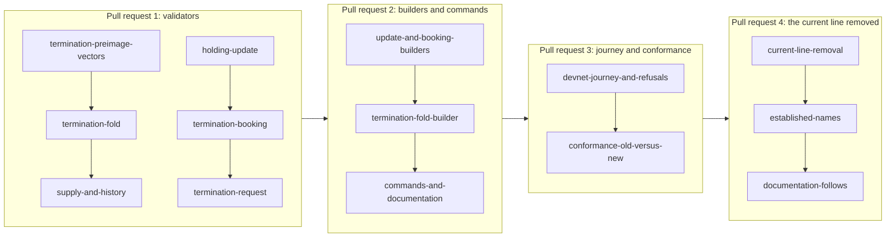

# Plan for updating a holding and terminating its key on the proved design

Issue 743. This page is for the people who implement and review the pull requests. It binds the model, the rulings, the
order against issue 742, the pull requests and their slices, and the seats. The story and the requirements are in
[the specification](spec.md); the checks are in [the gate](gate.md); every place a slice can break is in
[the consumers page](consumers.md).

## Lane

| Field | Value |
| --- | --- |
| Repository and worktree | lambdasistemi/singular, /code/singular-issue-743 |
| Branches | feat/743-update-terminate for the first pull request, from 000ccf6a, the head of issue 742's open-datum validator branch; one branch per later pull request, each from the branch it stacks on |
| Pull request target | issue 742's branch each one stacks on, until issue 742's stack lands on `epic/731-no-pin-registry`; then the epic branch, after one rebase the epic owner calls |
| Runtime root | /home/paolino/.orch-runtime/singular/epic-731/ticket-743 |
| Constitution | version 1.19.0 |
| Change class | changes behaviour (on-chain code, conformance claims, removal of the current line): ticket owner, commit owner and a persistent mute auditor |

## Lean binding

Lean is the authority. The code takes the models' vocabulary: `Preimage.terminationApproval`, `Change.terminate`,
`bookTermination`, `liveUpdate`, `terminationFold`, `terminationShape`, `liveShape`, `requiredTreasury`.

| Family | Lake project, library and recipe | Bound at | Statements this ticket implements and checks |
| --- | --- | --- | --- |
| Singular fold | `models/singular-application-held`, `SingularApplicationHeld.Statements`, `just application-held-model` | af995a1d (epic branch) | `termination_inversion`, `termination_effects`, `batch_inversion` and `batch_effects` over batches carrying terminations, `fold_untouched_keys` over mixed batches, `publicFold_inversion` and `public_fold_constructed` over termination requests |
| Supply and history | the same project, `HistoryStatements` | af995a1d | `supply_in_step`, `one_live_token`, `burn_only_terminating_fold`, `no_remint_after_terminal` |
| Open-datum lifecycle | `models/open-datum-application-held`, `OpenDatumApplicationHeld.RefundLifecycle.Statements`, `just open-datum-application-held-model` | 8b31dc23 (issue 742's validator branch: the epic branch models plus the one-configuration statement) | `bookTermination_inversion`, `terminationFold_inversion`, `liveUpdate_inversion`, `termination_burn`, `treasury_at_booking`, `no_stuck_termination`, and `booking_authority_and_parameters`, `burning_grants_nothing`, `folder_protection` over the termination actions |
| Money and equivalence | the same project, `OpenDatumApplicationHeld.Money.Statements` | 8b31dc23 | `update_journey`, `termination_booking_journey`, `termination_fold_journey`, `update_both_models`, `accepted_update_authority`, and `journey_allocations` for the update and termination journeys |

A history statement quantifies over every reachable world, so its executable check is a generated sequence of accepted
transactions against the real validators, not one example; the check states the inputs it covers. A statement the
aligned models rename or restate is rebound by name; one whose meaning the code cannot meet is a question to the epic
owner, never a quiet change of the check. The open-datum binding moves to the epic branch revision when issue 742's
validator pull request lands there, with no change of statement.

## Rulings in force

From the epic runtime root's ruling records and issue 741's decisions page, as they bear on this ticket:

- Application-held termination (2026-10-23): the termination request and the token stay at the application's script;
  the application does not need to know Singular's addresses; the request is released by the exact burn of its token.
- Termination request shape (2026-10-23): one output holding the active token and one termination approval, with an
  empty datum; the approval burn is open; booking is an application operation only, Singular mints nothing and checks
  nothing then; Singular's only moment is the fold.
- Money (2026-10-23): the whole value of a termination request is the folder's; the deposit is open datum's treasury
  share and goes to the treasury when the holding is released, at termination booking; Singular has no treasury and
  routes no money.
- Lifecycle in the application (2026-10-23): Singular has no request script and no witness scripts.
- Trie (operator, 2026-10-25): the new line keeps the current trie library; the termination proof uses it.
- Placement (issue 742, answer A-001): the new line was added beside the current one; this ticket removes the current
  line and moves the new commands onto the established names.
- Fold command (issue 742, commands answer A-001): the fold is shared library command code hosted by `open-datum` as its
  state fold command; this ticket extends it to termination requests.
- Staffing (operator, 2026-10-25): as issue 742's team: Claude Opus 5.5 high ticket owner, Claude Sonnet 5.5 xhigh
  commit owner, Muse xhigh auditor. No other seats.

## Order against issue 742

Issue 742's team still changes the Singular fold (the registration absence check, pull request 1), builds the commands
(pull request 3) and the registration journey (pull request 4). Each file below has one owner at a time.

| File or area | Issue 742 | This ticket | Order |
| --- | --- | --- | --- |
| `onchain/lib/singular_state/fold.ak` and the fold tests | the registration branch and its absence check | the termination branch and the batch over both | this ticket's first pull request stacks on issue 742's validator branch; the termination branch is a separate function, so a rebase over the absence check meets no shared lines; any conflict is resolved toward issue 742's text |
| `onchain/lib/singular_state/preimage.ak`, `offchain/lib/Singular/State/Preimage.hs`, the preimage vector table and its generated module | the three registration roles | the termination role's vectors | appended rows only; the generated module is regenerated, never edited |
| `applications/open-datum/onchain/validators/application/*.ak` and the request validator tests | configuration, booking, pending registration | the live holding's spend paths, the termination booking, the termination request | after issue 742's validator pull request; the request validator's "not yet written" holding path becomes this ticket's |
| Identity manifests, blueprints, declared-changes records | its new titles | the hashes of the two new validators move again | regenerated in each slice that moves a hash; the declared record names both tickets' titles |
| Open-datum and library builders, the fold builder, the commands, help snapshots, parser rows | pull request 3 | the update, termination booking and termination fold additions | this ticket's second pull request starts after issue 742's commands land |
| The devnet journey job and its script, the refusals job, conformance | pull request 4 | the continuation, the termination refusals, the update and termination statements | this ticket's third pull request starts after issue 742's journey lands |
| The current line, command names, documentation | untouched | removed and renamed | this ticket's fourth pull request, after issue 742's stack and this ticket's first three are on the epic branch |

## Pull requests and slices

Four pull requests in singular, merged in order. Each slice finishes in well under two hours with its own RED
evidence and checkpoints; the commit owner may cut a slice smaller, never merge two.

| Pull request | Slice | Delivers | Requirements |
| --- | --- | --- | --- |
| 1 | termination-preimage-vectors | the CBOR preimage of `Preimage.terminationApproval` in Aiken and Haskell, with byte vectors appended to the shared table | preimage-bytes-pinned |
| 1 | termination-fold | the termination change: the approval recomputed, consumed and burned; the trie proof shows the key active before and terminal after; the active token burned once; nothing else under the state policy; batches mixing registrations and terminations of distinct keys | validators-follow-the-model |
| 1 | supply-and-history | generated sequences of accepted transactions against the real validators showing the four history statements, and the refusal of a registration of a terminal key | validators-follow-the-model |
| 1 | holding-update | the controller-signed update: same control, exactly the same tokens, at least the deposit, any payload | validators-follow-the-model |
| 1 | termination-booking | the termination approval mint, the request shape, the treasury donation equal to the deposit, the controller's signature | validators-follow-the-model |
| 1 | termination-request | the request spent only with its token and approval burned under the state policy, by anyone; no stuck termination | validators-follow-the-model |
| 2 | update-and-booking-builders | update and termination booking transactions | devnet-update-termination-journey |
| 2 | termination-fold-builder | the shared fold builder folds termination requests, alone or mixed with registrations, from chain data alone | devnet-update-termination-journey, fold-from-public-data |
| 2 | commands-and-documentation | the update, termination booking and fold commands, help snapshots, parser rows, recovery partitions, the command reference | interrupted-commands-keep-identity |
| 3 | devnet-journey-and-refusals | the journey continuation and the four devnet refusals, each with its control, in hosted jobs | devnet-update-termination-journey, devnet-termination-refusals, fold-from-public-data |
| 3 | conformance-old-versus-new | the update and termination journeys old against new, with the two decided differences | conformance-old-versus-new |
| 4 | current-line-removal | the current line's validators, builders, commands, hosted jobs and Lean models leave the epic branch, with every consumer of [the consumers page](consumers.md) moved | current-line-removed |
| 4 | established-names | the new commands take the established `singular registry` and `open-datum` names; help snapshots, parser rows and recovery partitions follow | current-line-removed |
| 4 | documentation-follows | the user documentation describes only the new line | current-line-removed |

Pull request 1's two chains are independent: the Singular chain and the open-datum chain may run in either order, one
slice at a time.

## Seats and briefs

The commit owner and the auditor are seated together, with the first slice of pull request 1, in panes of this window.
The auditor stays for the ticket, mute toward the commit owner; every message between them goes through the ticket owner.
Each commit-owner brief is one whole slice with its terminal condition: green (every checkpoint requested), blocked (a
question filed), or at capacity (a handoff written). The push of each pull request waits for every checkpoint of its
slices to be approved.

## Removal decisions

The census in [the consumers page](consumers.md#pull-request-4-the-current-line) shows the current line in every layer,
with three places where the new line still stands on it. Pull request 4 starts only after these are ruled; pull
requests 1 to 3 do not depend on them. Each is a proposal with its reason.

| Decision | Proposal | Reason |
| --- | --- | --- |
| Lean models | remove every current-line Lean module outside the closure the aligned models import (statements, audits, the corpus mains and their corpora, naming and M1 models); keep that closure where it is as the base and the old reference | the aligned models import about 43 current modules, and the money statements quote the current open-datum model as the old side; moving the closure is a model change of its own |
| Conformance and simulator | the new line's conformance rows run on the aligned models; the current-line rows, the driver corpora and the simulator mirror leave with the line; the old side of each old-versus-new statement is computed from the retained old model, not from devnet runs of a removed line | the conformance package runs on the current driver today; after removal there is no current line to run |
| Naming and the KERI stub | outside this ticket; a question to the operator whether they leave with the line or move to the new one | both are applications built on the current line; their fate is a product decision, not a removal detail |
| Demo 1 and release jobs | the current journey, rehearsal, two-actor, recovery, negative-host and forged-pin jobs leave with the line; the new line's journey jobs replace them; the release bundles keep building both executables | they exercise the removed commands; release itself is issue 747's |
| Size | pull request 4 is cut into four pull requests, each removing one layer with its consumers and its hosted jobs: commands and their jobs with the move onto the established names; the off-chain library and its tests; the on-chain validators, manifests and release tooling; Lean, simulator and conformance | about 150,000 lines move; one pull request could not be reviewed or finish in under two hours a slice |
