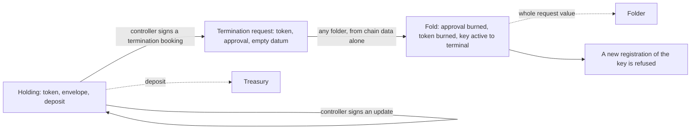

# Update a holding and permanently terminate its key on the proved design

Issue 743, part of epic 731. This page is for an open-datum user, for an author of another application, and for the
people who review the pull requests. It records the story, the requirements, the refusals and the checks that prove them.
It continues [the registration ticket](../742-create-register-no-pin/spec.md).

## Story

As an open-datum user, I update my registered key's payload without any registry fold, then book its permanent
termination. My deposit goes to the treasury at booking. Any folder burns the key's token in a fold and is paid the
request's whole value, and the key can never be registered again in that registry. The current contract line is gone
from the epic branch, and the new commands carry the established names.

## What the two validators promise

| Part | Promise |
| --- | --- |
| Holding update | The controller signs; the holding is recreated at the open-datum address with the same protected control, exactly the same tokens and at least the deposit; only the payload may change. No registry fold takes part. |
| Termination booking | The controller signs; the application mints one termination approval naming the key and the registry (state policy and name); the active token moves out of the holding into a termination request at the open-datum address holding exactly the token and the approval, with an empty datum; the transaction's treasury donation is exactly the holding's deposit. Singular takes no part. |
| Termination request | It is spent only in a transaction that burns its active token, under the state policy, and burns its approval. Anyone may spend it so; the folder takes its whole value. |
| Termination fold | Singular burns a key's active token only in a fold of that registry that consumes and burns the matching termination approval, shows the key active in the trie and leaves it terminal; nothing else moves under the state policy. Singular routes no money. |
| Mixed fold | One fold may carry registrations and terminations of distinct keys; every key outside the changes keeps its leaf. |
| Supply and history | A live token of a key exists exactly when its leaf is active; at most one exists; a burn happens only in a terminating fold of that registry; a terminal key is never minted again, in that registry or through another. |
| No stuck termination | A booked termination is foldable by anyone from chain data alone. |
| Money | The deposit goes to the treasury at booking; the folder takes the termination request's whole value. |
| Hashed names | The termination approval preimage is CBOR (Plutus Data serialisation), pinned by byte vectors that off-chain encoders reproduce. |

The binding Lean statements are listed in [the plan](plan.md#lean-binding); they come from the aligned models of issue 741.

## Requirements

- validators-follow-the-model: the two validators implement the aligned Lean statements for the holding update, the
  termination booking, the termination request, the termination fold and supply and history; each statement has an
  executable check that has been seen to fail.
- devnet-update-termination-journey: through the packaged commands on a development network, continuing the
  registration journey: update the payload; book the termination, and the deposit reaches the treasury; a second wallet
  folds it from chain data alone, the token is burned and the folder is paid the request's value; a new registration of
  the same key is refused.
- fold-from-public-data: the termination fold is built and signed by a wallet that is not the controller's, from chain
  data alone: no file, key or record from the controller.
- devnet-termination-refusals: on a development network, each of these is refused, each beside a passing control: a burn
  without a fold of that registry; a fold moving another key; a termination fold without the approval; spending the
  termination request without burning its token.
- conformance-old-versus-new: the conformance suite states the old and new outcome of the update and termination
  journeys in requirement language, with the decided differences: the deposit goes to the treasury at booking and the
  folder takes the termination request's whole value.
- current-line-removed: the current contract line leaves the epic branch in this change set: its validators, builders,
  commands, hosted jobs and Lean models; the new commands move onto the established `singular registry` and
  `open-datum` command names; the documentation follows.
- preimage-bytes-pinned: the termination approval preimage has byte vectors reproduced by the on-chain and off-chain
  encoders.
- interrupted-commands-keep-identity: cancellation and uncertain submission preserve the transaction identity; no
  command resubmits on its own.
- hosted-checks-green: hosted checks are green on each pull request into the epic branch.

## Refusals

| Attempt | Refused by | Seen on |
| --- | --- | --- |
| A burn of an active token with no fold of that registry | Singular | validator test and devnet |
| A termination fold whose trie change moves another key than the approval names | Singular | validator test and devnet |
| A termination fold without the matching termination approval consumed and burned | Singular | validator test and devnet |
| Spending a termination request without burning its active token | open datum | validator test and devnet |
| A termination fold whose trie proof does not show the key active | Singular | validator test |
| A registration of a terminal key | Singular (trie proof) | validator test and devnet |
| A termination booking or an update not signed by the controller | open datum | validator test |
| A termination booking whose request holds anything but the token and the approval, or a datum | open datum | validator test |
| A termination booking whose treasury donation is not the holding's deposit | open datum | validator test |
| An update that changes the protected control, adds or drops a token, or leaves less than the deposit | open datum | validator test |

## Out of scope

The reader (issue 744), the preimage specification command (issue 745), batch folding limits (issue 746), integration
into `main` and release (issue 747), the trie library itself, and the paused protected-rejection work (issues 498 and
529). Registration, its builders, commands and journey are issue 742's; this ticket continues them.
