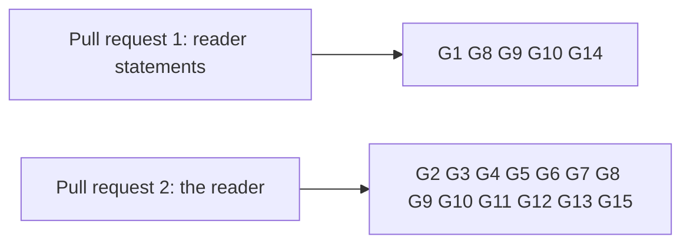

# Gate for reading a key from the registry address

Issue 744. This page is for the commit owner, the auditor and the reviewers: each acceptance item, the hosted job and the
verbatim command that proves it, and what each pull request must show. The requirements are in
[the specification](spec.md) and the pull requests in [the plan](plan.md#pull-requests-and-slices).

## Rows

The ticket owner's table, written before the auditor's. The auditor writes its own table independently when it is seated;
the ticket owner joins the two once, records both input hashes and freezes the result in the runtime root before the
commit owner starts. Every command is an existing hosted command, or one this ticket adds to a hosted job and marks
"CI change in this ticket".

| Row | Acceptance it proves | Hosted job | Verbatim command | Expected exit |
| --- | --- | --- | --- | --- |
| G1 | the reader statements, if added, proved and in the models' inventories; the models the reader stands on still build | ci.yml `dev-shell-checks` | `nix develop --quiet -c just application-held-model`; `nix develop --quiet -c just open-datum-application-held-model` | 0 |
| G2 | the reader library (each conclusion and refusal), the network read, rows and bytes per call, the release table rows and the current build's row, singular help and parser rows | registry.yml `cage-tests` | `nix run --quiet .#cage-tests` in `offchain/` | 0 |
| G3 | open datum still builds and passes over the changed session; its reading host, if ruled, with help and parser rows | ci.yml `open-datum-tests` | `nix run --quiet .#open-datum-tests` in `applications/open-datum/offchain/` | 0 |
| G4 | the packages build | ci.yml `offchain-component-build`, `open-datum-component-build` | `nix build --quiet .#component-build` in `offchain/` and in `applications/open-datum/offchain/` | 0 |
| G5 | the Singular package names no application | ci.yml `offchain-component-build` | `nix run --quiet .#application-separation-check`; `nix run --quiet .#application-separation-controls` | 0 |
| G6 | the provider change stays inside the provider layer | ci.yml `dev-shell-checks` | `nix develop --quiet -c just node-confinement`; `nix develop --quiet -c just node-confinement-controls`; `nix develop --quiet -c just io-ownership-check`; `nix develop --quiet -c just io-ownership-controls` | 0 |
| G7 | documented flags of the new command | registry.yml `cli-flags` | `nix run --quiet .#cli-flags-check`; `nix run --quiet .#cli-flags-controls` | 0 |
| G8 | pages, diagrams and speech | ci.yml `rendered-docs`, `dev-shell-checks` | `nix run --quiet .#docs-check`; `nix develop --quiet -c just check-presentation` | 0 |
| G9 | lint and format of touched paths | ci.yml `dev-shell`, `offchain-lint`; conformance.yml `format-check` | `nix develop --quiet -c just lint`; `(cd offchain && nix run --quiet .#lint)`; `nix run --quiet .#format-check` | 0 |
| G10 | the reading rows and the coverage ratchet | conformance.yml `conformance-checks`, `coverage-gate` | `nix run --quiet .#conformance-appendix-tests`; `nix run --quiet ./conformance#coverage-gate -- --root . ratchet` | 0 |
| G11 | live, pending termination, terminal and never registered through the packaged command, the measured lookup with a second registry's holdings at the same address | registry.yml `no-pin-registration-journey`, extended (CI change in this ticket) | `nix run --quiet .#no-pin-registration-journey` | 0 |
| G12 | wrong network, unknown state policy and provider failure refused on a development network, each beside its passing control | registry.yml `no-pin-registration-refusals`, extended, or a new job of the same shape (CI change in this ticket) | `nix run --quiet .#no-pin-registration-refusals`, or the new job's app | 0 |
| G13 | the provider change keeps the provider contract | registry.yml `contract` | `nix run --quiet .#contract-tests` and `nix run --quiet .#contract-external` in `offchain/`, each with its `CONTRACT_RESULTS` file as the job sets it | 0 |
| G14 | the root model, if a reader statement touches it | ci.yml `model` | `nix run --quiet .#model-check` | 0 |
| G15 | the new command is in the packaged executable | ci.yml `open-datum-singular-smoke` | `nix run --quiet .#singular -- --help` in `applications/open-datum/offchain/` | 0 |

Rows run scoped to what each slice can break. `just ci` runs once on the final candidate of each pull request, then the
push; hosted checks on the pull request head are the net. Every build or test runs in a named, memory-capped scope:
`systemd-run --user --scope --unit=t744-<what>-<n> -p MemoryMax=24G timeout 3600 <command>`.

## Rows per pull request

## Evidence the pull requests will carry

- per conclusion and refusal: the test that executes it, the hosted step that runs it, and the RED run that showed it fail;
- if pull request 1 is ruled: each reader statement, the checkpoint that reviewed it before its proof, and its proof;
- the journey job's receipt: the four answers with their keys and the registry address, and the measured lookup (calls,
  rows, bytes) with the number of other holdings at the application's address;
- the refusals job's receipt: each refusal and its control;
- left uncovered, stated in the pull requests: member enumeration, browser delivery, batch limits (issue 746), release
  (issue 747), the network read of the other chain commands (issue 729).

## Synthesis

The ticket owner's table and the auditor's independent table (auditor-1, `handoffs/gate-table.md`, written without
reading this page) were joined once on 28 October 2026. The auditor's table added the provider contract suites (G13),
the root model check (G14), the presentation check (G8) and the packaged-executable smoke (G15). It marked the devnet
reading steps and refusals as needing new jobs; they are carried by extending the existing no-pin journey and refusals
jobs, or by a new job of the same shape, as a CI change in this ticket. The refusal of a token at the state address is a
unit test: no accepted transaction places the token there, so no devnet run can show it. The frozen table and both input
hashes are in the ticket's runtime root.
