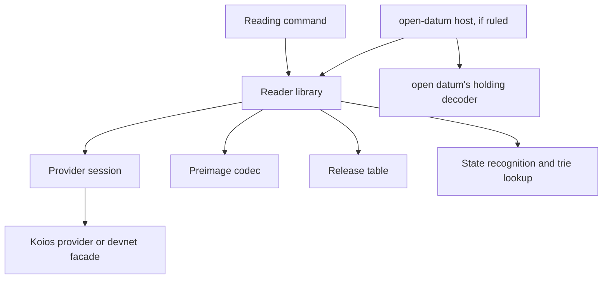

# Modules for reading a key from the registry address

Issue 744. This page places the new and changed code and fixes its dependency direction. Records are in
[the data model](data-model.md) and signatures in [the functions model](functions-model.md).

## Changed components

| Component | Change | Depends on | Must not depend on |
| --- | --- | --- | --- |
| Reader statements, in `models/singular-application-held` and `models/open-datum-application-held` (only if the first open question says so) | one reader definition over observed evidence and its statements | the models' identity, history, recognition and custody definitions | any implementation code |
| Provider session, `offchain/local-services/Singular/Registry/LedgerProvider.hs` | a read of the network the provider serves | — | any application |
| Koios provider and the private devnet facade | answer the network read; report the size in rows and bytes of every answer to the trace | the session | any application |
| Provider trace, `offchain/local-services/Singular/Registry/ProviderTrace.hs` and `Trace.hs` | rows and bytes per call, so a command can total its query work | the session | — |
| Release table, `offchain/local-services/Singular/Registry/ContractTable.hs` and its data file | rows from an applied state policy to the application's policy and script and their releases | the address codec | any application's code or name in Haskell source |
| Reader library, a new module beside `offchain/lib/Singular/State/` | address and key to a conclusion or a refusal | the session, the preimage codec, the release table, the state recognition and the trie lookup the fold already uses | any application module |
| Reading command or commands | per the second open question | the reader library, the settings and trace plumbing of the existing commands | — |
| Devnet journey and refusals | reading steps and refusals with controls | the packaged executables | test-only controls in ordinary builds |
| Conformance suite and user documentation | the reading rows and pages | the journey receipts | — |

Paths are proposals. When the Lean models name a component differently, the code takes the model's name, and the mandate
is versioned before the slice that creates it starts.

## Dependency direction

The Singular package names no application: the reader identifies the application by policy and script hashes from the
release table, and an application that decodes its own holding hosts the reader from its own package.
