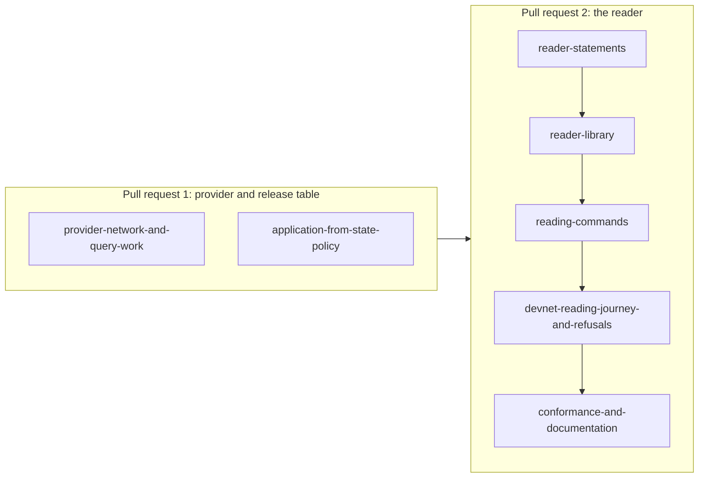

# Plan for reading a key from the registry address

Issue 744. This page is for the people who implement and review the pull requests. It binds the model, the rulings, the
pull requests and their slices, the answered questions and the seats. The story and the requirements are in
[the specification](spec.md); the checks are in [the gate](gate.md).

## Lane

| Field | Value |
| --- | --- |
| Repository and worktree | lambdasistemi/singular, /code/singular-issue-744 |
| Branch | feat/744-registry-reader from `main` deb4b5c99 (the 0.17.0 release); one branch per later pull request, each from `main` once its predecessor merged |
| Pull request target | `main` (the epic branch is retired) |
| Constitution | `.specify/memory/constitution.md` as on the base |
| Change class | changes behaviour (a new command, conformance claims, possibly the Lean models): ticket owner, commit owner and a persistent mute auditor |

## Lean binding

Lean is the authority. The code takes the models' vocabulary: `PublishedRelease`, `Preimage.active`, `activeAsset`,
`stateAsset`, `recognizeState`, `trieGet`, `Leaf.unknown`, `State.active`, `State.terminal`, open datum's `liveShape`
and its termination request shape.

| Family | Lake project | Statements the reader stands on |
| --- | --- | --- |
| Identity | `models/singular-application-held`, `just application-held-model` | `registry_identity`, `registry_unique`; `activeAsset` names the live token from the whole registry identity and the key |
| Supply and history | the same project, `HistoryClaims` | `supply_in_step` (a live token exists exactly when the key's leaf is active), `one_live_token`, `burn_only_terminating_fold`, `no_remint_after_terminal` |
| State recognition | the same project, `Statements` | `active_role_never_state`, `minted_active_never_state`, `fold_minted_outputs`: an output carrying the active token is never recognised as the state |
| Custody | `models/open-datum-application-held`, `just open-datum-application-held-model` | `liveShape`, `liveUpdate_inversion` (a live holding stays at the application's script with the same control and tokens), the termination request shape, `termination_burn` |

No Lean declaration stated what a reader may conclude from an observation, and issue 741 left its observation tasks to
this ticket. By [the first answer](#answered-questions) this ticket adds them to the application-held models: one reader
definition over the observed evidence, returning live holding, pending termination, terminal, never registered,
unavailable, or refused (token outside application custody, foreign state policy), with statements that each answer
implies its leaf and custody in every reachable world, that an empty or failed read never yields never registered or
terminal, and that those two need the authenticated leaf, read as the trie lookup it is. The statements are reviewed at
a checkpoint before their proofs; the reader's classification code binds to them by name.

## Rulings in force

- Registry identity (issue 741 decisions, approvals bind the complete registry asset identity): a registry is its state
  policy and its state token name; the registry address of issue 728 spells exactly these two with the network.
- Reader starting point (epic owner, 2026-10-24): the reader starts from the registry
  identity as the registry address spells it; absence of a token is not proof the key is unused.
- Hashed names (ruling 2026-10-23, CBOR preimages): the active token's name is the hash of the CBOR preimage of the active
  role, the registry identity and the key; the reader computes it with the shared preimage codec.
- Application-held termination (2026-10-23): a pending termination's request and token stay at the application's script.
- The provider is the chain entry point (2026-10-20): every chain read goes through the session; a reader works from a
  web page, Koios and a wallet, with no local file.
- The trie library's proofs are assumed sound.

## Pull requests and slices

| Pull request | Slice | Delivers | Requirements |
| --- | --- | --- | --- |
| 1 | provider-network-and-query-work | the session reads the provider's network; the provider trace records rows and bytes per call so a command can report its query work | refusals-never-absence, query-work-measured |
| 1 | application-from-state-policy | the release table gains rows from an applied state policy to its application's policy and script and their releases; the current build's row is checked present, with a control | application-from-state-policy |
| 2 | reader-statements | one reader definition over the observed evidence and its statements: each answer implies its leaf and custody in every reachable world; a failed or empty read never yields terminal or never registered; terminal and never registered need the recognised state; statements reviewed at a checkpoint before their proofs; the models' statement inventories and their consumers updated | reader-follows-the-model |
| 2 | reader-library | the application-neutral reader: address and key to a conclusion or a refusal, one asset query when live, the recognised state and the key's leaf otherwise | reader-follows-the-model, one-asset-query-when-live, full-classification-when-absent, refusals-never-absence |
| 2 | reading-commands | `singular registry inspect` (classification, application identity, the holding's datum as plain data) and `open-datum inspect` (the same library, plus the decoded control, deposit and payload by name), each with help snapshots, parser rows, documented flags | reader-follows-the-model |
| 2 | devnet-reading-journey-and-refusals | reading steps in the journey job (live, pending termination, terminal, never registered, the measured lookup with a second registry's holdings at the same address) and the refusals with controls | devnet-reading-journey, devnet-reading-refusals, query-work-measured |
| 2 | conformance-and-documentation | the reading rows in the conformance suite, the command reference and the user page | conformance-and-documentation |

Each slice finishes in well under two hours with its own RED evidence and checkpoints; the commit owner may cut a slice
smaller, never merge two. Pull request 1 carries the two slices that needed no answer; pull request 2 starts from its head.

## Consumers to run before the first push

- a provider-layer change reaches open datum, conformance and node confinement: their tests run in the gate;
- a new command reaches help snapshots, parser corpora, the documented flags check and the command reference;
- a release table change reaches the table's freshness check and its control;
- a Lean change reaches the models' check inventories, audits and their recipes.

## Answered questions

| Question | Answer (epic owner, 2026-10-28) |
| --- | --- |
| Does this ticket add the reader's Lean statements first? | yes: in the application-held models, before the classification code; the auditor's checkpoint on the statements before their proofs is the review issue 741's task asked for |
| Which command hosts the reader, and who decodes the holding? | both: `singular registry inspect` prints the holding's datum as plain data; `open-datum inspect` hosts the same library and prints the decoded control, deposit and payload; the library names no application |

## Seats

Operator, 2026-10-28, as issue 743's team: Claude Opus 5.5 high ticket owner; commit owner Codex gpt-6.1-sol high; commit
auditor Muse xhigh, mute and persistent, in a read-only audit worktree. No other seats. The auditor writes its own gate
table when seated; the ticket owner joins the two once and freezes the result before the commit owner starts.
