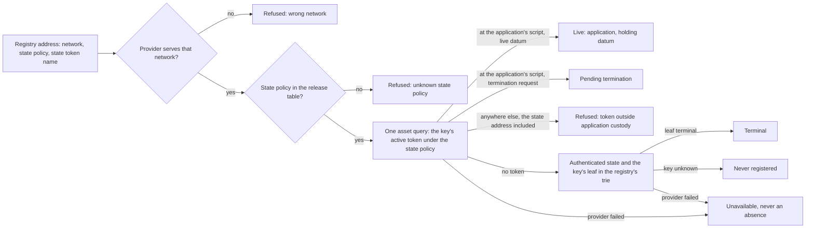

# Read a key and identify its application from the registry address

Issue 744, part of epic 731. This page is for a reader of a registry (an integrator such as Cardano KERI, an open-datum
user) and for the people who review the pull requests. It records the story, the requirements, the refusals and the
checks that prove them. It follows [the update and termination ticket](../743-update-terminate-no-pin/spec.md).

## Story

As a reader, I give a registry's address and a key, and I learn whether the key is live in that registry, which
application it belongs to, and what its holding says, with one asset lookup and without trusting anything a creator
wrote.

## What the reader answers

The five conclusions are those of [issue 741's specification](../741-no-pin-model/spec.md#understand-what-a-reader-can-conclude-priority-p1);
the evidence each needs follows [the observation contract](../741-no-pin-model/contracts/model-observations.md).

| Answer | Evidence the reader requires | Never concluded from |
| --- | --- | --- |
| Live | the key's active token, named by the reader from the registry identity and the key, under the state policy, held by one output at the application's script whose datum is a live holding of that registry and key | a token of another name, another policy, or a datum alone |
| Pending termination | the same token held by a termination request at the application's script | the token having left the holding |
| Terminal | no live token, and the registry's state, recognised under the state policy, whose trie holds the key's leaf as terminal | a missing token alone |
| Never registered | no live token, and the registry's authenticated trie holds no leaf for the key | a missing token alone |
| Unavailable | a provider read failed or returned an incomplete answer | — it is never reported as an absence |

The application is identified by the state policy: the state validator is applied to the application's policy, so each
state policy belongs to one application, and the release table names it with its releases. The holding's datum is read
and printed; how far it is decoded by application rules is [an open question](plan.md#open-questions).

## Requirements

- reader-follows-the-model: the reader's conclusions implement the Lean statements this ticket binds
  ([the plan](plan.md#lean-binding)); each conclusion and each refusal has an executable check seen to fail.
- one-asset-query-when-live: a live key is answered with exactly one asset query to the provider, with no scan of the
  application's address and no read of the registry's history.
- full-classification-when-absent: with no live token, the reader recognises the registry's state under the state policy
  and reads the key's leaf in its trie; terminal and never registered are distinguished there and nowhere else.
- application-from-state-policy: the application and its releases are named from the state policy through the release
  table; the current build's applied state policy has its row.
- refusals-never-absence: wrong network, unknown state policy, a token outside application custody (the state address
  included) and provider failure each produce a named refusal, never an absence and never a conclusion.
- query-work-measured: the calls, rows and bytes of a known-key lookup are recorded on a development network where the
  application's address holds other registries' holdings, and published.
- devnet-reading-journey: on a development network, through the packaged command, the reader answers live, pending
  termination, terminal and never registered for keys of the journey, from the registry address alone.
- devnet-reading-refusals: on a development network, each refusal above beside a passing control.
- conformance-and-documentation: the conformance suite carries the reading rows in requirement language, and the user
  documentation describes the command, in the same change.
- hosted-checks-green: hosted checks green on each pull request into `main`.

## Refusals

| Attempt | Answer | Seen on |
| --- | --- | --- |
| The address names one network and the provider serves another | refused, naming both networks and the provider | unit test and devnet |
| The address's state policy has no row in the release table | refused, naming the policy | unit test and devnet |
| The key's active token is held at the state address | refused: token outside application custody | unit test and devnet |
| The key's active token is held anywhere else than the application's script | refused: token outside application custody | unit test |
| Two outputs, or a quantity other than one, of the key's active token | refused: conflicting evidence | unit test |
| A provider read fails, times out or returns an incomplete page | unavailable, naming the read | unit test and devnet |
| An output at the state address carrying the state token with more assets or another datum | not recognised as the state; the reader answers unavailable, never terminal or never registered | unit test |

## Out of scope

Registry member enumeration, browser delivery (issues 580, 738), general reference discovery (issues 355, 473), batch
limits (issue 746), integration and release (issue 747). The network read for every other chain command stays with
issue 729; this ticket reads it for the reader.
