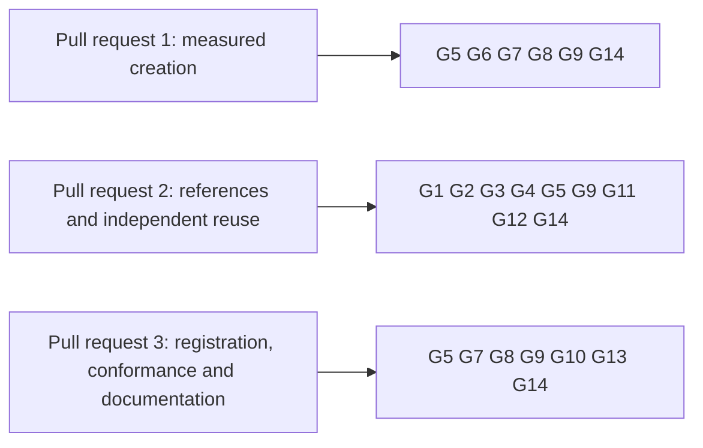

# Gate for creating registries on shared script publications

Issue 745. This page is for the commit owner, the auditor and the reviewers: each acceptance item, the hosted job and
the verbatim command that proves it, and what each pull request must show. The requirements are in
[the specification](spec.md) and the pull requests in [the plan](plan.md#pull-requests-and-slices).

## Rows

Two tables were written independently and joined once on 29 October 2026 (see [the synthesis](#synthesis)). Every command
is an existing hosted command, or one this ticket adds to a hosted job and marks "CI change in this ticket". Every row
expects exit 0; a control's inner command must fail on purpose, and the enclosing control command exits 0 only after
seeing it fail.

| Row | Acceptance it proves | Hosted job (check-run name) | Verbatim command | Expected exit |
| --- | --- | --- | --- | --- |
| G1 | the library and the creation command: each reference outcome of the specification (reused, published, missing, spent, wrong script, another application policy or release) with its receipt and its control; the provider's claim of a hash is never taken for the hash | registry.yml `cage-tests` ("Off-chain registry and command tests") | `nix run --quiet .#cage-tests` in `offchain/` | 0 |
| G2 | open datum still builds and passes over the changed library | ci.yml `open-datum-tests` ("Open-datum tests") | `nix run --quiet .#open-datum-tests` in `applications/open-datum/offchain/` | 0 |
| G3 | the packages build | ci.yml `offchain-component-build`, `open-datum-component-build` | `nix build --quiet .#component-build` in `offchain/` and in `applications/open-datum/offchain/` | 0 |
| G4 | the Singular package names no application | ci.yml `offchain-component-build` | `nix run --quiet .#application-separation-check`; `nix run --quiet .#application-separation-controls` | 0 |
| G5 | the journey: the first creation, a later creation, a creator that never published creating from an empty state directory and discovering both live copies, a registry created from live copies booked and folded by a second wallet from chain data alone, the candidate leg of the creation measurement and the carrying attempt, no witness publication or witness configuration in any leg | registry.yml `no-pin-registration-journey` ("No-pin registration, update and termination through the packaged commands"), extended (CI change in this ticket) | `NO_PIN_JOURNEY_RESULTS="$RUNNER_TEMP/no-pin-journey-results-$GITHUB_RUN_ID-$GITHUB_RUN_ATTEMPT" nix run --quiet .#no-pin-registration-journey` | 0 |
| G6 | the committed measurement receipts of both designs are valid and agree with the page: every published figure is recomputed from the receipts, both legs name the same parameters and workload, fees and locked ADA are separate totals, and an altered figure is refused | a hosted job that already runs the documentation or repository checks (`rendered-docs` or `dev-shell-checks`), wired by the slice (CI change in this ticket) | the repository's check named by the slice that adds it | 0 |
| G7 | documented flags and commands of every page this ticket adds | registry.yml `cli-flags` ("Documented CLI flags and refusal controls") | `nix run --quiet .#cli-flags-check`; `nix run --quiet .#cli-flags-controls` | 0 |
| G8 | pages, diagrams and speech | ci.yml `rendered-docs` ("Rendered documentation"), `dev-shell-checks` | `nix run --quiet .#docs-check`; `nix develop --quiet -c just check-presentation` | 0 |
| G9 | lint and format of touched paths | ci.yml `dev-shell`, `offchain-lint`; conformance.yml `format-check` | `nix develop --quiet -c just lint`; `(cd offchain && nix run --quiet .#lint)`; `nix run --quiet .#format-check` | 0 |
| G10 | the reuse rows are stated in the suite's description language and computed from receipts; the previous rows stay exactly as they were; typed success and dropped claims are refused | conformance.yml `conformance-checks` ("Conformance checks without a devnet") and `coverage-gate` | `nix run --quiet .#conformance-appendix-tests` in `conformance/`; `nix run --quiet .#conformance -- list` in `conformance/`; `bash test/ci/registration-journey-rows.sh` and `bash test/ci/registration-journey-rows-control.sh` as the job runs them; `nix run --quiet ./conformance#coverage-gate -- --root . ratchet` | 0 |
| G11 | the commands stay in the packaged executable | ci.yml `open-datum-singular-smoke` | `nix run --quiet .#singular -- --help` in `applications/open-datum/offchain/` | 0 |
| G12 | recovery over shared publications: interruption before and after a publication and after an uncertain creation; no automatic resubmission, a stable registry identity, conserved funding; a repeated command publishes only what is no longer live | registry.yml `cli-recovery-partition` ("CLI recovery — partition"), the partitions the slice extends (CI change in this ticket) | `DEMO1_KEEP_SCRATCH=1 nix run --quiet .#cli-recovery-partition -- '<partition key>'` | 0 |
| G13 | the creation and reuse instructions and the new pages are in the packaged release | ci.yml `release-artifacts` ("On-chain release assembly and artifact checks") | `nix run --quiet .#release-artifacts -- "$RUNNER_TEMP/release"`; `nix run --quiet .#verify-release-controls -- "$RUNNER_TEMP/release"`; `nix run --quiet .#verify-release -- --assets "$RUNNER_TEMP/release" --without-bundles "v$(cat version.txt)"` | 0 |
| G14 | every app and check the flake declares is named by a hosted step or carries a reasoned entry; this ticket adds no unhosted check | ci.yml `declared-checks-hosted` ("Declared checks are hosted") | `nix run --quiet .#declared-checks-classify-controls`; `nix run --quiet .#declared-checks-issue-states "$RUNNER_TEMP/issue-states.txt"`; `nix run --quiet .#declared-checks-hosted "$RUNNER_TEMP/issue-states.txt"` | 0 |

Rows run scoped to what each slice can break. `just ci` runs once on the final candidate of each pull request, then the
push; hosted checks on the pull request head are the net. Every build or test runs in a named, memory-capped scope:
`systemd-run --user --scope --unit=t745-<what>-<n> -p MemoryMax=24G timeout 3600 <command>`.

## Rows per pull request

## Evidence the pull requests will carry

- per outcome of the specification: the test that executes it, the hosted step that runs it, and the run in which it
  failed before the change;
- the measurement receipts of both designs with revision, parameters and every transaction, and the page that is read
  from them;
- the carrying attempt: the attempted transaction, its size and its execution evaluation against the same frozen limits;
  a size estimate alone does not show that a transaction fits;
- the journey's receipts: the independent creator's creation and the registration on a registry created from live
  copies;
- left uncovered, stated in the pull requests: public discovery of references for everyone (issues 355 and 473), batch
  limits (issue 746), release (issue 747); and the existing registration rows that stay uncovered for want of a
  comparison with the application-held model, which this ticket does not turn into coverage.

## Synthesis

The ticket owner's table and the auditor's independent table, written without reading this page, were joined once on
29 October 2026. The auditor's table added the creation-recovery partitions (G12), the conformance row checks (G10) and
the release packaging check (G13), and named seven places where an existing job needs an extension, which are carried by
G1, G5, G6, G10 and G12 as changes in this ticket. The frozen table and both input hashes are kept with the ticket's
working records. Rows are added to a later version of this table, never edited. Version 2 added G14, the census of hosted checks, after a hosted run showed that neither first table had it.
