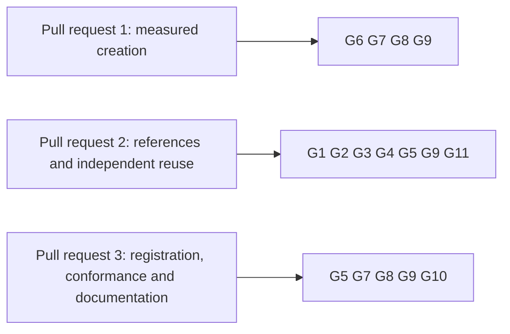

# Gate for creating registries on shared script publications

Issue 745. This page is for the commit owner, the auditor and the reviewers: each acceptance item, the hosted job and
the verbatim command that proves it, and what each pull request must show. The requirements are in
[the specification](spec.md) and the pull requests in [the plan](plan.md#pull-requests-and-slices).

## Rows

The ticket owner's table, written before the auditor's. The auditor writes its own table independently when it is seated;
the ticket owner joins the two once, records both input hashes and freezes the result in the runtime root before the
commit owner starts. Every command is an existing hosted command, or one this ticket adds to a hosted job and marks
"CI change in this ticket".

| Row | Acceptance it proves | Hosted job | Verbatim command | Expected exit |
| --- | --- | --- | --- | --- |
| G1 | the library: reference outcomes (reused, published, missing, spent, wrong script, another policy), the creation command's receipts, recovery and repeat invocation, each beside its control | registry.yml `cage-tests` | `nix run --quiet .#cage-tests` in `offchain/` | 0 |
| G2 | open datum still builds and passes over the changed library | ci.yml `open-datum-tests` | `nix run --quiet .#open-datum-tests` in `applications/open-datum/offchain/` | 0 |
| G3 | the packages build | ci.yml `offchain-component-build`, `open-datum-component-build` | `nix build --quiet .#component-build` in `offchain/` and in `applications/open-datum/offchain/` | 0 |
| G4 | the Singular package names no application | ci.yml `offchain-component-build` | `nix run --quiet .#application-separation-check`; `nix run --quiet .#application-separation-controls` | 0 |
| G5 | the journey: the first creation, a later creation, the independent creator's creation from an empty state directory and a registration on a registry created from live copies, with the creation measurement for the candidate | registry.yml `no-pin-registration-journey`, extended (CI change in this ticket) | `nix run --quiet .#no-pin-registration-journey` | 0 |
| G6 | the measurement page agrees with its committed receipts, and the candidate leg of the receipt agrees with the journey's | ci.yml `dev-shell-checks`, or the journey job (CI change in this ticket) | the repository's check named by the slice that adds it | 0 |
| G7 | documented flags and commands of every page this ticket adds | registry.yml `cli-flags` | `nix run --quiet .#cli-flags-check`; `nix run --quiet .#cli-flags-controls` | 0 |
| G8 | pages, diagrams and speech | ci.yml `rendered-docs`, `dev-shell-checks` | `nix run --quiet .#docs-check`; `nix develop --quiet -c just check-presentation` | 0 |
| G9 | lint and format of touched paths | ci.yml `dev-shell`, `offchain-lint`; conformance.yml `format-check` | `nix develop --quiet -c just lint`; `(cd offchain && nix run --quiet .#lint)`; `nix run --quiet .#format-check` | 0 |
| G10 | the reuse rows computed from receipts, and the coverage ratchet | conformance.yml `conformance-checks`, `coverage-gate` | `nix run --quiet .#conformance-appendix-tests`; `nix run --quiet ./conformance#coverage-gate -- --root . ratchet` | 0 |
| G11 | the new command surface stays in the packaged executable | ci.yml `open-datum-singular-smoke` | `nix run --quiet .#singular -- --help` in `applications/open-datum/offchain/` | 0 |

Rows run scoped to what each slice can break. `just ci` runs once on the final candidate of each pull request, then the
push; hosted checks on the pull request head are the net. Every build or test runs in a named, memory-capped scope:
`systemd-run --user --scope --unit=t745-<what>-<n> -p MemoryMax=24G timeout 3600 <command>`.

## Rows per pull request

## Evidence the pull requests will carry

- per outcome of the specification: the test that executes it, the hosted step that runs it, and the run in which it
  failed before the change;
- the measurement receipts of both designs with revision, parameters and every transaction, and the page that is read
  from them;
- the carrying attempt's receipt: script sizes, transaction sizes and limits, and the outcome;
- the journey's receipts: the independent creator's creation and the registration on a registry created from live
  copies;
- left uncovered, stated in the pull requests: public discovery of references for everyone (issues 355 and 473), batch
  limits (issue 746), release (issue 747).

## Synthesis

Pending: the auditor's independent table, written without reading this page, is joined to this one before the commit
owner starts. Both input hashes and the frozen table are kept with the ticket's working records.
