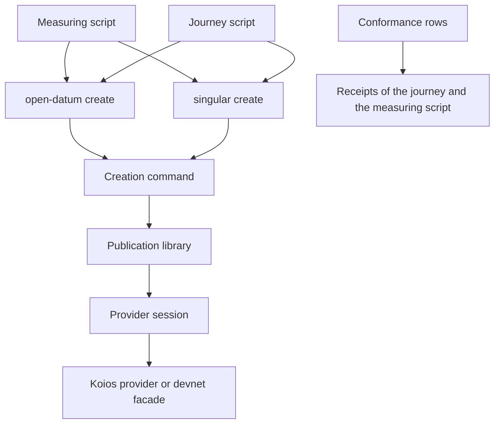

# Modules for creating registries on shared script publications

Issue 745. This page places the new and changed code and fixes its dependency direction. Records are in
[the data model](data-model.md) and signatures in [the functions model](functions-model.md).

## Changed components

| Component | Change | Depends on | Must not depend on |
| --- | --- | --- | --- |
| Publication library, `offchain/lib/Singular/State/Publication.hs` | classifies each candidate reference (live, missing, spent, wrong script) and keeps the reason; the check stays the hash of the carried script | the session | any application |
| Creation command, `offchain/cli/src/Singular/CLI/State.hs` | prints the reference outcomes in its receipt; no new flag unless a question is answered otherwise | the publication library | any application |
| Open-datum creation, `applications/open-datum/offchain/src/Singular/Application/OpenDatum/Registration.hs` | follows the library's receipt | the creation command | — |
| Measuring script, a new file under `tools/` beside the journey scripts | runs the creation twice for each design and writes one receipt per leg | the packaged executables, the development network | test-only controls in ordinary builds |
| Journey script, `tools/no_pin_registration_journey.sh` | gains an independent creator's leg and a registration on a registry created from live copies | the packaged executables | — |
| Conformance rows and the user pages | the reuse rows and the creation pages | the journey and measurement receipts | typed figures: every number is read from a receipt |

Paths are proposals. When the Lean models name a component differently, the code takes the model's name.

## Dependency direction

The Singular package names no application: the creation command receives the application's scripts from the program
that hosts it, as it does today.
