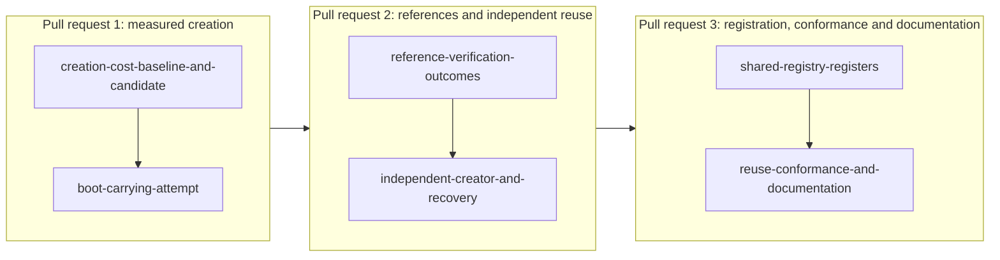

# Plan for creating registries on shared script publications

Issue 745. This page is for the people who implement and review the pull requests. It binds the model, the rulings, the
pull requests and their slices, the consumers a slice can break and the seats. The story and the requirements are in
[the specification](spec.md); the checks are in [the gate](gate.md).

## Lane

| Field | Value |
| --- | --- |
| Repository and worktree | lambdasistemi/singular, /code/singular-issue-745 |
| Branch | feat/745-shared-publications from `main` a5bde203a (after pull request 768); one branch per later pull request, each from `main` once its predecessor merged |
| Pull request target | `main` (the epic branch is retired) |
| Constitution | `.specify/memory/constitution.md` as on the base |
| Change class | changes behaviour (creation transactions, conformance claims): ticket owner, commit owner and a persistent mute auditor |

## What already exists on main

Issue 742 shipped the publication library (`Singular.State.Publication`): the first registry of an application publishes
the state script and the application script, each in a transaction of its own; a later registry finds the live copies by
script hash and sends the creation alone. Its devnet journey already records a creation measurement of three
transactions for the first registry and one for a later one. This ticket does not rebuild that. It owes what the issue
still asks for and the journey does not show:

- a matched baseline against the previous design, with every transaction, reference output, script size, fee and locked
  ADA;
- explicit, receipted outcomes for a missing, spent or wrong reference, and for another application policy or release;
- the measured attempt to carry a script in the creation transaction;
- reuse by a creator who never published and holds no file of an earlier creator;
- a registry created on live copies completing a registration;
- the instructions and the receipt-computed conformance rows for all of it.

## Lean binding

Lean is the authority. This ticket adds no Lean statement and changes no on-chain script, hash or wire format. Creation
stays bound to the statements issue 742 implements: `genesis_inversion`, `recognition_inversion` and the
`create_journey` money statement of the Singular family, and `configurationCreate_inversion` and
`configuration_immutable` of the open-datum family (Lake projects `models/singular-application-held` and
`models/open-datum-application-held`). If a measurement shows a statement cannot be met, or a requirement here needs a
statement the models lack, the ticket owner files a question with a user story before work on that line continues.

## Rulings in force

- Registry identity is the state policy and the state token name (issue 741 decisions). The state script is the state
  validator applied to the application's policy; the application script takes no registry parameter.
- The request lifecycle belongs to the application (23 October 2026): no per-registry request script exists on this line.
- Roles (issue 767, 28 October 2026): folders and readers are application-neutral; creators and key holders may use the
  application's program. This ticket adds no per-application code to a neutral role.
- The provider is the chain entry point (20 October 2026): every chain read goes through the session; a creator works
  from a web page, Koios and a wallet, with no local file of another creator.
- Versioning: stay 0.x; no script hash changes in this ticket.
- Wallets for any preprod work live in `~/.local/share/singular-demo/preprod/`; the default network is the development
  network.
- The trie library's proofs are assumed sound.

## Pull requests and slices

| Pull request | Slice | Delivers | Requirements |
| --- | --- | --- | --- |
| 1 | creation-cost-baseline-and-candidate | a measuring script that runs a first and a later creation on a development network for the previous design (a worktree at the last revision that has it) and for the candidate, on the same frozen parameters, and writes one receipt per leg; a published page of the measured figures, with the receipts committed beside it; the hosted journey keeps checking the candidate leg | creation-cost-measured, no-witness-publication |
| 1 | boot-carrying-attempt | the sizes of the scripts, of the creation transaction with and without a carried script and the frozen limits, as a receipt; the outcome and its limiting evidence on the same page | boot-carrying-measured |
| 2 | reference-verification-outcomes | the explicit outcomes of the table in the specification, each with a test that fails when the outcome is wrong and a control that passes; another application policy or release never reuses the earlier state script | references-verified-before-use |
| 2 | independent-creator-and-recovery | a journey leg in which a wallet that never published creates a registry from an empty state directory and reuses both copies; the recovery and repeat-invocation checks over shared publications; the statement of what discovery exists | independent-creator-reuse, create-recovery-kept |
| 3 | shared-registry-registers | the journey leg in which a registry created on live copies is booked and folded by a second wallet, with the same commands as the first registry | shared-registry-registers |
| 3 | reuse-conformance-and-documentation | the conformance rows for each reuse claim, computed from the receipts with what is uncovered kept; the creation and reuse instructions, packaging and the speech of every new page | reuse-documented-and-conformance-computed |

Each slice finishes in well under two hours with its own RED evidence and checkpoints; the commit owner may cut a slice
smaller, never merge two. If the carrying attempt fits and is adopted, the change of the creation transaction is a
fourth pull request and the ticket owner asks the epic owner first, because the receipt shape is shared with issues 743
to 746.

## Consumers a slice can break

| A change to | Breaks, unless updated | Run before the first push |
| --- | --- | --- |
| the journey script and its flake app | the hosted job `no-pin-registration-journey`, the conformance rows that name it | the journey app on a development network |
| the creation receipt fields | the journey's receipt checks, the documented receipts, the conformance rows | the command specs of the CLI and the journey |
| the publication library | the state creation command, the open-datum creation and fold paths, the publication specs | the offchain test suite and the open-datum suite |
| a documented command line | the documented flags check | the flags check |
| a new page | the speech companion, the diagram check, the site check | the docs check |

## Seats

A ticket owner, a commit owner and a commit auditor, as the operator agreed on 29 October 2026. The auditor is
persistent and mute, and answers each checkpoint through the ticket owner. No other seat. A stalled seat is reported;
no other model takes its place.
