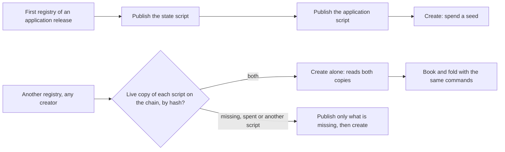

# Create registries on shared application and state script publications

Issue 745, part of epic 731. This page is for a registry creator, for an author of another application, and for the
people who review the pull requests. It records the story, the requirements, the refusals and the checks that prove
them. It follows [the registry creation ticket](../742-create-register-no-pin/spec.md).

## Story

As a registry creator, I create another registry for the same application release, and I see the shared application
and state scripts reused from their live reference outputs: I pay only for what is specific to my registry.

## What is shared and what is not

| Part | Shared by | Why |
| --- | --- | --- |
| State script | every registry of one application | it is the state validator applied to the application's policy, so one hash per application |
| Application script | every registry of one release of the application | it takes no registry parameter; the registry is read from the datum and the state token |
| Configuration record, state token, root | nobody: one per registry | they are outputs and a token, not scripts |

On this line no script is specific to one registry. The issue was written before the request lifecycle moved to the
application (the 23 October 2026 ruling): it speaks of a per-registry request script. That script no longer exists, so
the measured claim of the issue, four transactions for the first registry and two for a later one, is reported as
measured against the baseline that has it, and the candidate's counts are reported as they are.

## Requirements

- creation-cost-measured: matched baseline and candidate runs of a first and a later creation for the same application
  release, on the same frozen protocol parameters; every transaction, reference output, script size in bytes, fee and
  locked ADA is recorded, with locked capital kept apart from fees and the baseline's unused witness-publication
  overhead named. The four-then-two claim is reported as measured, never as an estimate.
- references-verified-before-use: a reference output is reused only when the script it carries has the expected hash,
  computed from the script itself, which covers its bytes, its language and its applied parameters. A different
  application policy or release never reuses a previous state script. A missing, spent or wrong reference has its own
  outcome and its own receipt.
- boot-carrying-measured: the attempt to carry a registry's reference script in the creation transaction is measured
  against the frozen transaction size and execution limits. If it fits and is adopted, the one-transaction later create
  is shown; otherwise the limiting evidence is published and the valid path stays.
- independent-creator-reuse: a creator with a wallet that never published, and no local file from any earlier creator,
  reuses the live copies. The page states whether discovery exists: the provider finds a live copy by script hash; the
  general public-reference discovery program of issues 355 and 473 is not part of this ticket.
- create-recovery-kept: an uncertain submission, a repeated invocation, the saved registry identity and the funding
  accounting behave as before, with shared publications.
- no-witness-publication: no witness-policy publication and no witness-pin configuration is required to create or use a
  registry on this line.
- shared-registry-registers: a registry created on shared publications completes a real registration with the same
  commands as the first registry: book, then fold by a second wallet from chain data alone.
- reuse-documented-and-conformance-computed: the creation and reuse instructions ship with the pull request that
  changes the behaviour; the conformance suite states each reuse claim from the journey receipts and keeps what is not
  covered visible.

## Refusals and outcomes

| Situation | Outcome |
| --- | --- |
| Both live copies found by hash | the create sends one transaction; the receipt names both references and says nothing was published |
| One copy missing | exactly the missing script is published, then the create |
| A reference output that was spent | not live: the script is published again; the receipt says so |
| An output carrying another script, or the same bytes under other parameters | never reused, whatever the provider says; the receipt names the hash found and the hash expected |
| A state script of another application policy | never reused for this application |
| Interrupted before or after a publication | rerunning the command reuses what is live and publishes only what is not |

## Out of scope

Public discovery and publication of references for everyone (issues 355 and 473), batch folding limits (issue 746),
integration into `main` and release (issue 747), any change to an on-chain script or its hash, and a change to a
registry that already exists.
