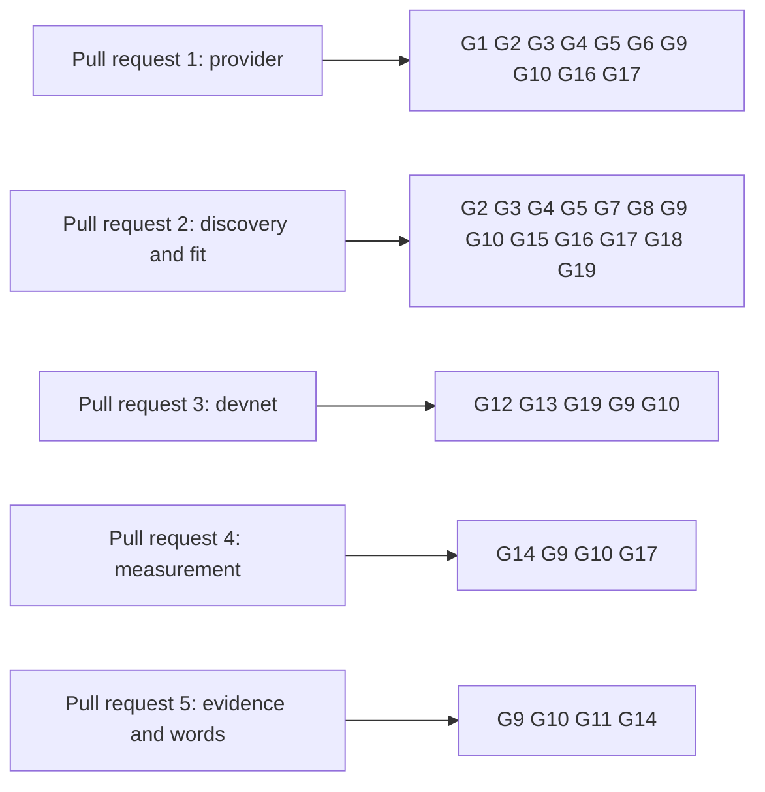

# Gate for folding a batch of registry requests

Issue 746. This page is for the commit owner, the auditor and the reviewers: each acceptance item, the hosted job and the
verbatim command that proves it, and what each pull request must show. The requirements are in
[the specification](spec.md) and the pull requests in [the plan](plan.md#pull-requests-and-slices).

## Rows

The ticket owner's table, written before the auditor's. The auditor writes its own table independently when it is seated;
the ticket owner joins the two once, records both input hashes and freezes the result in the runtime root before the
commit owner starts. Every command is an existing hosted command, or one this ticket adds to a hosted job and marks
"CI change in this ticket". No Lean model is touched: the model rows join the gate only if a statement is added, and then
the mandate is versioned first.

| Row | Acceptance it proves | Hosted job | Verbatim command | Expected exit |
| --- | --- | --- | --- | --- |
| G1 | the policy query keeps the provider contract, rows and bytes per call | registry.yml `contract` | `nix run --quiet .#contract-tests` and `nix run --quiet .#contract-external` in `offchain/`, each with its `CONTRACT_RESULTS` file as the job sets it | 0 |
| G2 | discovery, skipping, ordering, the largest fitting batch, the named-batch refusals, the Koios and facade answers | registry.yml `cage-tests` | `nix run --quiet .#cage-tests` in `offchain/` | 0 |
| G3 | open datum still builds and passes over the changed library and command; its fold command with help and parser rows | ci.yml `open-datum-tests` | `nix run --quiet .#open-datum-tests` in `applications/open-datum/offchain/` | 0 |
| G4 | the packages build | ci.yml `offchain-component-build`, `open-datum-component-build` | `nix build --quiet .#component-build` in `offchain/` and in `applications/open-datum/offchain/` | 0 |
| G5 | the Singular package names no application | ci.yml `offchain-component-build` | `nix run --quiet .#application-separation-check`; `nix run --quiet .#application-separation-controls` | 0 |
| G6 | the provider change stays inside the provider layer and adds no unowned input or output | ci.yml `dev-shell-checks` | `nix develop --quiet -c just node-confinement`; `nix develop --quiet -c just node-confinement-controls`; `nix develop --quiet -c just io-ownership-check`; `nix develop --quiet -c just io-ownership-controls` | 0 |
| G7 | documented flags of the changed command | registry.yml `cli-flags` | `nix run --quiet .#cli-flags-check`; `nix run --quiet .#cli-flags-controls` | 0 |
| G8 | recovery partitions of the changed command | registry.yml `cli-recovery-partitions` | `nix run --quiet .#cli-recovery-partitions`; `nix run --quiet .#cli-recovery-partition-check` | 0 |
| G9 | pages, diagrams and speech | ci.yml `rendered-docs`, `dev-shell-checks` | `nix run --quiet .#docs-check`; `nix develop --quiet -c just check-presentation` | 0 |
| G10 | lint and format of touched paths | ci.yml `dev-shell`, `offchain-lint`; conformance.yml `format-check` | `nix develop --quiet -c just lint`; `(cd offchain && nix run --quiet .#lint)`; `nix run --quiet .#format-check` | 0 |
| G11 | the batch rows and the coverage ratchet | conformance.yml `conformance-checks`, `coverage-gate` | `nix run --quiet .#conformance-appendix-tests`; `nix run --quiet ./conformance#coverage-gate -- --root . ratchet` | 0 |
| G12 | a wallet that booked none of the requests discovers and folds a mixed batch, the skipped holders, the folder's change read from the chain | registry.yml `no-pin-registration-journey`, extended (CI change in this ticket) | `nix run --quiet .#no-pin-registration-journey` | 0 |
| G13 | the three batch refusals, each beside an accepted control | registry.yml `no-pin-registration-refusals`, extended, or a new job of the same shape (CI change in this ticket) | `nix run --quiet .#no-pin-registration-refusals`, or the new job's app | 0 |
| G14 | the measurement receipt, kept on failure; the limit it states re-measured and equal to the committed receipt; the documented numbers equal to the committed receipt, each beside a control with an altered figure that fails | a new registry.yml job, `no-pin-batch-measurement` (CI change in this ticket); the documentation consumer of the receipt joins this job or `rendered-docs` (CI change in this ticket) | `nix run --quiet .#no-pin-batch-measurement` | 0 |
| G15 | the packaged executables carry the changed command | ci.yml `open-datum-singular-smoke` | `nix run --quiet .#singular -- --help` in `applications/open-datum/offchain/` | 0 |
| G16 | no test fixture holds unowned shared state | ci.yml `dev-shell-checks` | `nix develop --quiet -c bash tools/no-global-fixture-state.sh` | 0 |
| G17 | every new source is mapped by the inventory and its controls | ci.yml `inventory` | `nix run --quiet .#inventory-check`; `nix run --quiet .#inventory-controls` | 0 |
| G18 | the recovery partitions the changed command joins run | registry.yml `cli-recovery-partition` | `DEMO1_KEEP_SCRATCH=1 nix run --quiet .#cli-recovery-partition -- '<partition key>'`, each discovered partition | 0 |
| G19 | the existing termination refusals still pass over the changed fold command | registry.yml `no-pin-termination-refusals` | `nix run --quiet .#no-pin-termination-refusals` | 0 |
| G20 | the Lean models, only when a model file changes (then the mandate is versioned first) | ci.yml `dev-shell-checks` | `nix develop --quiet -c just application-held-model`; `nix develop --quiet -c just open-datum-application-held-model` | 0 |

Rows run scoped to what each slice can break. `just ci` runs once on the final candidate of each pull request, then the
push; hosted checks on the pull request head are the net. Every build or test runs in a named, memory-capped scope:
`systemd-run --user --scope --unit=t746-<what>-<n> -p MemoryMax=24G timeout 3600 <command>`.

## Rows per pull request

## Evidence the pull requests will carry

- per requirement and refusal: the test that executes it, the hosted step that runs it, and the RED run that showed it fail;
- each skip reason and its control, the order by the folder's take with a tie, the fit search on a pending set larger than
  what fits and on one that fits entirely;
- the journey job's receipt: the discovered set, the skipped holders, the folded batch by kind, and the folder's change
  read from the transaction's outputs;
- the refusals job's receipt: each refusal and its control;
- the measurement receipt: scripts, protocol parameters, workload and the largest accepted batch per kind, with the first
  refused size and its reason;
- left uncovered, stated in the pull requests: several registries in one transaction, other trie depths and registry
  sizes than the workload names, networks whose parameters differ from the receipt's.

## Synthesis

The ticket owner's table and the auditor's independent table, written without reading this page, were joined once on
29 October 2026. The auditor's table added the fixture and inventory checks (G16, G17), the recovery partitions (G18), the
existing termination refusals job over the changed fold command (G19) and the models as a conditional row (G20). It marked
the measurement job and the check that published limits equal the receipt as missing jobs, carried by G14 as a CI change in
this ticket, and the devnet journey and refusals as extensions of existing jobs (G12, G13). Two cautions are binding: the
largest fitting batch is decided by a search whose cost law is checked at its boundary and not assumed, and only a
refusal that names a capacity limit counts as "does not fit". Both input hashes and the frozen hash are recorded in the
runtime root. A row with no existing hosted command is a missing job and is escalated, never replaced by an invented
local check.

## Gate version 2

Appended on 29 October 2026; every row above is unchanged. A pull request that adds a flake app or check carries this row, because
the census reads every app and check a flake declares and fails on one that no workflow step names.

| Row | Acceptance it proves | Hosted job | Verbatim command | Expected exit |
| --- | --- | --- | --- | --- |
| G21 | every flake app or check the pull request adds is named by a workflow step | ci.yml `declared-checks-hosted` | `nix run --quiet .#declared-checks-classify-controls`; `nix run --quiet .#declared-checks-issue-states <file>` with a read-only `GH_TOKEN`; `nix run --quiet .#declared-checks-hosted <file>` | 0 |

Pull requests 3 and 4 carry G21 whenever they add an app or a check; one execution is added, never a wrapper plus an app.

## Gate version 3

Appended on 29 October 2026; every row above is unchanged. Row G14 keeps its command and is clarified by what the hosted app does: the
committed receipt is bound to the current scripts (their hashes), its kept transactions are re-evaluated under the recorded preprod
parameters and reproduce the committed figures byte for byte, and a fresh capture on a development network finds the same largest
batch per kind and the refusal of the next, with the figure differences reported as observations and not compared. A control with an
altered script hash, an altered figure and an off-by-one largest size each fails.

## Gate version 4

Appended on 29 October 2026; every row above is unchanged. A pull request that changes Haskell under `applications/open-datum/offchain`
carries this row, because its component build runs the application's own lint and the root and off-chain lint rows do not reach it.

| Row | Acceptance it proves | Hosted job | Verbatim command | Expected exit |
| --- | --- | --- | --- | --- |
| G22 | lint of the open-datum application's Haskell | ci.yml `open-datum-component-build` | `nix run --quiet .#lint` in `applications/open-datum/offchain/` | 0 |
