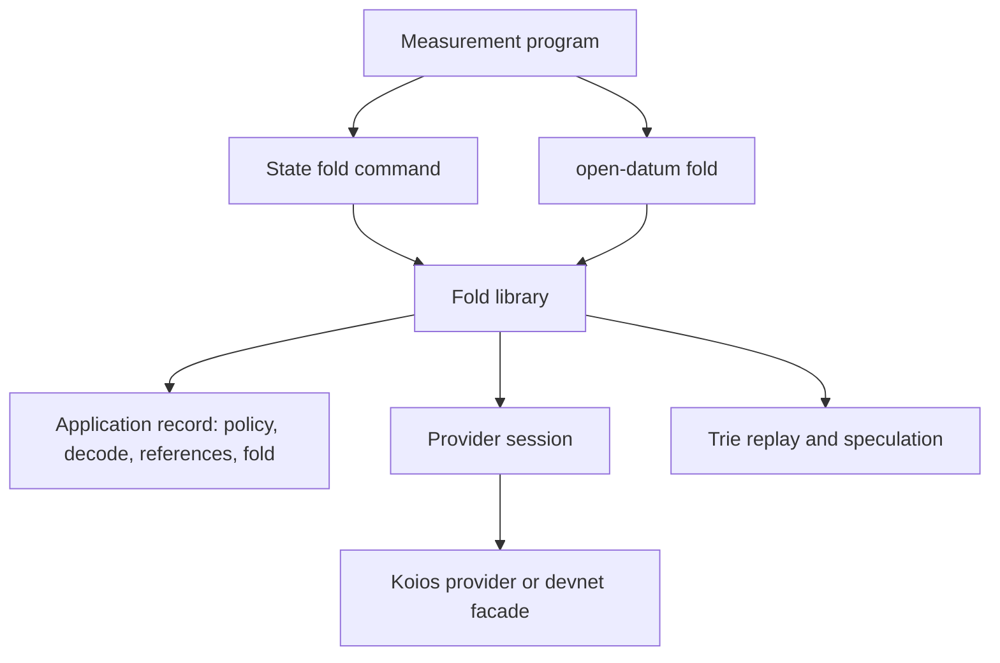

# Modules for folding a batch of registry requests

Issue 746. This page places the new and changed code and fixes its dependency direction. Records are in
[the data model](data-model.md) and signatures in [the functions model](functions-model.md).

## Changed components

| Component | Change | Depends on | Must not depend on |
| --- | --- | --- | --- |
| Provider session, `offchain/local-services/Singular/Registry/LedgerProvider.hs` | one more output query: outputs holding any asset under a policy | — | any application |
| Koios provider and the private devnet facade | answer the policy query and report its rows and bytes to the trace | the session | any application |
| Test providers and the provider contract suites | the same query with the same rows | the session | — |
| Fold library, `offchain/lib/Singular/State/Fold.hs` and a new module beside it | discovery of pending requests, the order by the folder's take, the largest fitting batch | the session, the application record, the trie replay the fold already uses | any application module |
| State fold command in the Singular package and the application's fold command | discover when no request is named; an optional limit; a receipt of folded, skipped and left | the fold library | — |
| Devnet journey and refusals | the batch steps and refusals with controls | the packaged executables, the test-only harness for malformed transactions | test-only controls in ordinary builds |
| Measurement program and job | the largest accepted batch per kind, the receipt | the packaged executables, the development network | — |
| Conformance suite and user documentation | the batch rows and pages, limits generated from the receipt | the journey and measurement receipts | — |

Paths are proposals. When the Lean models name a component differently, the code takes the model's name, and the mandate
is versioned before the slice that creates it starts. The application record gains no field.

## Dependency direction

The Singular package names no application: it finds requests by the policy the application record carries and keeps
those the application's own decode accepts. The application that decodes its own requests hosts the command from its
own package.
