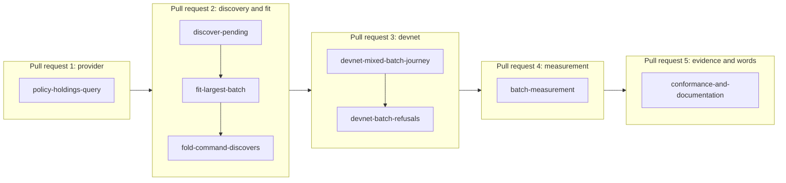

# Plan for folding a batch of registry requests within measured limits

Issue 746. This page is for the people who implement and review the pull requests. It binds the model, the rulings, the
pull requests and their slices, the decisions taken, the consumers and the seats. The story and the requirements are in
[the specification](spec.md); the checks are in [the gate](gate.md).

## Lane

| Field | Value |
| --- | --- |
| Repository | lambdasistemi/singular |
| Branches | feat/746-batch-fold for the first pull request, from `main` after pull request 772; one branch per later pull request, each from `main` once its predecessor merged |
| Pull request target | `main` (the epic branch is retired) |
| Constitution | `.specify/memory/constitution.md` as on the base |
| Change class | changes behaviour (provider layer, fold library, a command, conformance claims): ticket owner, commit owner and a persistent mute auditor |

## Lean binding

Lean is the authority. The code takes the models' vocabulary: `FoldObservation`, `Change`, `PendingRequest`,
`PublicFoldPremises`, `buildFold`, `stateAsset`, `activeAsset`.

| Family | Lake project | Statements this ticket implements and checks |
| --- | --- | --- |
| Batch fold | `models/singular-application-held`, `just application-held-model` | `batch_inversion`, `batch_effects`, `registration_separate_holdings`, `fold_untouched_keys` over batches mixing registrations and terminations |
| Public construction | the same project | `public_fold_constructed`, `public_fold_effects`: anyone builds an accepted, balanced fold from public records alone; the premises name what the folder must have read |
| State policy | the same project | `fold_minted_outputs`, `minted_active_never_state`, and the state-role mint of a fold being zero (`fold_state_mint_zero`): a fold moves nothing else under the state policy |
| Supply and history | the same project, `HistoryClaims` | `supply_in_step`, `one_live_token`, `burn_only_terminating_fold` over mixed batches |

Lean states no rule for finding requests, for ordering them, for the size of a batch or for protocol parameters. They are
operational facts of a folder: selection soundness is checked against the premises of `public_fold_constructed`; the
batch size is a measured fact the receipt states and no theorem claims. If a statement the code needs is missing or
conflicts with a ruling, the ticket owner files a question with a user story; the check is never weakened.

## Rulings in force

- Registry identity (issue 741): a registry is its state policy and its state token name.
- Roles (operator, 2026-10-28, issue 767): the folder is a neutral role; the batch logic lives in the neutral fold
  library and names no application. Whatever open datum must contribute goes through the existing application record
  (policy, decode, references, fold); this ticket adds nothing to that record, so issue 767 has nothing new to absorb.
- Money (2026-10-23): a request's value above what the application requires to stay is the folder's.
- The provider is the chain entry point (2026-10-20): every chain read goes through the session; users have a web page,
  Koios and a wallet.
- Versioning (operator): stay 0.x; script hashes may change before 1.0, cut together with issue 747. This ticket changes
  no script and no hash.
- The trie library's proofs are assumed sound.

## Decisions taken

| Decision | Choice | Rejected alternative and why |
| --- | --- | --- |
| How requests are found | a new provider query for outputs holding any asset under a policy; the application's decode keeps only requests at its script, so a key-address holder is skipped by the same code that skips everything undecodable | scanning the application's whole address: every live holding of every registry is read to find a few requests; the issue names the approvals as the way in |
| Order when more are pending than fit | the folder's take, largest first, ties by output reference | output-reference order: it ignores the market the issue describes |
| Unfoldable requests | automatic selection skips, with a named reason, a request the builder would refuse on its own account; a request unfoldable on its own account never reserves a key, the first foldable request for a key in the order keeps it | handing every discovered request to the builder: one request that cannot be folded would refuse every discovering fold of the registry until it is cleaned up |
| What fits | the largest prefix of that order that builds under the network's limits, found by trying prefixes; only a refusal that names a capacity limit (size, memory, steps) counts as not fitting, any other failure ends the fold; the search shows at its boundary that the greatest fitting prefix builds and the next one is refused for capacity | a fixed constant: it would be assumed, not measured, and wrong on another network; a search that assumes cost never falls, unchecked |
| Named batches | built as named or refused; never trimmed | trimming a batch the caller named would hide which request was left |
| Where the limit is published | generated from the measurement receipt into the documentation | typing the numbers |

## Pull requests and slices

| Pull request | Slice | Delivers | Requirements |
| --- | --- | --- | --- |
| 1 | policy-holdings-query | one provider query for outputs holding any asset under a policy, answered by the Koios provider, the private devnet facade and the test providers, with rows and bytes in the trace and the provider contract rows | pending-found-from-public-data |
| 2 | discover-pending | the neutral library finds the pending requests of one registry from the approvals under the application policy; skipped holders and requests are named; failure is unavailable, never empty | pending-found-from-public-data, foreign-holders-skipped, batch-follows-the-model |
| 2 | fit-largest-batch | the order by the folder's take and the largest prefix that builds; the count left; a named batch refused when it cannot be built | largest-fitting-batch, mixed-batch, batch-refusals, folder-takes-the-surplus |
| 2 | fold-command-discovers | the state fold command discovers when no request is named and takes an optional limit; its receipt lists folded, skipped and left; help snapshots, parser rows, documented flags and recovery partition follow | pending-found-from-public-data, largest-fitting-batch |
| 3 | devnet-mixed-batch-journey | in the journey job, a wallet in fresh directories that booked none of the requests folds a mixed batch of one registry from chain data alone; the change is read from the chain | devnet-batch-journey, folder-takes-the-surplus, foreign-holders-skipped |
| 3 | devnet-batch-refusals | the refusals with controls on a development network, the state-policy movement from a deliberately malformed transaction | batch-refusals |
| 4 | batch-measurement | a measurement program and a hosted job that find the largest accepted batch for registrations, terminations and mixed batches and write the receipt | limits-measured |
| 5 | conformance-and-documentation | the batch rows in the conformance suite and the user page, with the limits generated from the receipt | documentation-and-conformance, limits-stated-as-measured |

Each slice finishes in well under two hours with its own RED evidence and checkpoints; the commit owner may cut a slice
smaller, never merge two. Pull requests merge into `main` in order, each when its required checks are green at the head.

## Consumers to run before the first push

- a provider-layer change reaches the provider contract suites, the Koios provider and facade tests, node confinement,
  the input and output census, open datum and conformance;
- a fold builder, selection or receipt change reaches the conformance unit suite, the journey's late-fold steps and open
  datum's printed refusals; the legacy wording is searched for before the first push;
- a command change reaches help snapshots, parser corpora (`after` rows), the documented flags check, the recovery
  partitions and the command reference;
- a conformance report change reaches every consumer of the rendered row text;
- a new reference to shared mutable state in a test fixture needs its census entry in the same commit.

## Seats

A ticket owner, a commit owner and a commit auditor, mute and persistent, in a read-only audit worktree. No other seats.
The auditor writes its own gate table when it is seated; the ticket owner joins the two once and freezes the result
before the commit owner starts. Every build and test runs in a named, memory-capped scope with a timeout; long gates run
in the background.
