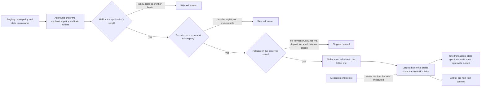

# Fold a batch of registry requests within measured network limits

Issue 746, part of epic 731. This page is for a folder (anyone who wants to fold a registry's pending requests), for the
integrators who run folders, and for the people who review the pull requests. It records the story, the requirements, the
refusals and the checks that prove them. It follows [the reader ticket](../744-registry-reader/spec.md) and
[the update and termination ticket](../743-update-terminate-no-pin/spec.md).

## Story

As a folder, I give a network and a registry's name, and a wallet that booked none of the requests finds the registry's
pending registrations and terminations from public data, folds as many as fit in one transaction, keeps what each request
holds above what the application requires to stay, and knows from published measurement how large a batch the network
accepts.

## What the folder finds and takes

| Step | Rule |
| --- | --- |
| Find | every output that holds an approval of the application's policy is read from the provider; only an output at the application's script that decodes as a request of this registry is a pending request |
| Skip | an approval held at a key address, a request of another registry, an output that does not decode, and a request that cannot be folded in the observed state (its key already registered, a termination of a key that is not live, the later of two requests for one key, a deposit below what its holding must keep, a closed processing window) are skipped and named in the receipt; none of them refuses the fold, and a request that cannot be folded never keeps its key from a foldable one |
| Take | a registration request gives the folder its held ADA above the deposit the holding must keep; a termination request gives the folder its whole ADA; both are the transaction's change |
| Fit | the folder builds the largest prefix of the ordered requests that the network's limits accept; the rest are counted as left |
| Explicit | a folder may name the requests instead; a named batch is refused, never trimmed, when it cannot be built |

## Requirements

- batch-follows-the-model: the batch fold implements the statements of [the plan's Lean binding](plan.md#lean-binding);
  each refusal and each success has an executable check seen to fail.
- pending-found-from-public-data: the pending requests of a registry are found from the provider alone, by the approvals
  under the application policy and their holders; a wallet that booked none of them finds the same set as the booker.
- foreign-holders-skipped: a request held at a key address, a request of another registry and an undecodable output are
  skipped and named, each beside a control that folds the same shape when it is held correctly.
- unfoldable-requests-skipped: in automatic selection a request the builder would refuse on its own account is skipped and
  named, never handed to the builder; the first individually foldable request for a key in the order keeps it; every
  discovered request is folded, skipped with its reason or counted as left, and a skipped one is never counted as left;
  each class has a control that folds the same shape when it is foldable.
- mixed-batch: one transaction folds registrations and terminations of one registry together.
- folder-takes-the-surplus: the transaction's change carries each request's value above what the application requires
  to stay, read from the chain and not from a command's receipt.
- largest-fitting-batch: when more requests are pending than fit, the fold takes the largest ordered prefix the network
  accepts and reports the count left; it never refuses only because more are pending, and a failure that is not a
  capacity limit is never read as "does not fit".
- batch-refusals: a named batch with a request of another registry, a named batch with a duplicate key, and a batch that
  moves anything else under the state policy are each refused, beside an accepted control.
- limits-measured: a measurement receipt binds the exact scripts, the workload and the protocol parameters, and states the
  largest accepted batch for registrations, terminations and mixed batches, with memory, steps, bytes and fee per request.
- limits-stated-as-measured: every published limit names the receipt it comes from and the workload it was measured on;
  none is typed.
- devnet-batch-journey: on a development network, through the packaged commands, a wallet that booked none of the
  requests discovers and folds a mixed batch of one registry.
- documentation-and-conformance: the user documentation describes folding and its limits, and the conformance suite
  carries the batch rows, in the same change.
- hosted-checks-green: hosted checks green on each pull request into `main`.

## Refusals

| Attempt | Answer | Seen on |
| --- | --- | --- |
| A named batch holds a request of another registry | refused, naming the request and its registry | unit test and devnet |
| A named batch holds two requests for one key | refused, naming the key | unit test and devnet |
| A named batch holds one request twice | refused, naming the request | unit test |
| A transaction spends the state and moves anything else under the state policy | rejected by the state script | devnet, from a deliberately malformed transaction |
| A named batch is too large for the network's limits | refused, naming the limit that failed; never trimmed | unit test and devnet |
| Nothing pending | refused: nothing to fold | unit test and devnet |
| Every discovered request is unfoldable or skipped | refused: nothing to fold, with each skipped request and its reason in the receipt | unit test and devnet |
| An automatic selection holds a request that cannot be folded in the observed state | that request is skipped and named; the rest folds | unit test and devnet |
| The provider fails or answers incompletely while finding requests | unavailable, naming the read; never an empty batch | unit test |
| A provider read of the state or of a named request fails | unavailable, naming the read | unit test |

## What the receipt and the documentation claim

The measurement shows what one network accepted for one workload under one set of protocol parameters. It claims nothing
about a larger registry, a different trie depth, other scripts or other parameters; the receipt names each, and the
documentation repeats the numbers from the receipt. The trie library's proofs are assumed sound.

## Out of scope

Folds of several registries in one transaction, the reader (issue 744), integration and release (issue 747), general
capacity work (issue 530). Ordering by anything but the folder's take is not a goal of this ticket.
