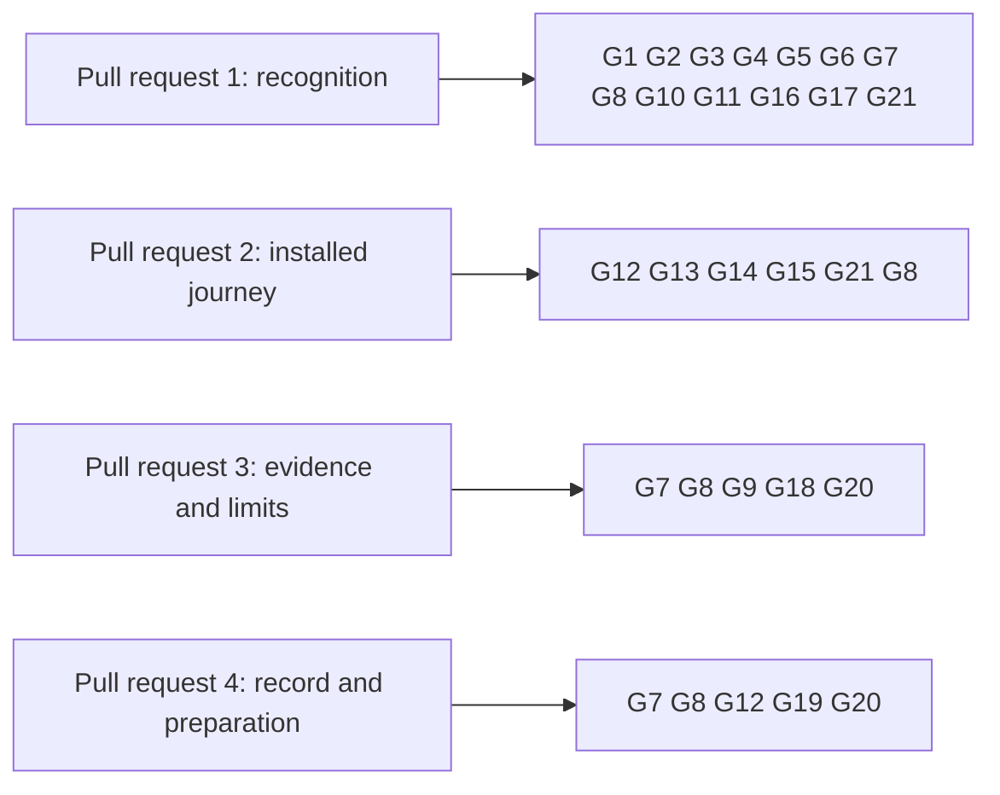

# Gate for the 1.0 release from its installed artifacts

Issue 747. This page is for the commit owner, the auditor and the reviewers: each acceptance item, the hosted job and the
verbatim command that proves it, and what each pull request must show. The requirements are in
[the specification](spec.md) and the pull requests in [the plan](plan.md#pull-requests-and-slices).

## Rows

The ticket owner's table, written before the auditor's. The auditor writes its own table independently when it is seated;
the ticket owner joins the two once, records both input hashes and freezes the result in the runtime root before the
commit owner starts. Every command is an existing hosted command, or one this ticket adds to a hosted job and marks
"CI change in this ticket". No Lean model is touched: the model rows join the gate only if a statement is added, and then
the plan is versioned first.

| Row | Acceptance it proves | Hosted job | Verbatim command | Expected exit |
| --- | --- | --- | --- | --- |
| G1 | the release table rows, the serving answer for each case and the same text from every command | registry.yml `cage-tests` | `nix run --quiet .#cage-tests` in `offchain/` | 0 |
| G2 | open datum's inspect and write commands print the same answer and refuse before building | ci.yml `open-datum-tests` | `nix run --quiet .#open-datum-tests` in `applications/open-datum/offchain/` | 0 |
| G3 | the packages build | ci.yml `offchain-component-build`, `open-datum-component-build` | `nix build --quiet .#component-build` in `offchain/` and in `applications/open-datum/offchain/` | 0 |
| G4 | the neutral library names no application | ci.yml `offchain-component-build` | `nix run --quiet .#application-separation-check`; `nix run --quiet .#application-separation-controls` | 0 |
| G5 | documented flags and help of the changed commands | registry.yml `cli-flags` | `nix run --quiet .#cli-flags-check`; `nix run --quiet .#cli-flags-controls` | 0 |
| G6 | recovery partitions of the changed commands | registry.yml `cli-recovery-partitions`, `cli-recovery-partition` | `nix run --quiet .#cli-recovery-partitions`; `nix run --quiet .#cli-recovery-partition-check`; `DEMO1_KEEP_SCRATCH=1 nix run --quiet .#cli-recovery-partition -- '<partition key>'` for each discovered partition | 0 |
| G7 | pages, diagrams and speech; the documentation check under the runner's bare path | ci.yml `rendered-docs`, `dev-shell-checks` | `env -i HOME="$HOME" PATH="$(dirname "$(readlink -f "$(command -v nix)")"):$(dirname "$(readlink -f "$(command -v git)")")" nix run --quiet .#docs-check`; `nix develop --quiet -c just check-presentation` | 0 |
| G8 | lint and format of touched paths | ci.yml `dev-shell`, `offchain-lint`; conformance.yml `format-check` | `nix develop --quiet -c just lint`; `(cd offchain && nix run --quiet .#lint)`; `nix run --quiet .#format-check` | 0 |
| G9 | the conformance report and the coverage ratchet, rows kept uncovered | conformance.yml `conformance-checks`, `coverage-gate` | `nix run --quiet .#conformance-appendix-tests`; `nix run --quiet ./conformance#coverage-gate -- --root . ratchet` | 0 |
| G10 | every new source is mapped by the inventory and its controls | ci.yml `inventory` | `nix run --quiet .#inventory-check`; `nix run --quiet .#inventory-controls` | 0 |
| G11 | no test fixture holds unowned shared state | ci.yml `dev-shell-checks` | `nix develop --quiet -c bash tools/no-global-fixture-state.sh` | 0 |
| G12 | the release assembly, its checks and the verifier's refusals | ci.yml `release-check`, `release-artifacts` | `nix run --quiet .#release-check`; `nix run --quiet .#release-build-control`; `nix run --quiet .#release-artifacts -- "$RUNNER_TEMP/release"`; `nix run --quiet .#verify-release-controls -- "$RUNNER_TEMP/release"` | 0 |
| G13 | the verifier's journey from the assembled release | ci.yml `release-artifacts` | `nix run --quiet .#verify-release -- --assets "$RUNNER_TEMP/release" --without-bundles "v$(cat version.txt)"` | 0 |
| G14 | the bundles are built and smoke-tested on their platforms, the Linux packages install on machines without Nix, the aggregate decides | release-bundles.yml `changes`, `bundle`, `install`, `bundles` | the workflow's own steps on the pull request head; a pull request that touches the release files sets the scope to build | success |
| G15 | the journey from the unpacked Linux bundle on a path with no Nix: create, register, update, terminate, read, discovered batch fold, each judged from the chain and shown failing on altered input | release-bundles.yml, a new job after `bundle` (CI change in this ticket) | the registration journey script with the bundle's commands, blueprint and node, as the job runs it | 0 |
| G16 | the connected journey and the refusals still pass over the changed commands | registry.yml `no-pin-registration-journey`, `no-pin-registration-refusals`, `no-pin-termination-refusals` | `nix run --quiet .#no-pin-registration-journey`; `nix run --quiet .#no-pin-registration-refusals`; `nix run --quiet .#no-pin-termination-refusals` | 0 |
| G17 | a write given a registry of an earlier or unknown contract sends nothing: the chain before and after, beside a passing control | registry.yml `no-pin-registration-refusals`, extended (CI change in this ticket) | `nix run --quiet .#no-pin-registration-refusals` | 0 |
| G18 | the decision table equals its receipts and fails on an altered figure; the batch receipt equals the page's figures | ci.yml `rendered-docs`; registry.yml `no-pin-batch-measurement` | `nix run --quiet .#creation-cost-check`; `nix run --quiet .#no-pin-batch-measurement`; the decision table's check, added to `docs-check` (CI change in this ticket) | 0 |
| G19 | the compatibility record equals the release table and fails on a disagreement | ci.yml `rendered-docs`, a step of `docs-check` (CI change in this ticket) | `nix run --quiet .#docs-check` | 0 |
| G20 | the four stated limits are present in the release notes and the documentation, and a missing one fails | ci.yml `release-check` (CI change in this ticket) | `nix run --quiet .#release-check` | 0 |
| G21 | every check this ticket relies on is hosted, every workflow command resolves, no job is renamed | ci.yml `declared-checks-hosted`, `workflow-commands-resolve` | `nix run --quiet .#declared-checks-classify-controls`; `nix run --quiet .#declared-checks-hosted`; `nix run --quiet .#workflow-commands-resolve-controls` | 0 |
| G22 | the Lean models, only when a model file changes (then the plan is versioned first) | ci.yml `dev-shell-checks` | `nix develop --quiet -c just application-held-model`; `nix develop --quiet -c just open-datum-application-held-model` | 0 |

Rows run scoped to what each slice can break. `just ci` runs once on the final candidate of each pull request, then the
push; hosted checks on the pull request head are the net. Every build or test runs in a named, memory-capped scope:
`systemd-run --user --scope --unit=t747-<what>-<n> -p MemoryMax=24G timeout 3600 <command>`.

## Rows per pull request

## Evidence the pull requests will carry

- per requirement and refusal: the test that executes it, the hosted step that runs it, and the run that showed it fail;
- pull request 1: the serving answer for a registry of each known earlier contract, of an unknown contract and of an
  application upgrade, from a development network, and the chain read before and after a refused write;
- pull request 2: the journey job's verdict table, with the packages' install result and the proof that the path held no
  Nix; the verifier's route list names the commands of the line;
- pull request 3: the decision table beside its two receipts, the altered-figure failure, and the receipt's recorded date;
- pull request 4: the compatibility record beside the release table, its disagreement failure, and the tag-run checklist;
- the exact head each hosted job ran at, read by exact job name, for the release bundle scope job and the Linux package
  install job.

Left uncovered, stated in the pull requests: the tag run's publication jobs, which run only on a tag, and the conformance
rows the report already lists as uncovered.
