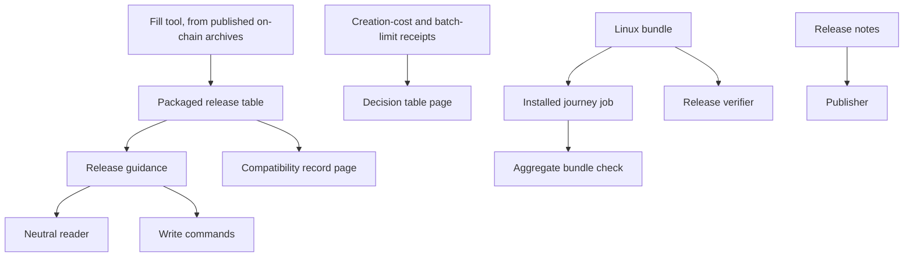

# Modules for the 1.0 release from its installed artifacts

Issue 747. This page lists the components that change, who owns each, and the direction of dependency. It follows
[the specification](spec.md) and [the plan](plan.md).

## Changed components

| Component | Responsibility after this ticket | Dependency direction |
| --- | --- | --- |
| Packaged release table (data file in the registry package) | the rows from a state contract and an applied state policy to the Singular and application releases that carry them, complete up to the release being cut | read by the neutral reader; written only by the fill tool |
| Release guidance (neutral library, next to the reader) | one function from the table and an observed registry to the text that names the serving release, or says none is known; names no application | depends on the table and the reader's observation types; used by every command that reads or writes a registry |
| Neutral and application commands | print the guidance in their refusals and answers; the write commands refuse before building | depend on the guidance; no command carries its own wording |
| Installed journey job (release bundles workflow) | after the Linux bundle is built, unpack it on a machine without Nix and run the registration journey script with the bundle's commands, blueprint and node | depends on the bundle output and the existing journey script; nothing depends on it except the aggregate bundle check |
| Release verifier | on the published release, run the journey from the downloaded bundle of its platform; keep the sums, members and build checks | depends on the journey script and the bundle tools |
| Evidence pages generator | the decision table and the compatibility record, each computed from its receipt or table and checked against an altered input | depends on the two receipts and the table; the documentation check depends on it |
| Release notes | the install paths, the stated limits and the compatibility pointer, with a check that the limits are present | read by the publisher |

## Dependency direction

The guidance sits in the neutral library because a neutral reader must be able to answer for an application it does not
know; it takes the application's identity from the table and never from application code. No new component is promoted:
the journey script, the bundle tools and the fill tool already exist and are used where they are.
