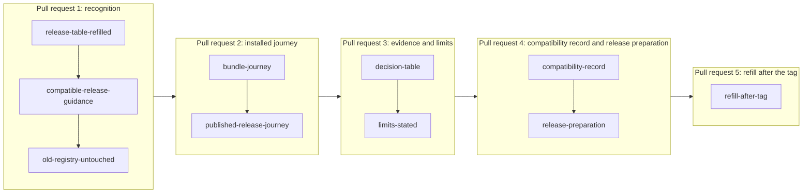

# Plan for the 1.0 release from its installed artifacts

Issue 747, part of epic 731. This plan follows [the specification](spec.md). It orders the pull requests, names the
decisions taken and the consumers to run before the first push.

## Lane

| Item | Value |
| --- | --- |
| Repository | the public repository, pull requests target `main` |
| Worktree and branch | `/code/singular-issue-747`, branch `feat/747-release-1-0`, created at main 7c48fa6e3 |
| Base moves | the update and terminate ticket's last removal cut and the open release pull request landed or land on `main` while this ticket runs; each pull request is rebased once before its push |
| Version line | stays 0.x until the release pull request, opened by the epic owner, cuts 1.0 |
| Release | merging the release pull request publishes nothing; the tag does; both belong to the epic owner and the milestone desk |

## Lean binding

Lean is the behavioural authority. This ticket changes no Lean statement, no on-chain script, no script hash and no wire
format. Its model position is Below: release plumbing, evidence pages and the wording of an answer that already exists.

- Preserved: the reader's classification order of the frozen model (network, release, active token, state) and its
  recognition of a state output, the registration, update, termination and batch fold statements, and the refusal of a
  write that the model refuses.
- The guidance names a release; it adds no new refusal and no new acceptance. If a pull request finds that guidance needs
  a different classification, or that a script, hash or wire format must change, the work stops there and goes to the epic
  owner as a user story with the Lean clauses; nothing is invented.
- Conformance and the model mappings are computed again at the release revision by the existing jobs; no row is added,
  removed or reclassified by this ticket, and uncovered rows stay uncovered.

## Rulings in force

- Roles (2026-10-28, issue 767): folders and readers are application-neutral; the guidance reads the packaged release table
  and names no application in a neutral role.
- The provider is the chain entry point (2026-10-20): every chain read goes through the session; users have a web page,
  Koios and a wallet. A journey that needs a local file from a registry's booker is a failure.
- Release standard (2026-10-20): Linux packages and the Homebrew formula come from the distribution helpers and actions;
  nothing here adds a local packaging script.
- Versioning: stay 0.x until this ticket cuts 1.0. Choosing 1.0.0 is the epic owner's.
- The trie library's proofs are assumed sound.
- Preprod: devnet is the default. A read of the public test network's protocol parameters for the receipt refresh, and any
  measurement on it, wait for the epic owner's go.

## Decisions taken

| Decision | Choice | Rejected alternative and why |
| --- | --- | --- |
| Where the installed journey runs | a new job after the existing Linux bundle build, on a plain Ubuntu machine, unpacking the bundle and running the existing registration journey script with the bundle's commands, blueprint and node | a second journey script: two copies drift; the script already takes its commands, blueprint and node as arguments |
| What the published-release check runs | the existing verifier, with its journey run from the downloaded bundle of its platform instead of binaries built from the archive's flakes, and the build step kept | dropping the archive build: it also proves the archive builds from its own flakes |
| How guidance is worded | one function of the packaged release table returns the answer's release text; every command prints it | per-command wording: five commands would drift |
| Compatibility record | a page generated from the release table, with a check that fails when they disagree | a typed page: it would say what was true when it was typed |
| Decision table | a page generated from the two receipts, with a check against an altered figure | a typed page, for the same reason |
| Release table for the line itself | the rows for releases published since the table was last filled are added from their published on-chain archives with the existing fill tool; the installed release recognises its own contracts by derivation from its packaged blueprints and answers that it serves the registry without a tag lookup; the table may lag the package by the release being cut, every older release must be present, and after each tag a refill pull request adds that release's row from its published archive | a prepared row with a predicted tag, which may never be published; and no version freshness, which lets the table lag for many releases |

## Pull requests and slices

| Pull request | Slice | Delivers | Class | Requirements |
| --- | --- | --- | --- | --- |
| 1 | release-table-refilled | rows for the releases published since the table was filled, from their on-chain archives; the application rows for the pair each carries | behaviour (reader input) | release-pair-recognised |
| 1 | compatible-release-guidance | one answer text from the table, printed by `singular registry inspect`, `open-datum inspect` and every write command, for a known earlier contract, an unknown contract and an application upgrade | behaviour | compatible-release-guidance, release-pair-recognised |
| 1 | old-registry-untouched | a write command given such a registry sends nothing; a development network shows the chain unchanged beside a passing control | behaviour | no-old-registry-mutated |
| 2 | bundle-journey | a hosted job runs the registration journey from the unpacked Linux bundle on a path with no Nix; create, register, update, terminate, read and the discovered batch fold; the Linux package install job still passes | release plumbing, hosted CI is the gate | installed-journey, packages-green-here |
| 2 | published-release-journey | the verifier runs the same journey from the downloaded bundle of its platform and keeps its build, sums and member checks; its route list names the line's commands | release plumbing | published-release-journey |
| 3 | decision-table | a page computed from the creation-cost receipt and the batch-limit receipt, with parameters, gains, regressions and unmeasured limits, and its altered-figure control; the batch receipt refreshed when the epic owner grants the read of the public test network's parameters | documentation, hosted CI is the gate | combined-evidence, batch-receipt-current |
| 3 | limits-stated | the four limits in the release notes and in the documentation, and the check that fails when one is missing | documentation | limits-stated |
| 4 | compatibility-record | the page computed from the release table, with its disagreement control | documentation | compatibility-record |
| 4 | release-preparation | the release notes for 1.0, the tag-run checklist handed to the epic owner; no tag, no merge of the release pull request, no version choice | documentation | version-line-prepared |
| 5 | refill-after-tag | after the tag, the row of the released version from its published on-chain archive through the fill tool, and the compatibility record regenerated from it; the freshness tests make it the gate for the next release pull request | documentation and data, hosted CI is the gate | compatibility-record |

Each slice finishes in well under two hours; the commit owner may cut a slice smaller, never merge two. Pull requests merge
into `main` in order, each when its required checks are green at the head. Pull request 1 takes the audited process;
pull request 2 takes one writer and one review before its push; pull requests 3 and 4 take one writer, with hosted CI as
the gate.

## Consumers to run before the first push

- a reader or command wording change reaches help snapshots, parser corpora (`after` rows), the documented flags check,
  the recovery partitions, the command reference and open datum's printed refusals;
- a release table change reaches the packaged table's freshness test, the neutral and application inspect tests, the
  bundle assembly (the table travels in the bundle) and the verifier's route list;
- a release workflow change reaches the release scope pattern, the declared checks that must be hosted, the workflow
  command resolution check and the job names the ruleset requires; no job is renamed;
- a documentation control reaches the rendered documentation job under the runner's bare path (only Nix and Git on `PATH`),
  and every external command it calls is declared;
- a new reference to shared mutable state in a test fixture needs its entry in the input and output census in the same
  commit.

## Seats

A ticket owner, a commit owner and a commit auditor, mute and persistent, in a read-only audit worktree. No other seats. The
auditor writes its own gate table when it is seated; the ticket owner joins the two once and freezes the result before
the commit owner starts. Every build and test runs in a named, memory-capped scope with a timeout; long gates run in the
background.

## Open items for the epic owner

| Item | Needed when |
| --- | --- |
| a go to read the public test network's current protocol parameters for the receipt refresh, and whether to measure on it | pull request 3 |
| answered: the table may lag the package by the release being cut; the installed release recognises its own contracts by derivation; a refill pull request follows each tag | settled |
| whether a manual run publishing the development channels may exercise the Linux publication action before the tag | before the tag |
| the base moves when a pull request or the release pull request lands | each push |
