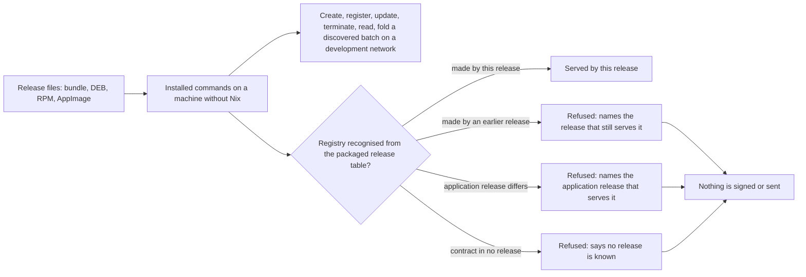

# Release the no-pin registry as 1.0 from its installed artifacts

Issue 747, part of epic 731. This page is for an M1 user (anyone who installs the released commands and runs a
registry), for the integrators who recommend a release, and for the people who review the pull requests. It records the
story, the requirements, the refusals and the checks that prove them. It follows
[the creation ticket](../742-create-register-no-pin/spec.md), [the update and termination ticket](../743-update-terminate-no-pin/spec.md),
[the reader ticket](../744-registry-reader/spec.md), [the shared publications ticket](../745-shared-publications/spec.md) and
[the batch fold ticket](../746-batch-fold/spec.md), all merged.

## Story

As an M1 user, I install the released `singular` and `open-datum` from the release's own files and, with nothing but the
release, a wallet and public chain data, I create a registry, register, update and terminate a key, read it back and fold a
batch of pending requests. A registry made by an earlier release is recognised, and the command tells me which release
still serves it.

## What the release has to show

| Part | What a user can check |
| --- | --- |
| Install | the files the release publishes install and run without Nix and without a checkout |
| Journey | every verb of the line, run from the installed files on a development network, each verb judged from the network's record of the chain |
| Recognition | the release pair of a registry and its state policy derivation are read from the packaged release table by the installed commands |
| Guidance | an earlier release's registry, an unknown contract and an application upgrade each get an answer that names the release that serves it, or says none is known |
| Evidence | the conformance report and the model mappings are computed again at the release revision; one table links the creation costs and the batch limits with their parameters |
| Limits | the release notes and the documentation say in plain words what is assumed and what is not measured |
| Record | the compatibility record names which earlier releases serve which existing registries |

## Requirements

- installed-journey: a journey whose commands, blueprint and development node come only from a release's published files, on
  a path that holds ordinary tools and no Nix, with no checkout of this repository and no credentials, runs create,
  register, update, terminate, read and a discovered batch fold on a development network; each of those six verbs is judged from
  the network's record of the chain and shown failing on altered input, and every other verdict of the journey is computed from the
  chain's record or from files and never typed.
- published-release-journey: the same journey runs against the files of the published release, downloaded without
  credentials, on the tag run.
- packages-green-here: the bundle jobs, the release-bundle scope job and the Linux package install job run green on this
  repository at the candidate, and the tag run's Linux package publication is green on the release.
- release-pair-recognised: the installed `singular registry inspect` and `open-datum inspect` identify a registry's Singular
  release and application release from the packaged release table and the derivation of the state policy from the
  application policy, including a neutral `singular` registry created with a supplied application policy.
- compatible-release-guidance: a registry of a known earlier contract, a registry of a contract no release carries, and a
  registry whose application release is not the installed one each get an answer that names the release that serves it
  or says that no release is known; the answer is the same for every command that reads or writes the registry.
- no-old-registry-mutated: a write command given such a registry builds, signs and sends nothing; the chain is the same
  before and after, shown on a development network beside a passing control.
- combined-evidence: the conformance report and the model mappings are computed again at the release revision with the
  uncovered rows kept; one decision table is computed from the creation-cost receipt and the batch-limit receipt, and
  shows each measurement's parameters, gains, regressions and unmeasured limits.
- batch-receipt-current: the batch-limit receipt is measured again against protocol parameters recorded at release time, or
  the page keeps the date of its recorded parameters and says so.
- limits-stated: the release notes and the documentation state that the trie library's proofs are assumed sound, that the
  history statements assume Cardano's script-execution rule, that the packaged development node cannot run the current
  public test network's protocol version so batch limits are evaluated under recorded parameters, and which conformance
  rows remain uncovered; a check fails when any of the four is missing.
- compatibility-record: a page names, for each earlier release, whether its registries are served by the 1.0 commands, by
  an earlier release, or by none, computed from the release table and failing when the table and the page disagree.
- version-line-prepared: everything the 1.0 release needs is prepared and its evidence kept; the choice of 1.0.0, the merge
  of the release pull request and the tag are not part of this ticket.

## Refusals

| Given | Then |
| --- | --- |
| a registry whose state contract a known earlier release carries | read: the answer names that release as the one that serves it; write: refused before anything is built |
| a registry whose state contract no release carries | read: unknown, no release named; write: refused before anything is built |
| a registry of the installed Singular release whose application release differs | the answer names the application release that serves it; write: refused before anything is built |
| a release file whose checksum differs from the list | the journey does not start |
| a journey step whose chain observation differs from the command's receipt | the journey fails naming the step |

## Out of scope

Automatic migration of old state, holdings or pending requests; protected rejection, pins, tags, tip and treasury;
proving the history statements (issues 676, 679 and 680); retiring the safeguards for old contracts (issues 730 and 738);
claiming KERI integration; choosing 1.0.0, merging the release pull request, pushing the tag and the demo repository's
follow-up, which belong to the epic owner and the milestone desk.

The trie library's proofs are assumed sound.
