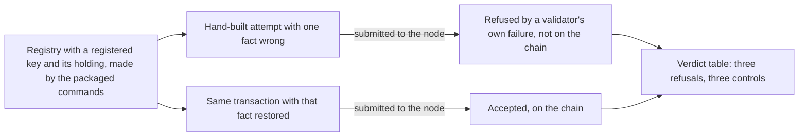

# Hand-built transactions refused by the deployed validators on a development network

Issue 764, first slice, part of milestone 1. This page is for a KERI integrator reading the 1.0 release, for an author of
another application, and for the people who review the pull request. It records the story, the requirements, the three
refusals and what the check does not show.

## Story

As a KERI integrator reading the 1.0 release, I see a hosted job on a development network in which transactions built by
hand, outside the packaged commands, are refused by the deployed validators. The packaged commands decline most wrong
requests before sending anything, so on their own they never show what the chain itself refuses. This job builds each wrong
transaction with the repository's own transaction-building libraries, submits it to the node, and shows the validator's
failure beside the same transaction built correctly and accepted.

## The three cases

| Attempt | Refused by | Control, accepted by the node |
| --- | --- | --- |
| Registering a key that is already registered | the registry's state validator | the same registration for a key that is not registered |
| Updating a key's holding without its controller's signature | the open-datum request validator | the same update signed by the controller |
| Moving a key's token out of its holding | the open-datum request validator | the same update with the token kept in the holding |

## Requirements

- taken-key-registration-refused: the node refuses a registration of a key that is already registered, by the failure of
  the registry's state validator, using only the answer the honest registry tree gives for that key.
- update-without-controller-refused: the node refuses an update of a holding that the key's controller did not sign, by the
  failure of the open-datum request validator.
- token-leaving-holding-refused: the node refuses a transaction that spends a holding and does not return the key's token
  to it, by the failure of the open-datum request validator.
- each-refusal-has-a-control: beside each refusal runs the same transaction with only the one wrong fact restored, and the
  node accepts it and the chain records it.
- refusal-read-from-the-validator: a refusal counts only when the node's answer names a validator of the application as
  failing by its own code (an explicit failure, not an exhausted budget) and the chain's own record does not hold the
  transaction. A control counts only when the chain's own record holds it.
- job-reads-green-on-all-six: the job is green only when all three refusals and all three controls behave as stated, and
  each assertion is shown failing on altered input.
- built-with-repository-libraries: the three attempts and their controls are built with the repository's transaction
  builders and read the chain through the ledger provider session; they use neither `cardano-cli` nor the packaged
  commands. The packaged commands only make the starting registry, key and holding.
- deployed-validators-as-built: the job runs against the validators as built from main. No validator is patched.
- hosted-and-counted: the job is a hosted job in the development-network workflow, with its step, and the check that
  declared checks are hosted accepts it.
- no-change-to-scripts-model-or-wire-format: no on-chain script, script hash, Lean model or wire format changes.

## Assumption

The trie library's proofs are assumed sound.

## Out of scope

This ticket ports the three cases above from the first row of issue 764 only. The rest of that row and every other row stay
open there: the Demo 1 journeys from
the release archive, the independent-actor checks, the public-indexer readback, the one-output creation, the refusals on one
existing registry beyond these three, the command recovery rows, the KERI-shaped consumer, the naming checks, the devnet
parts, the conformance devnet rows and the retired model and simulator checks. The pull request says `Refs #764`.
