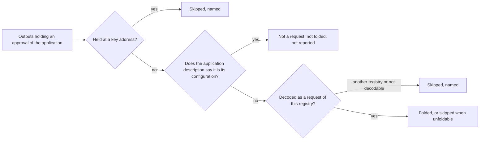

# A fold does not report the registry's configuration output as a skipped request

Issue 799, part of the work before the first stable release. This page is for a folder (anyone who folds a registry's pending
requests), for the integrators who read fold receipts, and for the people who review the pull request. It follows
[the batch fold ticket](../746-batch-fold/spec.md).

## Story

As a folder, I run `open-datum fold` on any open datum registry and the receipt lists under `skipped` only holders that were
requests, or looked like requests, and that the fold did not take. The registry's configuration output is never among
them. When a skip appears, it means something went wrong with a request: it could not be decoded, it belongs to another
registry, it is held at a key address, or it could not be folded in the observed state.

Today every fold of every registry lists the configuration output as skipped, with the reason a malformed request gets. A
reader cannot tell this permanent, expected output from a request that really failed to decode, and the published demo has
to explain the skip in its step text and accept exactly one skip in its receipt check.

## Requirements

| Name | Rule |
| --- | --- |
| configuration-output-not-skipped | Discovery reports no skipped entry for an output the application description names as its configuration, on a successful fold and in the accounting of a refused fold. |
| unrecognised-holder-still-skipped | An output under the approval policy that is neither a request nor named as configuration keeps its skip and its reason, so a real decode failure is never hidden. |
| fold-selection-unchanged | The same requests are folded, in the same order, with the same count left and the same transaction. Only the accounting of holders that are not requests changes. |
| neutral-fold | The fold library holds no notion of any application. What counts as configuration comes only through the application description; no code in the library names open datum. |
| open-datum-recognises-its-configuration | The open datum description names as configuration the output its creation step makes, and no output that decodes as one of its requests, and no output at another script address. |
| receipts-and-pages-follow | The receipt shape is unchanged (the `skipped` list is shorter). Every check and page that expected the configuration skip expects its absence, and the pages say what a skip means. |

## Refusals and limits

- Naming the configuration output with `--pending` is still refused as not a pending registration.
- No new skip reason is added and none is removed.
- The demonstration repository follows after the release and is not touched here.
- Position against the formal model: the fold selects and spends the same outputs, so the change has no consequence the
  model observes. A search of the model finds no declaration that names skipped accounting.
